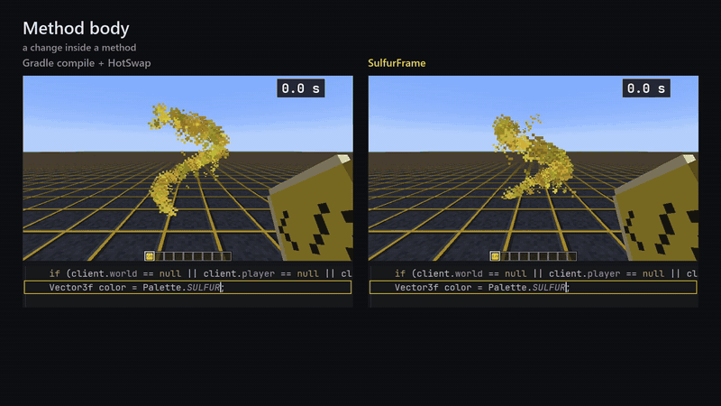

🌐 [English](README.md) · **한국어**

> 영어 원문([README.md](README.md))의 번역입니다. 원문(SSOT)은 영어판이라, 둘이 다르면 영어판이 맞습니다. 마지막 동기화: 2026-11-21.

# SulfurFrame

마인크래프트 모드의 개발 클라이언트를 **IDE 안에서** 실행하는 IntelliJ IDEA 플러그인입니다. 게임 창이 툴윈도우(또는 에디터 탭)에
들어가고, 코드를 치는 동안에는 프레임이 낮아지며, 저장하면 바뀐 코드가 실행 중인 게임에 바로 핫스왑됩니다.



https://github.com/user-attachments/assets/bcd5bcc8-3e16-4c39-ae28-bc25e90f8ea3

1분짜리 비교 영상: 메서드 본문, Mixin, 텍스처, 새 아이템을 같은 PC에서 두 방식으로 하나씩 고쳤습니다
([YouTube](https://youtu.be/G87LOVIu5as)에도 있습니다).

- 게임 창을 IDE에 넣고, 편집하는 동안은 낮은 프레임으로 제한하며, 숨기면 잠시 내려 둡니다
- 백그라운드에서 시작합니다: 쓰던 앱의 포커스나 마우스를 게임이 가져가지 않습니다
- 저장 시 핫스왑(IDE 밖에서 고친 파일도), "같은 월드로 재시작"
- JetBrains Runtime에서는 메서드와 필드의 추가·삭제도 바로 반영되고, 없으면 클릭 한 번으로 내려받습니다
- 빌드가 그대로면 재시작할 때 Gradle을 건너뜁니다: 게임을 마지막 명령줄로 바로 다시 띄웁니다
- 빌드 파일에서 마인크래프트 버전과 로더를 알아냅니다(다중 프로젝트, Stonecutter 방식 구조도)
- 월드 스냅샷, 버려도 되는 테스트 월드, 같은 마인크래프트 버전의 모든 프로젝트가 함께 쓰는 월드
- F11 전체화면이면 IDE 밖으로 나갔다가, 다시 누르면 IDE 안으로 돌아옵니다

**현황:** 0.2.0. Windows와 Linux(X11)의 Fabric 1.21.1 개발 클라이언트, IntelliJ IDEA 2026.3 이상.
모든 로더와 여러 마인크래프트 버전이 필요한 훨씬 큰 모드 옆에서 자랐기 때문에, Forge, NeoForge와 다른 버전도 그쪽이
넓어지는 대로 따라갑니다.

### 지원 버전

| 마인크래프트 | Fabric | Quilt | NeoForge | Forge |
|---|:-:|:-:|:-:|:-:|
| 26.3 | ⏳ | ⏳ | ⏳ | ⏳ |
| 1.21.11 | ⏳ | ⏳ | ⏳ | ⏳ |
| 1.21.1 | ✅ | ⏳ | 🧪 | ⏳ |
| 1.20.4 | ⏳ | ⏳ | ⏳ | ⏳ |
| 1.20.1 | ⏳ | ⏳ | ⏳ | 🧪 |
| 1.19.2 | ⏳ | ⏳ | ❌ | ⏳ |
| 1.18.2 | ⏳ | ⏳ | ❌ | ⏳ |
| 1.16.5 | ⏳ | ⏳ | ❌ | ⏳ |

✅ 지원 · 🧪 개념 검증(`poc/embed`)에서 동작, 플러그인에는 아직 · ⏳ 아직 · ❌ 그 버전용 로더 릴리스가 없음(Fabric, Quilt, NeoForge,
Forge 공식 버전 목록으로 확인)

<details>
<summary>1.16.5 이후 모든 정식 버전(35개)</summary>

| 마인크래프트 | Fabric | Quilt | NeoForge | Forge |
|---|:-:|:-:|:-:|:-:|
| 26.3 | ⏳ | ⏳ | ⏳ | ⏳ |
| 26.2 | ⏳ | ⏳ | ⏳ | ⏳ |
| 26.1.2 | ⏳ | ⏳ | ⏳ | ⏳ |
| 26.1.1 | ⏳ | ⏳ | ⏳ | ⏳ |
| 26.1 | ⏳ | ⏳ | ⏳ | ⏳ |
| 1.21.11 | ⏳ | ⏳ | ⏳ | ⏳ |
| 1.21.10 | ⏳ | ⏳ | ⏳ | ⏳ |
| 1.21.9 | ⏳ | ⏳ | ⏳ | ⏳ |
| 1.21.8 | ⏳ | ⏳ | ⏳ | ⏳ |
| 1.21.7 | ⏳ | ⏳ | ⏳ | ⏳ |
| 1.21.6 | ⏳ | ⏳ | ⏳ | ⏳ |
| 1.21.5 | ⏳ | ⏳ | ⏳ | ⏳ |
| 1.21.4 | ⏳ | ⏳ | ⏳ | ⏳ |
| 1.21.3 | ⏳ | ⏳ | ⏳ | ⏳ |
| 1.21.2 | ⏳ | ⏳ | ⏳ | ❌ |
| 1.21.1 | ✅ | ⏳ | 🧪 | ⏳ |
| 1.21 | ⏳ | ⏳ | ⏳ | ⏳ |
| 1.20.6 | ⏳ | ⏳ | ⏳ | ⏳ |
| 1.20.5 | ⏳ | ⏳ | ⏳ | ❌ |
| 1.20.4 | ⏳ | ⏳ | ⏳ | ⏳ |
| 1.20.3 | ⏳ | ⏳ | ⏳ | ⏳ |
| 1.20.2 | ⏳ | ⏳ | ⏳ | ⏳ |
| 1.20.1 | ⏳ | ⏳ | ⏳ | 🧪 |
| 1.20 | ⏳ | ⏳ | ❌ | ⏳ |
| 1.19.4 | ⏳ | ⏳ | ❌ | ⏳ |
| 1.19.3 | ⏳ | ⏳ | ❌ | ⏳ |
| 1.19.2 | ⏳ | ⏳ | ❌ | ⏳ |
| 1.19.1 | ⏳ | ⏳ | ❌ | ⏳ |
| 1.19 | ⏳ | ⏳ | ❌ | ⏳ |
| 1.18.2 | ⏳ | ⏳ | ❌ | ⏳ |
| 1.18.1 | ⏳ | ⏳ | ❌ | ⏳ |
| 1.18 | ⏳ | ⏳ | ❌ | ⏳ |
| 1.17.1 | ⏳ | ⏳ | ❌ | ⏳ |
| 1.17 | ⏳ | ⏳ | ❌ | ❌ |
| 1.16.5 | ⏳ | ⏳ | ❌ | ⏳ |

</details>

하한은 마지막 Java 8 버전인 **1.16.5**입니다. 그보다 오래된 버전은 대상이 아닙니다. 임베드와 게임 안 에이전트는 개념 검증에서는
그 버전들에서도 동작합니다(바닐라 1.7.10, 1.12.2, 1.13.2와 Forge 1.12.2, 그리고 바닐라 1.16.5, 1.21.1, 26.3).
Windows 10/11과 Linux X11(IntelliJ를 XToolkit으로), IntelliJ IDEA 2026.3 이상. macOS는 아직.

## 얼마나 줄어드나

대부분의 수정은 게임을 재시작할 필요가 없습니다. 얼마나 그런지 보려고 대형 오픈소스 모드 9개(Fabric API, Sodium,
Lithium, Iris, Create, Applied Energistics 2, Botania, Farmer's Delight, Mod Menu)의 최근 커밋 1,080개를, 실행 중인 클라이언트가
각 변경을 반영하려면 무엇이 필요한지로 나눴습니다. 그다음 PC 한 대에서 작은 테스트 모드와 실제 다중 프로젝트 모드(Gradle
프로젝트 9개, 모드 65개)로 경로마다 걸리는 시간을 쟀습니다:

| 수정-실행 1회당 기다리는 시간 | 작은 모드 | 다중 프로젝트 모드 |
|---|---|---|
| 매번 재시작(`runClient`로 바로 월드 진입) | 44초 | 83초 |
| 기본 HotSwap(Gradle 컴파일, 구조 변경은 재시작) | 26~30초 | 50~57초 |
| JetBrains Runtime에서 기본 HotSwap(구조 변경도 반영) | 20~25초 | 39~49초 |
| **SulfurFrame** | **8~17초** | **11~30초** |

재시작보다 63~87%, 기본 HotSwap보다 44~78%, JetBrains Runtime에서의 기본 HotSwap보다 35~72% 덜 기다립니다. JBR 줄은 멤버
추가·삭제가 바로 반영된다는 점만 기본 HotSwap과 다릅니다. 여전히 Gradle로 컴파일하고, 바뀐 Mixin은 Mixin의 hotswap 에이전트
(SulfurFrame이 붙임) 없이는 대상에 다시 적용되지 않아서, 거기서는 Mixin을 재시작으로 셉니다. 범위는 커밋 하나를 한 번으로
치는 경우(가장 느린 변경이 결정)부터 바뀐 파일 하나를 한 번으로 치는 경우까지입니다. 그중 65~85%가 바로 반영됩니다:
메서드 본문과 새 멤버(JetBrains Runtime이 있을 때, 설치 참고), Mixin, assets나 data.

0.3.0부터는 새 블록·아이템 등록과 기존 것의 설정 변경, `onInitialize`, enum 상수, 새 Mixin, 실행 중 더한 액세스 와이드너 항목(다시 빼기 포함), 데이터 리로드 이벤트(명령어, 루트 테이블), 월드 데이터
(월드 재입장), 프로젝트 타입끼리의 상속 변경도 재시작 없이 들어갑니다
(위 숫자는 그 전에 잰 것이라 이 몫이 빠져 있습니다). 나머지는 재시작이 필요합니다(모드 메타데이터, 빌드 파일, 상속에 JDK 타입 넣기
등). 재시작은 그사이 빌드 파일이
바뀌지 않았다면 Gradle을 건너뛰고(모드 메타데이터는 지난 빌드의 값으로 직접 채우고, 액세스 와이드너는 Fabric Loader가 시작할 때 적용) 게임을 마지막에 띄웠던 명령줄로 다시 띄웁니다. 그사이 저장한 코드와 리소스는
먼저 컴파일하고 복사합니다. 다중 프로젝트 모드에서는 재시작이 81초에서 64초로 줄었고, 작은 모드에서는 Gradle이 빨라서 거의
차이가 없었습니다(32초 → 30초). 커밋 표본으로는 어떤 재시작이 Gradle을 건너뛸지 알 수 없어서, 범위의 큰 쪽 끝은 커밋 단위에
모든 재시작을 Gradle 경유로, 작은 쪽 끝은 파일 단위에 모든 재시작을 Gradle 없이로 셉니다. 프로젝트의 Gradle이 느릴수록 효과가
커집니다. 방법, 스크립트, 원자료: [`sf-idea-plugin/docs/effect-study`](sf-idea-plugin/docs/effect-study)와 플러그인 README.

## 설치

- [JetBrains Marketplace](https://plugins.jetbrains.com/plugin/36205-sulfurframe)에서: *Settings → Plugins →
  Marketplace*에서 **SulfurFrame**을 검색합니다.
- 릴리스 zip으로: [Releases](https://github.com/0LUCID0/Sulfur_Frame/releases)에서 `SulfurFrame-<버전>.zip`을 받은 뒤
  *Settings → Plugins → ⚙ → Install Plugin from Disk…*.

Fabric 모드 프로젝트를 열고 **SulfurFrame** 툴윈도우의 *Run client*를 누르면 됩니다.

**구조 변경 핫스왑에는 게임의 Java 버전에 맞는 JetBrains Runtime(JBR)이 필요합니다.** Run client는 게임을 JBR과
`-XX:+AllowEnhancedClassRedefinition`으로 띄워서, 메서드와 필드를 추가하거나 지워도 바로 교체됩니다. 일반 JVM에서는 메서드
본문 변경만 반영되고, 재시작이 필요한 클래스를 SulfurFrame이 알려 줍니다. SulfurFrame은 `~/.jdks`에서 JBR을 찾고(마인크래프트
26.x에는 IDE 자신의 JBR 25를 씁니다), 맞는 것이 없으면 Run client가 원클릭 다운로드를 제안합니다(마인크래프트 1.21.1은 JBR
21). 직접 설치해도 됩니다: *File → Project Structure → SDKs → + → Download JDK…*, 공급자 **JetBrains Runtime**. 빌드 파일은
건드리지 않습니다: 그 실행에서만 Gradle init script가 게임의 실행기를 바꿉니다.

SulfurFrame은 자기가 한 일(교체, 리로드, 재시작)을 `~/.sulfurframe/logs`에 14일 동안 남겨서, 나중에 작업 기록을 돌아볼 수
있습니다. 기록은 내 PC에만 있고 어디로도 보내지 않습니다.

## 빌드

```bash
./gradlew buildPlugin          # → sf-idea-plugin/build/distributions/SulfurFrame-<버전>.zip
./gradlew check verifyPlugin   # fixture 자가 테스트 + JetBrains Plugin Verifier
```

JDK 25가 필요합니다(Gradle이 `~/.jdks`나 표준 설치 위치에서 찾습니다). 빌드는 `gradle.properties`의 `platformVersion`에 맞는
IntelliJ IDEA를 내려받습니다. 설치된 IDE를 쓰려면 `-PideaHome=<설치 폴더>`를 주거나 `IDEA_HOME`을 설정합니다.

릴리스: `PUBLISH_TOKEN`을 설정하고(서명하려면 `CERTIFICATE_CHAIN`, `PRIVATE_KEY`, `PRIVATE_KEY_PASSWORD`도)
`./gradlew publishPlugin`.

## 구성

- `sf-idea-plugin/` – 플러그인(설계 메모와 테스트 기록은 [README](sf-idea-plugin/README.ko.md))
- `poc/agent/` – 게임에 붙는 Java 에이전트(프레임 제한, 포커스 보정, 통계). 플러그인에 함께 들어갑니다
- `poc/embed/`, `poc/profile/` – 개념 검증(PoC)과 옵션 동기화 핵심

## 문서

모든 문서는 영어와 한국어로 있습니다. 각 페이지 맨 위의 전환 링크로 다른 언어로 갈 수 있습니다. "원문"은 먼저 쓰는 쪽이고,
둘이 다르면 원문이 맞습니다.

| 문서 | English | 한국어 | 원문 |
|---|---|---|---|
| 개요(이 페이지) | [README.md](README.md) | [README.ko.md](README.ko.md) | English |
| 플러그인: 설계 메모, 측정, 테스트 기록 | [sf-idea-plugin/README.md](sf-idea-plugin/README.md) | [README.ko.md](sf-idea-plugin/README.ko.md) | 한국어 |
| 목표(약속 아님) | [sf-idea-plugin/docs/roadmap.md](sf-idea-plugin/docs/roadmap.md) | [roadmap.ko.md](sf-idea-plugin/docs/roadmap.ko.md) | 한국어 |
| 임베딩 PoC와 javaagent | [poc/embed/README.md](poc/embed/README.md) | [README.ko.md](poc/embed/README.ko.md) | 한국어 |
| 프로필·월드·옵션 동기화 PoC | [poc/profile/README.md](poc/profile/README.md) | [README.ko.md](poc/profile/README.ko.md) | 한국어 |

## 라이선스

[MIT](LICENSE). Not an official Minecraft product. Not approved by or associated with Mojang or Microsoft.
Minecraft is a trademark of Mojang Synergies AB.
