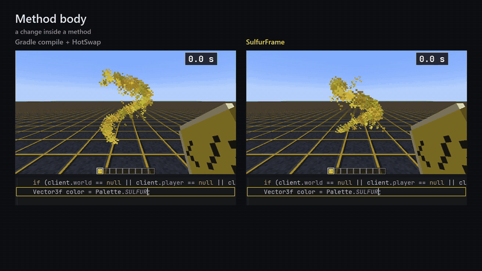

🌐 **English** · [한국어](README.ko.md)

# SulfurFrame

An IntelliJ IDEA plugin that runs your Minecraft mod's dev client **inside the IDE**: the game window is embedded in a
tool window (or an editor tab), throttled while you type, and changed code is hotswapped into it on save.



https://github.com/user-attachments/assets/bcd5bcc8-3e16-4c39-ae28-bc25e90f8ea3

The one-minute comparison: a method body, a Mixin, a texture and a new item, each edited both ways on the same PC
(also [on YouTube](https://youtu.be/G87LOVIu5as)).

- Embedded game window, throttled to a low frame rate while you edit and parked while hidden
- Starts in the background: the game does not take the focus or the mouse from the app you are in
- Hotswap on save (also for files changed outside the IDE), "Restart into the Same World"
- Added or removed methods and fields swap live on a JetBrains Runtime, downloaded in one click if you have none
- Restarts skip Gradle while the build is unchanged: the game starts again from its last command line
- Minecraft version and loader detected from the build files (multi-project and Stonecutter-style layouts too)
- World snapshots, throwaway test worlds, worlds shared by every project of a Minecraft version
- F11 fullscreen leaves the IDE and comes back embedded

**Status:** 0.2.0. Fabric 1.21.1 dev clients on Windows and Linux (X11), IntelliJ IDEA 2026.3 or newer.
It grew up next to a much bigger mod that needs every loader and many Minecraft versions, so Forge, NeoForge and the
other versions will follow as that one gets there.

### Supported versions

| Minecraft | Fabric | Quilt | NeoForge | Forge |
|---|:-:|:-:|:-:|:-:|
| 26.3 | ⏳ | ⏳ | ⏳ | ⏳ |
| 1.21.11 | ⏳ | ⏳ | ⏳ | ⏳ |
| 1.21.1 | ✅ | ⏳ | 🧪 | ⏳ |
| 1.20.4 | ⏳ | ⏳ | ⏳ | ⏳ |
| 1.20.1 | ⏳ | ⏳ | ⏳ | 🧪 |
| 1.19.2 | ⏳ | ⏳ | ❌ | ⏳ |
| 1.18.2 | ⏳ | ⏳ | ❌ | ⏳ |
| 1.16.5 | ⏳ | ⏳ | ❌ | ⏳ |

✅ supported · 🧪 works in the proof of concept (`poc/embed`), not in the plugin yet · ⏳ not yet · ❌ the loader has no
release for that version (checked against the official Fabric, Quilt, NeoForge and Forge version lists)

<details>
<summary>Every release from 1.16.5 on (35)</summary>

| Minecraft | Fabric | Quilt | NeoForge | Forge |
|---|:-:|:-:|:-:|:-:|
| 26.3 | ⏳ | ⏳ | ⏳ | ⏳ |
| 26.2 | ⏳ | ⏳ | ⏳ | ⏳ |
| 26.1.2 | ⏳ | ⏳ | ⏳ | ⏳ |
| 26.1.1 | ⏳ | ⏳ | ⏳ | ⏳ |
| 26.1 | ⏳ | ⏳ | ⏳ | ⏳ |
| 1.21.11 | ⏳ | ⏳ | ⏳ | ⏳ |
| 1.21.10 | ⏳ | ⏳ | ⏳ | ⏳ |
| 1.21.9 | ⏳ | ⏳ | ⏳ | ⏳ |
| 1.21.8 | ⏳ | ⏳ | ⏳ | ⏳ |
| 1.21.7 | ⏳ | ⏳ | ⏳ | ⏳ |
| 1.21.6 | ⏳ | ⏳ | ⏳ | ⏳ |
| 1.21.5 | ⏳ | ⏳ | ⏳ | ⏳ |
| 1.21.4 | ⏳ | ⏳ | ⏳ | ⏳ |
| 1.21.3 | ⏳ | ⏳ | ⏳ | ⏳ |
| 1.21.2 | ⏳ | ⏳ | ⏳ | ❌ |
| 1.21.1 | ✅ | ⏳ | 🧪 | ⏳ |
| 1.21 | ⏳ | ⏳ | ⏳ | ⏳ |
| 1.20.6 | ⏳ | ⏳ | ⏳ | ⏳ |
| 1.20.5 | ⏳ | ⏳ | ⏳ | ❌ |
| 1.20.4 | ⏳ | ⏳ | ⏳ | ⏳ |
| 1.20.3 | ⏳ | ⏳ | ⏳ | ⏳ |
| 1.20.2 | ⏳ | ⏳ | ⏳ | ⏳ |
| 1.20.1 | ⏳ | ⏳ | ⏳ | 🧪 |
| 1.20 | ⏳ | ⏳ | ❌ | ⏳ |
| 1.19.4 | ⏳ | ⏳ | ❌ | ⏳ |
| 1.19.3 | ⏳ | ⏳ | ❌ | ⏳ |
| 1.19.2 | ⏳ | ⏳ | ❌ | ⏳ |
| 1.19.1 | ⏳ | ⏳ | ❌ | ⏳ |
| 1.19 | ⏳ | ⏳ | ❌ | ⏳ |
| 1.18.2 | ⏳ | ⏳ | ❌ | ⏳ |
| 1.18.1 | ⏳ | ⏳ | ❌ | ⏳ |
| 1.18 | ⏳ | ⏳ | ❌ | ⏳ |
| 1.17.1 | ⏳ | ⏳ | ❌ | ⏳ |
| 1.17 | ⏳ | ⏳ | ❌ | ❌ |
| 1.16.5 | ⏳ | ⏳ | ❌ | ⏳ |

</details>

The lower bound is **1.16.5**, the last Java 8 version: older versions are not a target. The embedding and the in-game
agent still work on them in the proof of concept (vanilla 1.7.10, 1.12.2, 1.13.2 and Forge 1.12.2; also vanilla 1.16.5,
1.21.1 and 26.3).
Windows 10/11 and Linux X11 (IntelliJ on XToolkit), IntelliJ IDEA 2026.3 or newer. macOS: not yet.

## What it saves

Most edits never need the game to restart. To see how many, 1,080 recent commits of nine large open-source mods
(Fabric API, Sodium, Lithium, Iris, Create, Applied Energistics 2, Botania, Farmer's Delight, Mod Menu) were sorted by
what a running client needs to pick each change up. Then the time each path takes was measured on one machine, on a
small test mod and on a real multi-project mod (9 Gradle projects, 65 mods):

| Waiting per edit-run step | Small mod | Multi-project mod |
|---|---|---|
| Restart every time (`runClient` straight into the world) | 44 s | 83 s |
| Stock HotSwap (Gradle compile, restart for anything structural) | 26–30 s | 50–57 s |
| Stock HotSwap on a JetBrains Runtime (structural changes apply too) | 20–25 s | 39–49 s |
| **SulfurFrame** | **8–17 s** | **11–30 s** |

That is 63–87% less waiting than restarting, 44–78% less than stock HotSwap and 35–72% less than stock HotSwap on a
JetBrains Runtime. The JBR row differs from stock HotSwap only in that added or removed members swap live; it still
compiles through Gradle, and a changed mixin is not re-applied to its targets without Mixin's hotswap agent (which
SulfurFrame adds), so mixins count as restarts there. The range runs from counting a commit
as one step (its slowest change decides) to counting each changed file as one step. 65–85% of the steps apply live:
method bodies and new members (with a JetBrains Runtime, see Install), mixins, and assets or data.

The rest needs a restart (registrations, static initializers, mod metadata). A restart skips Gradle and starts the game
from the command line it was last started with, unless build files changed since (mod metadata is filled in with the last build's values; Fabric Loader applies access wideners as the game starts).
Code and resources saved in the meantime are compiled and copied first. On the multi-project mod that brought a restart
from 81 s to 64 s; on the small mod it made almost no difference (32 s to 30 s), because its Gradle is quick. The commit
sample cannot tell which restarts would skip Gradle, so each range's high end counts commits with every restart
through Gradle, and its low end counts files with every restart skipping it. The gain grows with how slow your project's Gradle is. Method, scripts and raw numbers:
[`sf-idea-plugin/docs/effect-study`](sf-idea-plugin/docs/effect-study) and the plugin README.

## Install

- From [JetBrains Marketplace](https://plugins.jetbrains.com/plugin/36205-sulfurframe): *Settings → Plugins →
  Marketplace*, search for **SulfurFrame**.
- From a release zip: download `SulfurFrame-<version>.zip` from
  [Releases](https://github.com/0LUCID0/Sulfur_Frame/releases), then *Settings → Plugins → ⚙ → Install Plugin from Disk…*.

Open a Fabric mod project, then use the **SulfurFrame** tool window's *Run client*.

**Structural hotswap needs a JetBrains Runtime (JBR) of the game's Java version.** Run client starts the game on JBR
with `-XX:+AllowEnhancedClassRedefinition`, so adding or removing methods and fields swaps in live too. On a regular
JVM only method body changes apply, and SulfurFrame names the classes that need a restart. SulfurFrame looks for a
JBR in `~/.jdks` (and uses the IDE's own JBR 25 for Minecraft 26.x); when none matches, Run client offers a one-click
download (JBR 21 for Minecraft 1.21.1). You can also install one yourself: *File → Project Structure → SDKs → + →
Download JDK…*, vendor **JetBrains Runtime**. Your build files stay untouched: a Gradle init script swaps the game's
launcher for that run only.

SulfurFrame keeps its own log of what it did (swaps, reloads, restarts) in `~/.sulfurframe/logs` for 14 days, so you
can look back at your sessions. It stays on your machine; nothing is sent anywhere.

## Build

```bash
./gradlew buildPlugin          # → sf-idea-plugin/build/distributions/SulfurFrame-<version>.zip
./gradlew check verifyPlugin   # fixture self-tests + JetBrains Plugin Verifier
```

JDK 25 is needed (Gradle finds it in `~/.jdks` or a standard install). The build downloads IntelliJ IDEA
`platformVersion` from `gradle.properties`; to use an installed IDE instead, pass `-PideaHome=<install dir>` or set
`IDEA_HOME`.

Release: set `PUBLISH_TOKEN` (and optionally `CERTIFICATE_CHAIN`, `PRIVATE_KEY`, `PRIVATE_KEY_PASSWORD` for signing),
then `./gradlew publishPlugin`.

## Layout

- `sf-idea-plugin/` – the plugin (design notes and test results in its [README](sf-idea-plugin/README.md))
- `poc/agent/` – the Java agent loaded into the game (frame cap, focus fixes, stats), bundled into the plugin
- `poc/embed/`, `poc/profile/` – proofs of concept and the options sync core

## Documentation

Every document comes in English and Korean; the switch at the top of each page goes to the other one. "Source" is the
version that is written first and wins if the two ever differ.

| Document | English | 한국어 | Source |
|---|---|---|---|
| Overview (this page) | [README.md](README.md) | [README.ko.md](README.ko.md) | English |
| Plugin: design notes, measurements, test records | [sf-idea-plugin/README.md](sf-idea-plugin/README.md) | [README.ko.md](sf-idea-plugin/README.ko.md) | 한국어 |
| Goals (not promises) | [sf-idea-plugin/docs/roadmap.md](sf-idea-plugin/docs/roadmap.md) | [roadmap.ko.md](sf-idea-plugin/docs/roadmap.ko.md) | 한국어 |
| Embedding PoC and the javaagent | [poc/embed/README.md](poc/embed/README.md) | [README.ko.md](poc/embed/README.ko.md) | 한국어 |
| Profiles, worlds and options sync PoC | [poc/profile/README.md](poc/profile/README.md) | [README.ko.md](poc/profile/README.ko.md) | 한국어 |

## License

[MIT](LICENSE). Not an official Minecraft product. Not approved by or associated with Mojang or Microsoft.
Minecraft is a trademark of Mojang Synergies AB.
