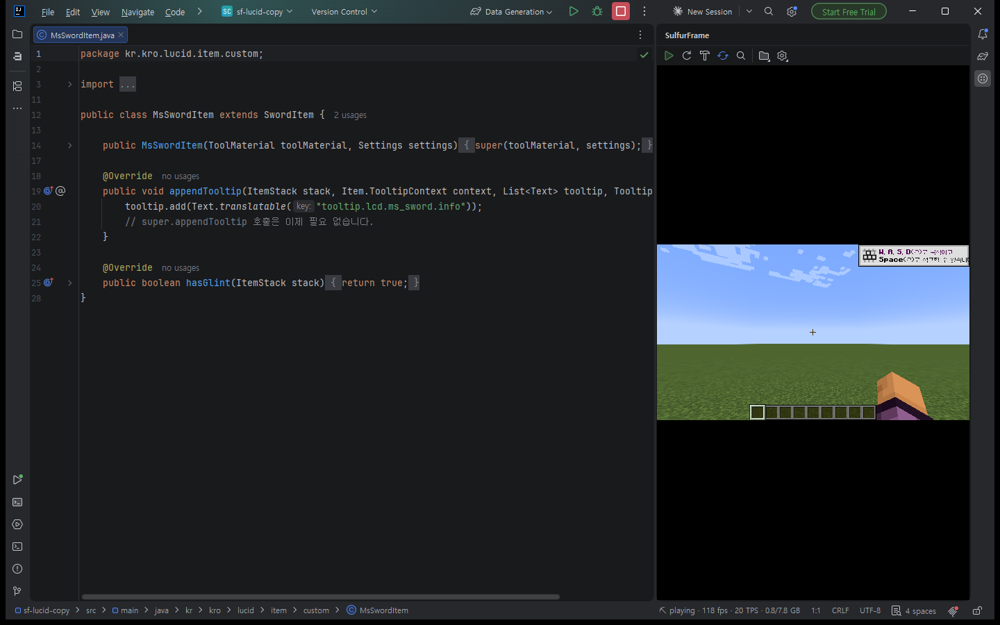
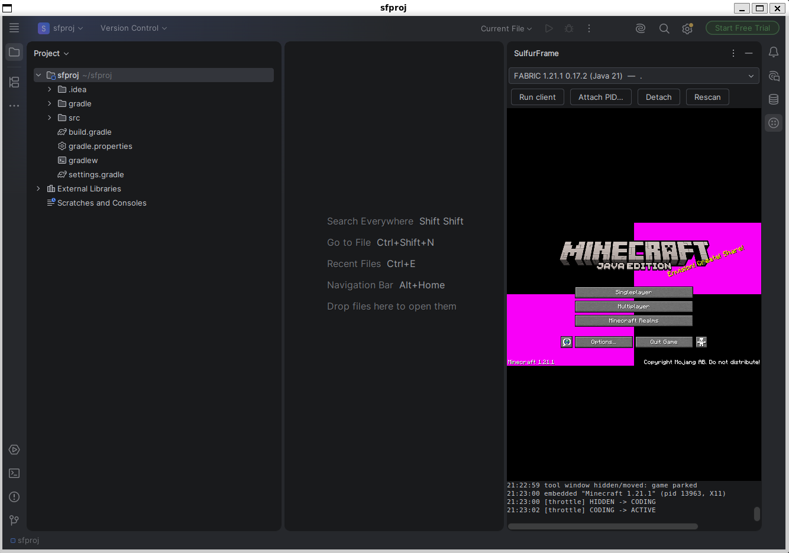

# SulfurFrame IntelliJ 플러그인 (PoC)

마인크래프트 모드 프로젝트를 열면, 빌드 파일에서 **마인크래프트 버전, 모드 로더, 로더 버전, 필요한 Java**를 읽어 툴윈도우에 보여 줍니다.
그리고 게임 창을 툴윈도우 안에 넣습니다.



## 기능
- **버전 자동 결정** (`profile/ProjectProfile.java`): 아무것도 실행하지 않고(Gradle 동기화 없이) 파일만 읽습니다.
  - 빌드 스크립트의 플러그인 id로 로더를 판별: `fabric-loom` / `net.fabricmc.fabric-loom` / `dev.architectury.loom`,
    `net.neoforged.moddev` / `net.neoforged.gradle`, `net.minecraftforge.gradle`, ForgeGradle 2의 `net.minecraftforge.gradle.forge`, `org.quiltmc.loom`
  - 버전을 읽는 곳(우선순위 순):
    1. `gradle.properties` (프로젝트에서 settings 루트까지)
    2. 빌드 스크립트의 좌표: `com.mojang:minecraft:X`, `fabric-loader`, `net.minecraftforge:forge:MC-FORGE`, `neoForge { version }`, FG2의 `minecraft { version = "1.12.2-..." }`
    3. `gradle/libs.versions.toml`
  - 주석과 `${...}` 참조를 처리합니다. NeoForge 버전만 있으면 MC 버전을 거꾸로 계산합니다(21.1.x → 1.21.1).
    필요한 Java는 Mojang `javaVersion` 기준입니다(≤1.16: 8, 1.17: 16, ~1.20.4: 17, ~1.21.x: 21, 26.x: 25).
  - 근거(evidence)를 로그로 보여 줍니다.
- **Run client**: 프로젝트의 `gradlew runClient`를 실행하고(Loom, ModDevGradle, ForgeGradle 모두 같은 이름) 새로 뜬 마인크래프트 창을 찾아 자동으로 임베드합니다.
- **임베딩** (`embed/GameEmbedder.java`): `poc/embed`에서 검증한 규칙을 모두 옮겼습니다.
  - 비동기 창 조작
  - 모드 없는 click-to-focus, `WM_MOUSEACTIVATE` 차단, 에디터 클릭 시 포커스 회수
  - 멈춤 와치독, 임베드 직후 크기 nudge
- **javaagent 내장**: 플러그인 안의 `sf-agent.jar`를 ASCII 경로에 풀어서 Attach API로 붙입니다. 코딩 중 FPS 제한과 SDL3 포커스 보정을 맡습니다.
- **스로틀러**: 툴윈도우가 숨겨지면 게임을 최소화하고, 5초 뒤 힙을 줄이고 워킹셋을 트림합니다. 다시 보이면 원래대로 돌립니다.

## 실제 IDE에서만 생기는 문제와 해결
- **캔버스 HWND 찾기**: 화면 좌표로 창을 찾는 방식(WindowFromPoint)은 IntelliJ에서 실패했습니다.
  IntelliJ는 `--add-opens java.desktop/sun.awt.windows=ALL-UNNAMED`로 실행되므로 `AWTAccessor`로 peer를 꺼내 `WComponentPeer.getHWnd()`로 읽습니다.
- **툴윈도우를 숨기거나 옮기거나 플로팅하면 IntelliJ가 컴포넌트를 떼어 내고**, 캔버스의 네이티브 창이 파괴됩니다. 자식인 게임 창도 함께 파괴됩니다.
  → `removeNotify` 직전에 게임을 **데스크톱 기준 최상위 창으로 되돌리고 최소화한 뒤 감추고**(park), `addNotify` 뒤 새 캔버스에 다시 붙입니다.
  - park 위치를 IDE 프레임으로 했을 때, 플로팅 창을 다시 도킹하면 그 프레임이 사라지면서 게임 창이 함께 없어졌습니다.
  - 그냥 감추기만(`SW_HIDE`) 하면 마인크래프트가 최소화로 보지 않아서 FPS가 그대로였습니다. 그래서 최소화한 뒤 감추고, 이 상태를 숨김으로 처리합니다.

## 릴리스 빌드와 배포 (Gradle)
저장소 루트의 Gradle 빌드(IntelliJ Platform Gradle Plugin 2.20.1, Gradle 9.9.1)가 배포용입니다.
```bash
./gradlew buildPlugin                # → sf-idea-plugin/build/distributions/SulfurFrame-<버전>.zip
./gradlew check verifyPlugin         # fixture self-test + JetBrains Plugin Verifier
./gradlew publishPlugin              # PUBLISH_TOKEN(서명은 CERTIFICATE_CHAIN, PRIVATE_KEY, PRIVATE_KEY_PASSWORD)
```
- 버전과 대상 IDE는 `gradle.properties`(`pluginVersion`, `platformVersion`, `sinceBuild`)에 있습니다. `-PideaHome=<설치 폴더>`나
  `IDEA_HOME`을 주면 설치된 IDE에 대고 빌드해서 IDE를 내려받지 않습니다.
- `:agent`(`poc/agent`)가 `sf-agent.jar`(안에 `sf-impl.jar` + ASM)를 만들고, 플러그인 jar에 `/sf-agent.jar`로 들어갑니다.
- 0.1.0 확인(2026-11-17, IntelliJ 2026.3): Plugin Verifier "Compatible"(폐기 예정 API 2곳), self-test 6/6 + 5/5.
- 아이콘은 `docs/logo/gen-icon.py`로 만듭니다(라이트/다크 테마 모두 WCAG 1.4.11 3:1 이상).

## 기대 효과 (측정, 2026-11-17)
스크립트와 원자료는 `docs/effect-study/`에 있습니다(`fetch.py` → `classify.py` → `model.py`, `sensitivity.py`, 측정 스크립트 3개, `measured-2026-11-17.txt`).

**1. 변경이 실행 중인 게임에 어떻게 반영되는지 (대형 모드 9개, 커밋 1,080개)**
Fabric API, Sodium, Lithium, Iris, Create, Applied Energistics 2, Botania, Farmer's Delight, Mod Menu의 최근 커밋 120개씩(머지 제외)을 GitHub API로 받아
변경을 나눴습니다. Mojang 공식 GitHub에는 게임 코드가 없어서 라이브러리 brigadier는 참고로만 돌리고 합계에서 뺐습니다. 다른 저장소의 diff 원문은 저장소에 두지 않고 집계(`mix.json`)만 둡니다.
- 바로 반영: 메서드 본문, 멤버 추가·삭제(JBR), Mixin, `assets/`(리소스 리로드), `data/`(`/reload`)
- 재시작: 등록 코드, static 초기화, `fabric.mod.json`/`mods.toml`, 액세스 와이드너, `*mixins.json`, 상속 구조 변경
- 빌드 파일만 바뀐 커밋(버전 올림 등)은 개발 루프가 아니라서 뺐고, 코드와 함께 바뀐 빌드 파일은 재시작으로 치지 않았습니다.
- 분류는 정규식입니다. 표본 12건을 직접 보고, 메서드 안 지역 변수 선언까지 "구조 변경"으로 잡던 것을 고쳤습니다.

| 집계 | 본문 | 구조 | Mixin | assets | data | 재시작 |
|---|---|---|---|---|---|---|
| 커밋 단위 (가장 느린 변경이 커밋 전체를 결정) | 24% | 12% | 12% | 15% | 3% | 35% |
| 파일 단위 (파일 하나 = 한 번의 수정) | 22% | 17% | 16% | 18% | 13% | 15% |

커밋 사이의 기록되지 않은 수정은 알 수 없습니다. 그래서 이 두 집계를 범위의 양 끝으로 둡니다. 값 조정이나 로그 추가 같은 중간 수정은 대부분 본문 변경이라 실제는 파일 단위 쪽에 가까울 것으로 보지만, 검증할 수는 없습니다.
그 빈칸은 실사용 기록(아래 4)으로 채웁니다.

**2. 각 경로에 걸리는 시간 (같은 PC, 같은 날)**

| 경로 | 테스트 사본 (Gradle 프로젝트 1개, 모드 56) | 다중 프로젝트 모드 (Gradle 프로젝트 9개, 모드 65) |
|---|---|---|
| Gradle 구성만 (`help`) | — | 30.7초 |
| 재시작: `runClient --quickPlaySingleplayer` → 월드 진입 | 49.4 / 41.9 / 41.8초 | 85.1 / 82.1 / 80.2초 |
| 기본 HotSwap: 본문 수정 후 `gradlew classes` | 10.9 / 7.0 / 7.5초 | 19.7 / 19.8 / 19.8초 |
| 리소스: `gradlew processResources` | 7.1 / 6.5 / 6.9초 | 18.8 / 18.5 / 18.5초 |
| SulfurFrame 교체 (컴파일 포함, Gradle 안 부름) | 0.5~1.3초 | (실사용 기록으로 확인 예정) |
| SulfurFrame "같은 월드로 재시작" (Gradle 경유) | 38~52초 (일반 재시작과 같은 수준) | 일반 재시작과 같게 계산 |
| 재시작, Gradle 경유 → Gradle 없이 (같은 명령줄, `measure-relaunch.sh`, 데운 뒤) | 31.8 → 29.9초 | 81.2 → 64.0초 |

마지막 줄은 다른 줄과 측정한 시각이 달라서(테스트 사본의 재시작이 이날 더 빨랐음) 절대값이 아니라 차이(1.9초, 17.2초)만 모델에 씁니다.
다중 프로젝트 모드의 기존 파일은 건드리지 않았습니다. 임시 클래스와 임시 리소스를 하나씩 추가해 고친 뒤 지우고 다시 빌드했습니다.
임시 클래스는 아무도 의존하지 않는 클래스라 Gradle 쪽에 가장 유리한 경우입니다. 측정 중 게임은 무음으로 돌렸습니다.

**3. 결과: 수정-실행 1회당 기다리는 시간**

| | 테스트 사본 | 다중 프로젝트 모드 |
|---|---|---|
| 매번 재시작 | 44.4초 | 82.5초 |
| 매번 재시작 + 종료·메뉴 클릭(가정 +13초) | 57.4초 | 95.5초 |
| 기본 HotSwap | 25.6~29.6초 | 49.9~56.8초 |
| JBR + 기본 HotSwap (구조 변경도 반영) | 19.6~25.3초 | 39.4~49.3초 |
| **SulfurFrame** | **7.6~16.5초** | **11.0~29.8초** |
| 재시작 대비 절감 | 63~83% | 64~87% |
| 기본 HotSwap 대비 절감 | 44~70% | 48~78% |
| JBR + 기본 HotSwap 대비 절감 | 35~61% | 40~72% |

- 하루 60회 기준(가정): 다중 프로젝트 모드에서 재시작만 하면 약 82분, 기본 HotSwap은 50~57분, JBR + 기본 HotSwap은 39~49분, SulfurFrame은 11~30분 기다립니다.
- JBR + 기본 HotSwap은 따로 재지 않고 계산했습니다. 기본 HotSwap과 같은 Gradle 컴파일을 쓰고, 멤버 추가·삭제도 바로 반영되는 점만 다릅니다(재정의 자체는 어느 쪽이든 1초 미만). Mixin은 바뀐 클래스는 재정의되지만 대상 클래스에 다시 적용되지 않아서(Mixin의 hotswap 에이전트가 필요하고, SulfurFrame은 이걸 붙임) 재시작으로 쳤습니다. IntelliJ 자체 빌더로 컴파일하면 이 줄은 더 짧아질 수 있습니다(재지 않음).
- 불리한 쪽 끝(`sensitivity.py`)에서도 절감은 남습니다. 가장 빠른 재시작, 느린 리로드(5초), 첫 교체(2.5초)를 쓰고 Mixin을 재시작으로 쳐도 재시작 대비 40~63%, 기본 HotSwap 대비 11~40%입니다.
- 재시작은 빌드 파일, 모드 메타데이터, 액세스 와이드너가 그대로면 Gradle을 건너뜁니다(아래 "빠른 재시작"). 커밋 표본으로는 어떤 재시작이 여기에 해당하는지 나눌 수 없어서, 범위의 큰 쪽 끝은 커밋 단위에 모든 재시작을 Gradle 경유로, 작은 쪽 끝은 파일 단위에 모든 재시작을 Gradle 없이로 계산했습니다(`model.py`의 `sulfur`와 `sulfur+relaunch`).
- 그래도 재시작에서 줄어드는 것은 Gradle 몫뿐입니다. 게임 자체의 시작과 월드 진입(다중 프로젝트 모드 64초)은 그대로라, 효과는 대부분 바로 반영되는 변경에서 나옵니다. Gradle이 느린 프로젝트일수록 효과가 커집니다.

**시간에 영향을 주는 요소**
- **Gradle 구성 시간:** 기본 경로는 Gradle을 부를 때마다 이 비용을 냅니다. 다중 프로젝트 모드에서는 30초입니다. SulfurFrame의 교체와 리소스 반영은 Gradle을 부르지 않습니다.
- **모드 수와 월드:** 게임 시작과 월드 진입 시간을 좌우합니다(56개 → 65개, 작은 평지 월드 → 실제 작업 월드).
- **데몬 상태:** 첫 실행은 데몬이 데워지느라 느립니다(테스트 사본 49초 → 42초).
- **고친 위치:** 다른 클래스가 많이 쓰는 클래스의 시그니처를 바꾸면 Gradle은 의존하는 클래스까지 다시 컴파일합니다. 위 측정은 Gradle에 가장 유리한 경우입니다.
- **어노테이션 프로세서와 Kotlin:** 컴파일 시간이 늘어납니다(위 "어노테이션 프로세서와 Kotlin" 참고).
- **리소스 양:** 리로드 시간은 리소스팩 크기에 따라 달라지고, SulfurFrame을 쓰든 안 쓰든 똑같이 듭니다.
- **PC 상태:** 측정 당시 C: 드라이브 남은 공간은 2.4GB였고, IDE는 꺼져 있었습니다. 백신 검사와 다른 작업 부하도 영향을 줍니다.

**한계**
- SulfurFrame은 지금 Fabric 1.21.1만 지원합니다. Create, AE2, Farmer's Delight는 NeoForge 모드라 그 행은 지원이 넓어졌을 때의 효과입니다.
- NeoForge/Forge에서 Mixin 핫스왑은 아직 시험하지 않았습니다.
- datagen 출력은 한 번에 많은 파일을 바꿔서 파일 단위 data 비율(Create 62%)이 부풀려져 있습니다.
- 측정은 PC 한 대에서 한 것입니다.

**4. 실사용 기록 (`UsageLog`, `usage.py`)**
패널 로그를 `~/.sulfurframe/logs/sulfurframe-<날짜>.log`에도 날짜·시각·프로젝트와 함께 남깁니다(14일 보관, 내 PC에만 쓰고 어디로도 보내지 않음, 자가 테스트 줄은 `autotest:` 표시).
`idea.log`는 다른 플러그인 경고로 몇 분 만에 넘어가 쓸 수 없었습니다. `python docs/effect-study/usage.py`는 실제로 있었던 교체, 리소스 반영, 재시작의 수와 시간을 셉니다.
커밋되지 않은 수정까지 포함되므로, 위 1의 범위가 실제로 어디쯤인지 이 기록으로 확인합니다.

## 빠른 빌드와 테스트 (Gradle 없이, 설치된 IDE 사용)
```bash
./sf-idea-plugin/build.sh          # → sf-idea-plugin/build/SulfurFrame (플러그인 폴더)
```
- 설치된 IntelliJ IDEA 2026.3+(JBR 25, FFM 사용 가능)의 `lib/*.jar`에 대고 컴파일합니다. 에이전트는 `poc/agent/sf-agent.jar`를 넣습니다.
- **샌드박스 자동 테스트**: 별도의 config/system/plugins 폴더로 IDE를 띄워서 사용자 설정을 건드리지 않습니다.
  - Gradle과 Maven 플러그인을 끄고, 동의 창은 `-Djb.consents.confirmation.enabled=false` 등으로 건너뜁니다.
  - 자가 테스트의 게임은 소리가 나지 않습니다(`ALSOFT_DRIVERS=null`, OpenAL 무음 출력). `options.txt`의 음량은 건드리지 않습니다. 옵션 동기화가 `soundCategory_*`를 공유해서, 그걸 바꾸면 평소 게임까지 음소거되기 때문입니다. 들으려면 `-Dsulfurframe.mute=false`(McFetch는 `SF_SOUND=1`).
  - `-Dsulfurframe.autotest.pid=<실행 중인 마인크래프트 PID>`를 주면 툴윈도우가 자동으로 열립니다. 그다음 붙이기, 플로팅, 재도킹, 숨김, 보이기를 차례로 검사해서 `%TEMP%/sulfurframe-autotest.txt`와 스크린샷으로 남깁니다.

샌드박스는 `./sf-idea-plugin/sandbox.sh <프로젝트 폴더> [-Dsulfurframe.autotest.pid=<PID>] …`로 띄웁니다. IDE 빌드마다
`%TEMP%/sf-idea-sandbox-<빌드 번호>`에 따로 만들어서, IDE를 올려도 이전 샌드박스와 섞이지 않습니다.

### IntelliJ 2026.3(빌드 263) 이전 확인 (2026-11-16)
- **컴파일:** 2026.3의 jar로 오류 없이 컴파일됩니다. 경고는 `GameTab`의 `FileEditorManager.openFile(VirtualFile, boolean)`
  deprecation 하나입니다. 대체 API(`requestOpenFile`)는 2026.3에서 생긴 것으로 보이고, 기존 메서드는 제거 예정이 아니라서
  2026.2 호환(`since-build="262"`)을 위해 그대로 둡니다.
- **번들 런타임:** 2026.3도 JBR 25(25.0.4.1)라서 FFM과 에이전트 쪽 변화는 없습니다.
- **사용자 IDE:** 설정 이전 때 `sulfurframe.jar`가 새 설정 폴더(`IntelliJIdea2026.3/plugins`)로 옮겨졌고, 2026.3에서 로드되어
  프로젝트 인식까지 동작한 기록이 있습니다.
- **샌드박스 자동 테스트:** 12개 모두 통과(프로필 인식, 임베드, 16:9, 플로팅, 재도킹, 숨김, 복원, 레터박스, F11 전체화면,
  F11 복귀, 에디터 탭, 탭 닫고 복귀). 첫 실행에서는 F11 검사가 키보드 포커스 없음으로 실패했습니다. 다른 앱이 앞에 있으면
  Windows 포커스 잠금 때문에 `toFront()`가 작업 표시줄만 깜빡이기 때문입니다. 이제 F11 검사는 IDE가 앞으로 올 때까지 최대
  1분 기다리고(그 사이 IDE 제목 표시줄을 클릭하면 됨), 기다렸다면 결과에 한 줄 남깁니다.
- **실제 개발 루프(Run client → 임베드 → 편집 → 핫스왑 → 재시작):** 23개 모두 통과. lucid-study-mod 사본(Fabric 1.21.1)에
  5초마다 `[SF-PROBE] <message()>`를 찍는 클래스를 넣고 `-Dsulfurframe.autotest.runclient=true
  -Dsulfurframe.autotest.hotswap=<SfHotswapProbe.java> -Dsulfurframe.autotest.world=SFWorld`로 돌렸습니다.
  Run client 후 27초 만에 임베드됐고, 메서드 본문 핫스왑은 컴파일 포함 523 ms(IDE 안 javac), 예열 후에는 414 ms였습니다.
  JBR에서는 필드와 메서드를 더하거나 빼는 변경도 적용되고, 저장만 해도 스왑됩니다. 재시작과 IDE의 Rerun은 둘 다 저장 후
  종료한 뒤 같은 월드로 돌아왔습니다.
  - 테스트 쪽 수정 두 가지: 1.21.1의 `--quickPlaySingleplayer`는 없는 월드를 만들지 않고 타이틀 화면에 머뭅니다. 그래서
    지정한 월드가 없으면 테스트가 먼저 테스트 월드 생성기로 만듭니다. 또 이 환경의 게임 로그에는 "joined the game" 줄이
    없어서, 월드 진입은 서버의 `logged in with entity id` 줄로 판정합니다.
  - 지금은 26개입니다. 컴파일 상수 변경(`SfProbeConst`)과 같은 바이트로 다시 빌드된 클래스 검사가 추가됐습니다.
    상수는 프로브의 별도 메서드에서 읽습니다. 끝없이 도는 루프 안에서 읽으면, 이미 실행 중인 프레임은 스왑 뒤에도 옛 코드로
    계속 돌기 때문입니다.

### 실제 프로젝트에서 쓰며 찾은 것 (다중 프로젝트 모드, 2026-11-16)
다중 프로젝트 모드(멀티 모듈, core의 `runAllModsClient`가 다른 모듈 네 개를 함께 실행)의 GUI 오버레이를 사용자 IDE에서
SulfurFrame 루프로 고치면서 찾은 문제입니다. 오버레이 작업은 GUI 모듈 핫스왑 열 번 남짓(각 약 2초)으로 끝났습니다.
- **기본 대상이 틀림:** 저장된 선택이 없으면 Run client가 알파벳순 첫 대상(다른 모듈 하나 + core, GUI 없음)을 띄웠습니다.
  이제 같은 버전·로더 안에서는 프로젝트가 직접 정의한 실행 설정(`runAllModsClient`)이 먼저입니다(fixture `runconfig`).
- **다른 모듈은 핫스왑 안 됨:** fast compile과 클래스 비교가 선택한 프로젝트(core)만 알아서 `:gui` 수정이 "no class
  changed"였습니다. 이제 실행 작업의 class path에 출력이 올라간 다른 프로젝트의 소스셋도 컴파일·비교합니다(11개 소스셋).
- **Gradle 빌드 뒤 751개 전송 → JVM 크래시:** 수정 시각만 비교해서, Gradle이 모듈의 클래스 파일을 전부 다시 쓴 뒤 한 줄
  수정에 751개를 보냈고 JBR의 클래스 재정의 중 VM이 죽었습니다(`ConstantPool::to_cp_index`). 이제 바이트가 바뀐 클래스만
  보내고, 나중에 알게 된 출력 폴더의 클래스는 기준으로 삼습니다.
- **상수 변경이 반영 안 됨:** `static final` 상수는 javac가 읽는 쪽 클래스에 복사해 넣는데, fast compile은 고친 파일만
  다시 컴파일해서 게임이 옛 값을 계속 썼습니다(경고 없음). 이제 그 클래스 이름이 나오는 소스를 다시 컴파일해 함께
  보냅니다. 실측: `PreviewPalette.A_OUTLINE` 0.30 → 0.95 변경 시 사용하는 파일 11개 재컴파일, 클래스 7개 교체(5.1초),
  재시작 없이 선택 상자가 다시 밝아짐.
- **IDE 밖에서 고친 파일:** 외부 편집기나 에이전트가 고친 파일은 IntelliJ가 창이 활성화될 때까지 알아차리지 못해서
  "저장 시 핫스왑"이 돌지 않았습니다. 이제 `SourceWatcher`가 빌드의 모든 `src` 폴더를 직접 감시해서 IDE 저장과 같은
  경로로 보냅니다(둘 다 잡혀도 한 번만 스왑). 같이 고친 것: 저장 처리가 대상 모듈 밖의 코드를 버려서, `runAllModsClient`로
  돌릴 때 `:gui` 파일을 IDE에서 저장해도 핫스왑되지 않았습니다. 테스트: VFS 새로고침 없이 디스크만 바꾼 변경이 게임에 반영
  (루프 테스트 27개).
- **빌드 도구:** Fabric Loom 1.19는 Gradle을 Java 25로 돌려야 합니다(게임은 Java 21). 프로젝트가
  `gradle/gradle-daemon-jvm.properties`(`toolchainVersion=25`)로 Gradle JVM을 정하면 플러그인이 JAVA_HOME을 건드리지
  않습니다. 테스트 사본도 Gradle 9.9.1 / Loom 1.19.4로 올려서 돌립니다.

결과 (IntelliJ IDEA 2026.2.3, 바닐라 1.21.1):
```
PASS profile detected  [FABRIC 1.21.1 0.17.2 (Java 21)]
PASS embedded in the tool window
PASS game fills the canvas  [game 450x725, canvas 450x725]
PASS survives floating the tool window
PASS survives re-docking
PASS hidden -> game minimized  [iconic true, state HIDDEN]
PASS shown -> game restored  [iconic false, state CODING]
failures: 0
```
**Run client 흐름** (`-Dsulfurframe.autotest.runclient=true`, lucid-study-mod 안쪽 프로젝트의 임시 사본, Fabric 1.21.1):
```
PASS profile detected  [FABRIC 1.21.1 0.17.2 (Java 21)]
PASS Run client -> game embedded  [after 25 s (첫 실행 97 s)]
PASS game fills the canvas  [game 450x725, canvas 450x725]
```
- 버튼을 누르면 프로젝트의 `gradlew.bat runClient`가 실행되고, 개발 클라이언트 창이 뜨면 에이전트를 붙인 뒤 툴윈도우에 넣습니다.
- 리소스를 로드하는 동안은 게임이 바빠서 와치독이 잠깐씩 입력 큐를 뗐다 붙입니다. 정상 동작입니다.
- **실제 프로젝트에서 찾은 문제:** 이 프로젝트의 wrapper는 Gradle 8.12인데, 쓰는 Loom 1.11-SNAPSHOT은 8.14 이상이 필요해서
  `runClient`가 실패합니다(원본의 `gradle-wrapper.properties`는 git에서 수정된 상태). 테스트는 사본의 wrapper만 캐시에 있는 9.4.1로 바꿔서 진행했고,
  원본은 건드리지 않았습니다. 플러그인은 이제 Gradle의 "What went wrong" 내용을 툴윈도우 로그에 그대로 보여 줍니다.

버전 감지기 fixture 테스트:
```bash
javac -d out sf-idea-plugin/src/main/java/dev/sulfurframe/idea/profile/ProjectProfile.java sf-idea-plugin/src/test/java/dev/sulfurframe/idea/profile/ProfileSelfTest.java
java -cp out dev.sulfurframe.idea.profile.ProfileSelfTest sf-idea-plugin/src/test/resources/profiles [실제 프로젝트 폴더...]
```
fixture 6개(NeoForge MDK, Forge 1.20.1 MDK, Forge FG2 1.12.2, Quilt, kts 직접 선언, 버전 카탈로그)와 로컬 실제 프로젝트 4개를 정확히 감지했습니다.

## 아직 안 된 것
- Linux: 실제 Linux 데스크톱(GNOME/KDE, mutter/kwin)과 GPU 드라이버 확인. 지금까지는 Xvfb + openbox와 WSLg에서 확인했습니다. 26.x(SDL3)와 1.12.2(LWJGL 2)는 PoC에서 확인(`poc/embed/README.md`), 플러그인으로는 1.21.1만 시험. 아래 "Linux (X11)" 참고.
- 로더와 버전: 지금은 Fabric 1.21.1만 지원합니다. Forge와 다른 버전은 함께 개발 중인 더 큰 모드의 멀티 버전 확장과 함께 갑니다.

## 컨테이너 폴더와 멀티 버전 프로젝트 (`profile/Workspace.java`)

열린 폴더에서 **실행할 수 있는 클라이언트를 모두 찾아**, 클라이언트마다 "Minecraft: <위치> [태스크]" 실행 구성을 만듭니다(최신 MC 버전 순).
메인 툴바의 실행 구성 목록에서 고르고, 선택은 프로젝트마다 기억합니다(`PropertiesComponent`).
"Run client"는 고른 대상이 속한 빌드 루트의 wrapper로 해당 작업 경로를 실행합니다.

| 구조 | 판별 방법 | 실행 작업 |
|---|---|---|
| 단일 프로젝트 | 폴더 자체가 모드 빌드 | `runClient` |
| **컨테이너** (모드 여러 개를 담은 레포, 예: lucid-study-mod) | 하위 폴더마다 독립된 `settings.gradle` | 각 빌드에서 `runClient` |
| **멀티 프로젝트** (다중 프로젝트 모드, 버전별 모듈) | `settings`의 `include(...)` 중 모드인 서브프로젝트 | `:core:mod-fabric-1_21_1:runClient` |
| **Architectury** | 서브프로젝트의 `architectury { fabric() / neoForge() / forge() }`. `common`은 제외 | `:fabric:runClient`, `:neoforge:runClient` |
| **Stonecutter** | `settings`의 `stonecutter { versions("1.20.1", "1.21.1") }`, 버전별 `versions/<v>/gradle.properties` | `:1.21.1:runClient` |

- **kts 변수 추적:** `val mcVersion = rootProject.property("mc_1_21_1_version")`, `property("deps.x")`, groovy `def x = rootProject.y`를 따라가서 버전을 읽습니다.
- **플러그인 판별 예외:** `apply false`로 선언만 한 플러그인과 `subprojects { }` 안에서 적용하는 플러그인은 그 프로젝트 자신의 로더로 보지 않습니다.
- **폴더 이름은 버전 힌트로만:** `mod-forge-1_21_1` 같은 이름은 버전을 짐작하는 데만 씁니다. 빌드 스크립트에 로더 근거가 없는 스텁 모듈은 대상에서 뺍니다.
- **중첩 settings 처리:** 다른 빌드에 include된 폴더는 자기 `settings.gradle`이 있어도 독립 빌드로 보지 않고, 프로퍼티도 상위 빌드 루트에서 읽습니다.
- **제외 폴더:** `.git`, `.gradle`, `.claude/worktrees` 같은 점(.) 폴더와 `build`, `run`, `src`는 훑지 않습니다.

검증:
```
PASS container     -> [runClient FABRIC 1.21.1 0.17.2, runClient NEOFORGE 1.21.1 21.1.265]
PASS multiproject  -> [:core:mod-fabric-1_21_1:runClient FABRIC 1.21.1 0.16.10, :core:mod-fabric-1_20_1:runClient FABRIC 1.20.1 0.15.11]
PASS architectury  -> [:fabric:runClient FABRIC 1.21.1 0.16.10, :neoforge:runClient NEOFORGE 1.21.1 21.1.265]
PASS stonecutter   -> [:1.21.1:runClient FABRIC 1.21.1 0.16.10, :1.20.1:runClient FABRIC 1.20.1 0.16.10]
```
실제 폴더 결과는 다음과 같습니다.
- **lucid-study-mod:** 대상 5개(savedeath·untitled1 1.21.7, 루트·lucid-study-mod·lucid-study-mod2 1.21.1). 루트는 "(no gradlew)"로 표시됩니다.
- **다중 프로젝트 모드:** Fabric 모듈 5개(`:core:mod-fabric-1_21_1`와 다른 모듈 4개)와 Forge `:core:mod-forge-1_21_1`(52.1.6). worktree 중복과 Forge 스텁은 빠졌습니다.

샌드박스 IDE에서 lucid-study-mod 컨테이너 전체 사본을 열고 `lucid-study-mod`를 골라 Run client를 눌렀습니다.
대상 5개가 나열됐고, 안쪽 프로젝트의 wrapper로 실행돼 82초 뒤 툴윈도우에 임베드됐습니다(테스트 4/4 PASS).
```bash
java -cp out dev.sulfurframe.idea.profile.WorkspaceSelfTest sf-idea-plugin/src/test/resources/workspaces [실제 폴더...]
```

## 화면 배치와 F11 전체화면

- **16:9 비율 유지**(기본값): 게임을 패널 안에서 16:9로 맞추고, 남는 곳은 검은 띠로 채웁니다. 세로로 긴 툴윈도우에서도 화면이 늘어나지 않습니다.
  "16:9" 체크를 끄면 패널을 꽉 채웁니다.
- **"Open as tab"**: 게임을 가로로 넓은 에디터 영역의 "Minecraft" 탭으로 옮깁니다(`GameTab`, `FileEditorProvider`).
  탭을 닫으면 툴윈도우로 돌아옵니다. 옮길 때 캔버스가 새로 만들어지는데, 게임은 park 후 다시 붙습니다.
  
- **F11 (게임 안의 전체화면 키)**: 임베드 상태에서 F11을 누르면 GLFW와 SDL은 창에 `WS_POPUP`만 추가합니다. 자식 창이라 패널 안에 그대로 남습니다.
  다시 누르면 `WS_POPUP`이 빠지고 **제목 표시줄이 생겨서** 패널 안에 창 테두리가 붙습니다(1.21.1에서 실측).
  → 와치독이 스타일 변화를 감지합니다.
  - `WS_POPUP`이 생기면 게임을 IDE에서 빼서 IDE가 있는 모니터를 꽉 채웁니다.
  - `WS_POPUP`이 빠지면 제목 표시줄을 걷어내고 패널에 다시 넣습니다.

샌드박스 자동 테스트(12개 항목), **1.21.1(GLFW)과 26.3(SDL3) 모두 12/12 통과**:
```
PASS 16:9 letterbox                     [game 450x253 (1.779) in canvas 450x708]
PASS F11 -> fullscreen                  [fullscreen true, child false, rect 1920x1200, monitor 1920x1200]
PASS F11 again -> embedded, no title bar
PASS open as editor tab
PASS tab closed -> back in the tool window
```
F11 검사는 실제 키를 보냅니다. 그래서 키보드 포커스가 게임에 있을 때만 보냅니다. IDE가 앞에 없으면 최대 1분 기다리고, 그래도 포커스가 없으면 실패로 기록합니다.

## IDE가 죽었을 때 게임 보호

**실측 결과:** 임베드한 상태에서 IDE(호스트) 프로세스를 강제 종료하면, **약 2.75초 뒤 게임 창이 파괴됩니다.** 자식 창은 부모와 함께 파괴되기 때문입니다.
게임 프로세스는 창 없이 남아서 더 쓸 수 없고, 마지막 자동 저장 이후의 월드 변경도 잃습니다.
- **외부에서 구할 수 없음:** 다른 프로세스가 10ms 간격으로 감시하다가 첫 신호에 게임 창을 데스크톱으로 빼려 했지만 실패했습니다.
  부모 창이 사라지는 순간 게임 창도 이미 파괴되는 중이었고, IDE의 GUI 스레드·프로세스 종료 신호는 그보다 늦게 왔습니다.
  → **진짜 자식 창 구조에서는 강제 종료 시 창을 지킬 수 없습니다.** 대신 작업을 잃지 않게 합니다.

| IDE 종료 방식 | 처리 | 결과(실측) |
|---|---|---|
| 정상 종료, 재시작, 플러그인 해제 | 툴윈도우 dispose → detach | 게임이 일반 창으로 남음 |
| `taskkill`(/F 없음), 로그오프 | JVM 셧다운 훅 `releaseForShutdown` | **게임이 일반 창으로 남음** (Confirm Exit → Exit, 2초 후 IDE 종료, 게임 창 유지) |
| **강제 종료(/F, 작업 관리자), 크래시** | **에이전트의 구명보트**(`Lifeboat`) | **게임이 월드를 저장하고 1~2초 안에 종료** |

**구명보트**(`poc/agent/.../Lifeboat.java`): 게임 안의 데몬 스레드가 250ms마다 자기 창을 확인합니다.
- **동작:** 다른 창의 자식인(임베드된) 상태에서 창이 사라지면, 게임에 평소의 종료를 요청합니다.
  - GLFW: `glfwSetWindowShouldClose`
  - SDL: `SDL_EVENT_QUIT` 넣기
  - LWJGL 2: `close_requested`
  
  마인크래프트는 "Stopping!" → 플레이어와 월드 저장 → 서버 종료 순서로 정상 종료합니다.
- **건드리지 않는 경우:** 먼저 detach된(최상위) 창이 닫히는 것은 평범한 종료라 그대로 둡니다.
- **창 핸들 얻는 법:** `GLFWNativeWin32`, SDL 창 프로퍼티(`SDL.window.win32.hwnd`), LWJGL 2 `WindowsDisplay.hwnd`
- **Win32 호출:** LWJGL 3 JNI를 쓰고, LWJGL 2 게임은 JNA를 씁니다(1.8 이상에 포함).

검증(호스트 강제 종료 → 게임 로그):
- 1.21.1 (GLFW), 26.3 (SDL3), 1.12.2 (LWJGL 2 + JNA): 모두 "Stopping!"과 월드 저장 후 1초 안에 프로세스 종료
- **실제 플러그인 흐름**: 샌드박스 IDE가 붙인 에이전트로 1.21.1 임베드 → IDE `/F` 강제 종료 → 2초 후 저장하고 종료
- **월드를 연 상태**(lucid-study-mod `runClient --quickPlaySingleplayer`, 1.21.1 Fabric): 호스트 `/F` → "Saving worlds" → "All chunks are saved"(3개 차원) → 7초 안에 종료, `level.dat` 갱신 확인
- **Run client로 띄운 게임 + IDE 정상 종료**(Confirm Exit → Exit): 게임은 일반 창으로 계속 돌아갑니다.
  게임 부모는 Gradle 데몬이고 IDE의 자식은 Gradle 클라이언트뿐이라, IDE가 꺼져도 빌드가 취소되지 않습니다. 클라이언트는 게임이 끝날 때 함께 종료됩니다.

한계: 1.7.10은 LWJGL 3 JNI도 JNA도 없어서 구명보트를 쓸 수 없습니다(로그에 "unavailable"로 남김).

## 핫스왑 (디버거 없이)

**흐름:** 저장하거나 "Hotswap" 버튼을 누르면 다음 순서로 진행됩니다.
1. 마지막 교체 이후 바뀐 `.java` 파일만 javac로 바로 컴파일해서 소스셋의 `build/classes/...`에 씁니다(`FastCompile.java`).
   javac에 필요한 정보(소스 폴더, 출력 폴더, 컴파일 클래스패스, release, 인코딩, toolchain javac)는 Run client 때 Gradle init script(`sfClasspath` 태스크)로 **한 번만** 받아서
   `%TEMP%\sulfurframe\classpath-*.txt`에 캐시합니다. 빌드 파일(`build.gradle*`, `settings.gradle*`, `gradle.properties`, `libs.versions.toml`)이 바뀌면 다시 받습니다.
   캐시가 아직 없거나, Kotlin 파일이 바뀌었거나, PID로 붙여서 어떤 소스가 바뀌었는지 모르면 예전처럼 Gradle `<경로>:classes`(+ `clientClasses`)로 컴파일합니다.
2. `build/classes` 아래에서 수정 시각이 바뀐 `.class` 파일을 찾습니다.
3. 목록 파일을 ASCII 경로에 쓰고, Attach API로 에이전트에 `redefine=<목록>`을 보냅니다.
4. 에이전트(`poc/agent/.../Hotswap.java`)가 이미 로드된 클래스를 `Instrumentation.redefineClasses`로 교체하고 결과 파일을 씁니다.

- **javac 경로의 범위:** 고친 파일만 컴파일하고(나머지는 출력 폴더의 클래스를 참조), 어노테이션 프로세서는 끕니다(`-proc:none`, Mixin refmap은 건드리지 않음). 핫스왑이 반영할 수 있는 것은 어차피 메서드 본문뿐이라 이걸로 충분합니다. 컴파일 오류가 나면 그 파일들은 다음 교체 때 다시 시도합니다.

- **디버거를 쓰지 않는 이유:** IntelliJ의 HotSwap(JDWP)은 게임을 디버거로 띄워야 하는데, `runClient`에 디버그 포트를 끼우면 Gradle 데몬과 충돌하기 쉽습니다. 이미 붙어 있는 에이전트를 쓰면 이 문제가 없습니다.
- **반영되는 범위:** Run client는 게임을 **JetBrains Runtime(JBR)**과 `-XX:+AllowEnhancedClassRedefinition`으로 띄웁니다(`Jbr.java`, Gradle init script로 runClient의 실행 파일과 JVM 인자만 바꾸고 프로젝트 빌드 파일은 건드리지 않음). JBR에 들어 있는 DCEVM 덕분에 **메서드와 필드를 추가하거나 지워도** 그대로 교체됩니다.
  - JBR은 게임이 필요한 Java 버전과 같아야 합니다. `~/.jdks`(IntelliJ의 SDK 다운로드)에서 찾고, 버전이 맞으면 IDE 자신의 JBR(2026.x는 25, 마인크래프트 26.x용)도 씁니다. 1.21.x는 `jbr-21`이 필요합니다.
  - 맞는 JBR이 없으면 일반 JVM으로 띄우고, 그때는 **메서드 본문 변경**만 반영됩니다. 메서드나 필드를 추가·삭제하면 해당 클래스만 "restart needed"로 알려 주고, 나머지 클래스는 그대로 반영합니다(한 번에 실패하면 클래스별로 다시 시도).
  - 새로 추가한 필드는 초기값 없이(0, null) 시작합니다. 클래스 초기화(static 블록)가 다시 돌지 않고, 이미 있는 객체의 생성자도 다시 돌지 않기 때문입니다.
  - 새 클래스는 교체할 필요가 없습니다. 처음 쓰일 때 build/classes에서 읽힙니다.
- **아직 로드되지 않은 클래스:** 할 일이 없습니다. 나중에 로드될 때 새 파일을 읽습니다.
- **저장 감지:** `VFS_CHANGES`의 `.java`/`.kt` 내용 변경을 0.5초 디바운스해서 받습니다. "Save All"로 파일 여러 개를 저장해도 한 번만 실행됩니다.
  고른 대상 폴더 안의 파일일 때만 동작하고, 툴윈도우의 "Hotswap on save" 체크로 켜고 끕니다.

검증: 샌드박스 IDE에서 lucid-study-mod 사본에 관찰용 클래스(5초마다 `[SF-PROBE] <message()>` 로그)를 넣고 진행했습니다.
```
PASS probe running (v1 in game log)
PASS fast compile: class path read from Gradle   [최초 1회 13 s, 이후 캐시]
PASS hotswap: method body change applied   [redefined 1, 에이전트 41 ms, 전체 2.4 s (javac)]
PASS hotswap compiled with javac, not Gradle
PASS hotswap on save (VFS change -> swap)  [game log shows v3]
PASS hotswap (JBR): added field + method applied and running   [redefined 1; game log "[SF-PROBE] v4 extra1"]
PASS hotswap (JBR): removed field + method applied              [redefined 1; "[SF-PROBE] v5"]
```
게임 로그는 `v1 ×5 → v2 → v3`로 바뀌었고, **게임은 재시작하지 않았습니다.**

### 보강 (IDE 안 컴파일, Mixin, 리소스, 게임 안 알림)
- **IDE 안에서 컴파일:** javac를 매번 새 프로세스로 띄우지 않고, IDE의 JBR에 들어 있는 javac(`jdk.compiler`, `ct.sym`)로 IDE 안에서 바로 컴파일합니다(`--release`는 프로젝트 것).
  소스셋마다 파일 매니저를 유지해서 Minecraft 클래스패스 jar 색인을 한 번만 읽고, 클래스패스를 받은 직후 백그라운드에서 한 번 미리 컴파일해 둡니다.
  IntelliJ 안에서는 `ToolProvider`가 javac를 못 찾아서(IDE 자체 시스템 클래스 로더), IDE가 실행 옵션으로 열어 둔 `com.sun.tools.javac.api.JavacTool`을 직접 씁니다. 없으면 예전처럼 javac 프로세스로 돌아갑니다.
  결과: 교체 한 번(컴파일 + attach + 교체)이 **0.47~0.86초**, 구조 변경 직후 등은 1.3초 안팎(이전 2.4초, 그 전 Gradle 15초).
- **Mixin:** Run client가 게임에 Mixin 자체의 핫스왑 에이전트(`-javaagent:<클래스패스의 (sponge-)mixin jar>`, `-Dmixin.hotSwap=true`)를 붙입니다. Mixin은 이때 Mixin 클래스마다 같은 이름의 가짜 클래스를 로드해 두고, 그 클래스가 교체되면 Mixin을 다시 읽어 대상 클래스에 다시 적용합니다. 그래서 우리 핫스왑이 Mixin 클래스를 그대로 교체하면 됩니다(로그 "Redefining mixin ...").
- **리소스:** `src/*/resources` 저장을 감지해, Gradle이 알려 준 소스셋의 리소스 출력 폴더(`processResources`가 채우는 곳, dev 게임이 읽는 곳)에 바로 복사하고 에이전트를 부릅니다.
  - `assets/` 아래(텍스처, 모델, 언어, 소리 등): 클라이언트 리소스 다시 불러오기(F3+T와 같음)
  - `data/` 아래(레시피, 루트 테이블, 태그 등): 내장 서버에서 `/reload`. 월드가 열려 있을 때만 됩니다.
  - `fabric.mod.json`, `mods.toml` 같은 모드 메타데이터는 `processResources`가 값을 채워 넣는 파일이라 복사하지 않고 "재시작 필요"로 알립니다.
- **게임 안 알림:** 교체나 리소스 새로고침이 끝나면 핫바 위 액션바에 "Hotswap: 1 class reloaded" / "Resources reloaded (assets)" 같은 줄을 띄웁니다. 재시작이 필요한 클래스가 있으면 노란색으로 알립니다. 월드 안(HUD가 있을 때)에서만 보입니다.
  - 게임 안 알림과 리소스 새로고침은 개발 환경의 이름(Mojang 매핑: NeoForge/Forge 개발 환경과 바닐라 26.x, Yarn: Fabric 개발 환경)으로 Minecraft 클래스를 찾습니다. 난독화된 게임에서는 동작하지 않습니다.

검증(Windows 샌드박스 IDE, lucid-study-mod 사본 1.21.1 Fabric, jbr-21, 시험용 Mixin `SfMixinProbe`를 사본에 추가):
```
PASS hotswap: method body change applied            [864 ms incl. compile (javac in the IDE)]
PASS hotswap compiled in the IDE (warm), whole swap fast
PASS in-game message after a swap                   (에이전트 로그 "in-game message shown: Hotswap: 1 class reloaded")
PASS hotswap: mixin change re-applied to its target ("Redefining mixin kr/kro/lucid/mixin/SfMixinProbe", 로그 m1 -> m2)
PASS resource change -> client reload               (언어 파일 -> "Reloading ResourceManager")
```
데이터 리로드는 월드를 연 게임에 직접 attach해서 확인했습니다("resources: /reload on the integrated server", 서버 스레드 "Loaded 1295 recipes").

### 어노테이션 프로세서와 Kotlin
- **어노테이션 프로세서:** Gradle에서 compileJava의 프로세서 경로(`annotationProcessorPath`)와 생성 소스 폴더를 받아, 빠른 컴파일에서도 돌립니다. Lombok처럼 그게 없으면 컴파일이 안 되는 프로젝트도 됩니다.
  Mixin의 프로세서(refmap 생성기, `fabric-mixin-compile-extensions`, `sponge-mixin`)와 그 `-A` 옵션은 뺍니다. 개발 환경에는 필요 없고, 일부 파일만 컴파일하면 refmap을 그 파일들 것만으로 덮어쓰기 때문입니다.
  프로세서용 클래스 로더는 소스셋마다 하나 만들어 계속 쓰고, 프로세서 객체만 매번 새로 만들어 넘깁니다(`task.setProcessors`). javac가 컴파일마다 jar를 다시 읽으면 Lombok 하나로 1.5초가 걸렸는데, 이렇게 하면 0.15~0.33초입니다.
- **Kotlin:** 예전에는 `.kt`가 바뀌면 Gradle로 컴파일했습니다(10초 이상). 이제 Gradle에서 그 프로젝트가 실제로 쓰는 Kotlin 컴파일러(`kotlinCompilerClasspath`: `kotlin-compiler-embeddable` 등)와 Kotlin 소스·출력 폴더, 클래스패스, `jvmTarget`, 모듈 이름을 받아, `K2JVMCompiler`를 IDE 안의 별도 클래스 로더에서 돌립니다(한 번 로드해 계속 씀, 미리 데우기 포함).
  바뀐 파일은 임시 폴더로 컴파일한 뒤 `.class`만 Kotlin 출력 폴더로 옮깁니다. 일부 파일만 컴파일하면 `META-INF/*.kotlin_module`이 그 파일들 것만으로 덮어써지기 때문입니다.
  Kotlin을 먼저 컴파일하고 Java를 그다음에 컴파일하며, Java 컴파일 클래스패스에 Kotlin 출력을 넣습니다(Gradle의 compileClasspath에는 없음).
  **IDE 안에서는 Kotlin 컴파일러가 실패**해서(컴파일러가 품고 있는 IntelliJ 코어가 IDE 환경을 집어 드는 것으로 보임, IDE 밖에서는 정상) 계속 떠 있는 별도 프로세스(`KotlinServer`, IDE의 JBR로 실행)로 돌립니다. 요청은 표준 입력으로 한 줄씩 보내고, 컴파일러는 그 프로세스에 로드된 채 데워져 있습니다. IntelliJ의 플러그인 클래스 로더는 jar 위치를 알려 주지 않아서, 서버 클래스 파일은 임시 폴더에 풀어 씁니다.
  결과: 미리 데우기 10~12초(백그라운드), 그 뒤 Kotlin 파일 교체 한 번 약 1.8~2.5초(Kotlin과 Java를 함께 컴파일한 경우 포함). Gradle로는 30초 이상 걸렸습니다.
- **고친 버그:** Gradle이 `build/resources`에 쓴 `fabric.mod.json` 같은 빌드 출력도 "저장"으로 받아 재시작을 권하고 있었습니다. `build/`, `.gradle/`, `run/`, `out/` 아래 변경은 이제 무시합니다.

검증(테스트 사본에 Lombok 1.18.38과 Kotlin 2.2.21을 추가, Lombok getter를 쓰는 `SfLombokProbe`, Kotlin `object SfKotlinProbe`):
```
PASS hotswap with an annotation processor (Lombok)        [javac in the IDE]
PASS hotswap of a Kotlin file, compiled by the warm Kotlin server   (게임 로그 "[SF-KOTLIN] k2")
```

### 빠른 재시작 (핫스왑이 못 하는 변경)
새 블록·아이템 등록, 모드 메타데이터, 액세스 와이드너, 빌드 변경처럼 게임이 시작할 때만 읽는 것은 실행 중에 바꿀 수 없습니다. 그래서 **Restart** 버튼이 그 부분을 맡습니다.
1. 에이전트에게 열린 월드의 폴더 이름을 묻고(Mojang `storageSource.getLevelId()` / Yarn `session.getDirectoryName()`, 서버 필드에서 찾음), 정상 종료를 요청합니다. 게임이 월드를 저장하고 꺼질 때까지 기다립니다(90초가 넘으면 강제 종료).
2. 게임을 `--quickPlaySingleplayer <월드>`(1.20+)로 다시 띄웁니다. 새 게임은 툴윈도우에 다시 붙고 같은 월드로 바로 들어갑니다.
   - **Gradle 없이 (`QuickRelaunch.java`):** Gradle로 실행한 게임의 명령줄을 실행 중인 프로세스에서 읽어 둡니다
     (Windows `NtQueryInformationProcess` + `CommandLineToArgvW`, Linux `/proc/<pid>/cmdline`, 인자 파일은 복사).
     작업 폴더와 환경 변수는 에이전트가 시작할 때 기록합니다. Loom이 클래스패스와 환경을 `exec()` 안에서 정해서
     Gradle 쪽(init script의 `doFirst`)에서는 최종 명령을 볼 수 없기 때문입니다. 다음 실행(Restart, Rerun, Run client)은
     이 명령줄로 게임을 바로 띄우고, 그 실행에만 해당하는 것만 새로 넣습니다: 에이전트와 실행 표식, 디버그 포트, 개발 모드, quick play 월드.
   - 띄우기 전에 그사이 저장한 소스는 빠른 컴파일로, 바뀐 리소스는 출력 폴더로 복사해 둡니다(`Hotswapper.prepareRelaunch`).
   - **Gradle로 가는 경우:** 빌드 파일(`*.gradle(.kts)`, `gradle.properties`, 버전 카탈로그, wrapper·데몬 JVM 파일,
     `buildSrc`/`build-logic`), 게임용 JBR, 모드 메타데이터나 액세스 와이드너(`fabric.mod.json`, `mods.toml`, `*.accesswidener`,
     `*.classtweaker`, `accesstransformer.cfg`)가 바뀌었거나, 컴파일 오류가 있거나, 바로 실행이 실패했을 때. 이유는
     `starting through Gradle: …`로 로그에 남습니다. `-Dsulfurframe.quickRelaunch=false`로 끕니다.
   - **Windows 명령줄 길이:** 경로에 ASCII가 아닌 글자가 있으면 Loom이 인자 파일을 쓰지 않아 클래스패스가 통째로
     명령줄에 들어갑니다(다중 프로젝트 모드 32,223자, 한계 32,767자). 넘칠 것 같으면 클래스패스를 `CLASSPATH` 환경 변수로
     넘깁니다(실측: 명령줄 511자, 같은 시간에 모드 65개 로드).
   - Gradle 경로: init script가 월드 이름을 Base64로 받아 인자에 붙여서 공백이나 한글도 됩니다.
   - 한계: 지운 소스·리소스의 출력은 다음 Gradle 실행 때까지 남습니다. Loom의 Microsoft 로그인을 쓰면 하루 넘게 이어진
     세션에서 저장된 토큰이 만료될 수 있습니다.
   - 남은 재시작 가운데 무엇이 JVM 몫이고 무엇이 Minecraft나 우리 구현의 몫인지, 그리고 줄일 목표는 [`docs/roadmap.md`](docs/roadmap.md)에 있습니다.

재시작이 필요한 변경을 감지하면 로그와 IDE 알림에 **"Restart into the same world"** 버튼을 띄웁니다.
- 저장한 파일: `fabric.mod.json`, `quilt.mod.json`, `mods.toml`, `*.accesswidener`, `accesstransformer.cfg`, `*mixins.json`, `build.gradle*`, `settings.gradle*`, `gradle.properties`, `libs.versions.toml`
- 핫스왑 결과의 "restart needed"(JBR이 없을 때의 구조 변경)
- **시작할 때 한 번만 도는 코드가 바뀐 경우**(`StartupCode.java`): 교체 전후 클래스에서 `<clinit>`, `onInitialize*`, `register*`, `initialize*`의 명령어를 비교합니다(줄 번호 제외, IntelliJ 내장 ASM). 교체 자체는 성공하지만 이미 실행된 코드라 게임에 반영되지 않는 경우입니다(새 블록 등록 등).

### 엉뚱한 게임을 붙이지 않기
예전에는 Run client 뒤 새로 뜬 마인크래프트 창을 아무거나 붙였습니다. 그사이 런처로 다른 마인크래프트를 켜면 그게 붙을 수 있었습니다.
이제 Run client가 init script로 게임 JVM에 에이전트를 시작 시점부터 붙이고(`-javaagent:...=launch=<실행마다 고유한 파일>`), 에이전트가 그 파일에 자기 PID를 씁니다. 플러그인은 **그 PID의 창만** 붙이고 다른 창은 무시합니다. Linux에서 PID를 모르는 창을 고르던 대체 경로도 없앴습니다. FPS 제한도 게임 시작부터 걸립니다.

검증(Windows 샌드박스, 월드 `SFWorld`에서 시작, Run client 직후 미끼로 바닐라 1.12.2를 따로 띄움):
```
PASS Run client -> game embedded                [game pid 6864]
PASS another Minecraft (decoy) not embedded     [decoy pid 40088 먼저 떴지만 무시]
PASS startup code change -> restart offered     [LucidsCustomPack.onInitialize]
PASS restart -> new game embedded               [38 s]
PASS restart -> back in the same world          [world 'SFWorld']
```

### 한계와 다음 과제
- **구조 변경:** JBR이 있으면 됩니다(위). Java 8/17 게임용 JBR은 시험하지 않았습니다. Attach PID로 붙인 게임은 이미 떠 있는 JVM이라, 직접 JBR과 플래그로 띄운 경우에만 구조 변경이 됩니다.
- **새로 추가한 정적 필드의 초기값, 생성자 변경:** 이미 만들어진 객체와 클래스 초기화에는 반영되지 않습니다.
- **Fabric 환경 어노테이션:** 바뀐 바이트에는 Knot의 `@Environment` 정리가 적용되지 않습니다. 클라이언트 개발 환경에서는 대개 문제가 없습니다.
- NeoForge/Forge와 Linux에서의 Mixin 핫스왑은 아직 시험하지 않았습니다. NeoForge/Forge는 함께 개발 중인 더 큰 모드가 그 로더로 넓힐 때 함께 합니다. Linux의 리소스 리로드와 게임 안 알림은 아래 "Linux (X11)"에서 확인했습니다.

## Linux (X11)

같은 플러그인이 Linux에서는 `embed/X11Embedder.java`를 씁니다(`GameView.create`가 OS로 고름).
Windows의 `GameEmbedder`와 같은 기능 묶음(`GameView` 인터페이스)이고, X11 호출은 `embed/X11.java`(libX11 FFM)에 모았습니다.
창 조회는 `embed/NativeWindows.java`가 두 OS를 감쌉니다(런처와 자가 테스트가 사용).

- **IDE가 X11로 돌아야 합니다.** Wayland 세션의 IntelliJ는 Wayland 툴킷을 쓰는데, Wayland에는 다른 프로그램의 창을 자식으로 넣는 방법이 없습니다. `-Dawt.toolkit.name=XToolkit`로 실행하면 됩니다. 아니면 Canvas에 안내 문구가 나오고 attach를 거절합니다.
- **임베드:** `XWithdrawWindow` → `override_redirect` 켜기 → 창 관리자가 프레임에서 뺄 때까지 대기 → Canvas 아래로 `XReparentWindow`, 매핑. 창 관리자가 되가져가면 다시 시도하고, 에이전트도 즉시 돌려놓습니다.
- **키보드:** X11에서는 자식 창을 클릭해도 포커스가 옮겨지지 않습니다. 창 관리자들이 쓰는 방식대로 게임 창의 버튼에 패시브 그랩(`XGrabButton`, 동기 모드)을 걸고, 클릭이 오면 `XSetInputFocus` 후 `XAllowEvents(ReplayPointer)`로 그 클릭을 게임에 그대로 넘깁니다. IDE의 다른 곳을 클릭하면 키보드를 AWT로 돌려줍니다.
- **숨김/이동:** 툴윈도우를 숨기거나 옮기기 전에 게임을 루트로 옮기고 매핑을 해제(park)합니다. 다시 보이면 새 Canvas로 넣습니다. 숨김 상태에서는 Windows의 최소화 대신 매핑 해제를 씁니다(자식 창에는 "최소화"가 없음, FPS는 에이전트가 제한). 힙 축소(jcmd)는 같고, 워킹셋 트림은 Windows 전용입니다.
- **IDE 종료:** 셧다운 훅이 `override_redirect`를 끄고 루트로 돌려 일반 창으로 남깁니다. 크래시 때는 에이전트의 X11 구명보트가 월드를 저장하고 게임을 끝냅니다(`poc/embed/README.md`).
- **F11 전체화면:** 게임이 전체화면을 요청하면 IDE 밖으로 꺼냅니다. `override_redirect`를 끄고, `_NET_WM_STATE_FULLSCREEN`을 붙여 루트에 매핑한 뒤 IDE 모니터 크기로 맞춥니다. 창 모드로 돌아오면 다시 넣습니다.
  - 판단 기준은 게임 자신의 상태입니다. 에이전트가 1초마다 `glfwGetWindowMonitor` 결과를 보고합니다. 에이전트 없이는 창이 모니터 크기로 커졌는지로 판단합니다.
  - 포커스는 `_NET_ACTIVE_WINDOW` 클라이언트 메시지(pager 출처)로 창 관리자에게 요청합니다. 새로 매핑된 창에 그냥 `XSetInputFocus`를 하면 openbox가 포커스 가로채기 방지로 IDE에 되돌렸고, GLFW는 포커스를 잃은 전체화면 창을 최소화했습니다.
  - 바닐라처럼 난독화된 게임에서도 통계 파일(전체화면 여부, 힙)을 씁니다. 전에는 `Minecraft` 클래스를 이름으로 못 찾으면 아무것도 쓰지 않았습니다.
- 폴더 탐색, 버전 결정, Run client(`gradlew`), 핫스왑은 OS와 무관한 코드라 그대로 씁니다. 아래처럼 Linux IDE에서 전부 돌려 봤습니다.

**테스트 환경:** WSL2 Ubuntu 24.04, IntelliJ IDEA 2026.3 Linux판(`-Dawt.toolkit.name=XToolkit`), 바닐라 1.21.1 / lucid 사본(Fabric 1.21.1, Loom 1.19.4, Gradle 9.9.1).
화면은 **Xvfb + openbox**입니다(`./sf-idea-plugin/xvfb-test.sh f11|runclient [핫스왑 프로브]`; `sudo apt install xvfb openbox xdotool x11-apps imagemagick` 필요).
WSLg에서는 정확한 판단이 안 됩니다.
- WSLg의 창 관리자는 Windows 쪽에서 활성인 창이 아니면 X 키보드 포커스를 None으로 돌려 놓습니다(`_NET_ACTIVE_WINDOW` 0). 그래서 임베드된 게임에 실제 키가 닿지 않습니다.
- 전체화면을 빠져나오는 순간 WSLg의 X 서버가 죽은 적이 있습니다("X connection to :0 broken").
- 전체화면으로 바뀌는 순간 IDE가 malloc 힙 손상으로 한 번 죽은 적도 있습니다. 스택이 남지 않았습니다. 감시 폴링의 X 호출을 작업 스레드 하나로 모은 뒤로는 재발하지 않았습니다.

F11 흐름(`f11`, 바닐라를 pid로 붙임):
```
PASS profile detected  [FABRIC 1.21.1 0.17.2 (Java 21)]
PASS embedded in the tool window
PASS game sized to the canvas (16:9 fit)  [game 454x255, canvas 454x824]
PASS survives floating the tool window
PASS survives re-docking
PASS hidden -> game minimized  [iconic true, state HIDDEN]
PASS shown -> game restored
PASS 16:9 letterbox
PASS F11 -> fullscreen  [fullscreen true, in canvas false, rect 1920x1080, monitor 1920x1080]
PASS F11 again -> embedded, no title bar
PASS open as editor tab
PASS tab closed -> back in the tool window
failures: 0
```
Run client 흐름(`runclient`, 25개 모두 통과): Run client → 임베드 74초(첫 실행은 Loom 준비로 110초).
- 핫스왑: 메서드 본문 javac 226~516 ms, 저장·외부 편집, 상수 전파, 같은 바이트 건너뛰기.
- 메서드 추가 → 재시작 안내(Linux에는 JBR 21이 없어 구조 변경은 재시작).
- 리소스 리로드, 시작 코드·`fabric.mod.json` 변경 → 재시작, 재시작 → 같은 월드, 상태바, Run 창, Rerun.

**찾아서 고친 것: 첫 실행 접근성 화면이 quick play를 막음.** 새 run 폴더에서는 Minecraft가 "Welcome to Minecraft! ... Narrator" 화면을 띄웁니다. 그 화면 때문에 `--quickPlaySingleplayer`가 월드에 들어가지 못하고, "같은 월드로 재시작"이 타이틀 화면에서 멈췄습니다. Windows 테스트 사본은 누군가 이 화면을 한 번 넘긴 상태(`onboardAccessibility:false`)라 드러나지 않았습니다. 이제 quick play로 실행할 때 run 폴더의 `options.txt`에 `onboardAccessibility:false`를 넣습니다(`SharedInstance.skipAccessibilityOnboarding`).

Windows 회귀 확인(같은 빌드, 2026.3 샌드박스): Run client + 핫스왑 26/26, F11 흐름 12/12.

예전 WSLg 화면: 

## 공유 인스턴스 (모드끼리 월드·설정 공유)
패널의 **Shared worlds**를 켜면 같은 마인크래프트 버전의 모든 프로젝트가 게임 폴더 하나를 같이 씁니다(`SharedInstance.java`, 기본은 꺼짐).
- `~/.sulfurframe/instances/<버전>/`에 공용 폴더를 두고, 각 프로젝트 `run/`의 `saves`, `resourcepacks`, `screenshots`, `shaderpacks`를 거기로 연결합니다. Windows는 디렉터리 정션(관리자 권한 불필요), 그 밖에는 심볼릭 링크입니다. `config/`, `logs/`, `mods/`는 프로젝트마다 그대로입니다.
- `options.txt`, `servers.dat`, `hotbar.nbt`는 게임이 통째로 다시 써서 링크가 끊어지므로, 실행 전에 공용 폴더에서 복사해 오고 게임이 끝나면 돌려놓습니다(더 최근 것이 이김).
- 처음 연결할 때 프로젝트에 있던 월드는 공용 폴더로 옮깁니다. 이름이 겹치면 `이름 (프로젝트)`로 보존하고, 아무것도 지우지 않습니다.
- 프로젝트의 버전이 바뀌면 링크만 새 버전 폴더로 바꿉니다. 이전 버전 폴더의 월드는 그대로 남습니다.

검증(임시 홈 폴더, 가짜 프로젝트 두 개): 링크 생성(정션), 겹친 월드 `World1 (projB)` 보존, A의 `options.txt`가 B로 넘어감, 다시 적용해도 변화 없음, 한글·공백 경로, 버전 변경 시 이전 버전 월드 보존.

## 월드 스냅샷과 테스트 월드
- **Snapshot:** 에이전트로 열린 월드 이름을 묻고, 내장 서버에서 `save-all flush`를 실행해 저장을 끝낸 뒤(완료는 파일로 알림), 월드 폴더를 `~/.sulfurframe/snapshots/<버전>/<월드>/<시각>/`에 복사합니다(`WorldSnapshots.java`). `session.lock`은 뺍니다.
- **Restore…:** 월드와 스냅샷을 고르면, 빠른 재시작 흐름으로 게임을 끄고 → 월드 폴더를 스냅샷으로 바꾸고 → 같은 월드로 다시 띄웁니다. 바뀌기 전 월드도 `…-before-restore` 스냅샷으로 남겨서, 되돌리기 자체도 되돌릴 수 있습니다.
- **Test world:** 평지, 크리에이티브, 치트 켬, 평화로움, 낮·날씨 고정, 몹 스폰 끔, 인벤토리 유지 월드를 만들고 바로 들어갑니다(게임이 떠 있으면 재시작해서 들어감). 1.20.5 이상.
  quickPlay는 없는 월드를 만들어 주지 않고, 게임 메뉴로 만들려면 버전·매핑마다 다른 코드가 필요해서, `level.dat`(NBT)를 직접 씁니다(`TestWorld.java`). 오래된 데이터 버전은 게임의 데이터 픽서가 올려 주므로 한 형식으로 1.20.5 이후 전 버전을 맡습니다. 모드 데이터 팩은 게임이 새 팩으로 보고 자동으로 켭니다.
  처음 만든 파일은 "Unknown data version: 0"으로 열리지 않았습니다. `Data.version`은 레벨 포맷 번호(Anvil 19133)이고 게임 버전 묶음은 대문자 `Version`이어서였습니다(바이트코드에서 확인).

검증: 1.21.1(lucid 사본)에서 만든 테스트 월드로 quickPlay → 평지·크리에이티브·낮으로 입장, 모드 데이터 팩 자동 로드("Found new data pack lcd, loading it automatically"). 에이전트의 `world=`/`cmd=save-all flush`/`done=` → 월드 이름 "SF Flat", "ran /save-all flush", 완료 표시.
- **영구 월드와 임시 월드:** **Test world**는 남는 테스트 월드, **Temp world**는 버리는 테스트 월드입니다(`TempWorlds.java`). 임시 월드는 이름이 `[Temp] Test`로 시작하고, 목록(`~/.sulfurframe/temp-worlds.txt`)에 적혀 다음 때 지워집니다: 게임이 끝날 때, 그리고 IDE가 먼저 꺼졌던 경우 다음 플러그인 시작 때.
  안전장치: 게임이 잡고 있는 월드(`session.lock` 잠김)는 건너뛰고, 이름에 `[Temp] ` 표식이 없으면 목록에 있어도 지우지 않습니다. 재시작으로 같은 임시 월드에 다시 들어갈 때는 이전 게임의 종료 정리가 그 월드를 지우지 않도록 잠시 핀을 겁니다.
  검증(임시 홈): 임시 월드 삭제, 핀 걸린 임시 월드 유지, 목록에 잘못 들어간 진짜 월드 `Real` 유지(목록에서만 빠짐).

## 게임 로그, 크래시, 리소스 문제, 디버거, Inspect
- **Game log 탭:** `run/logs/latest.log`를 따라가며 보여 줍니다(`GameLog.java`, `GameLogPanel.java`). 스택 트레이스의 프레임은 IDE의 Java 예외 필터로 소스 링크가 되고, "경고와 오류만" 필터가 있습니다.
- **크래시:** Loom 개발 실행에서는 "Crash report saved to" 줄이 표준 출력에만 나가서, `run/crash-reports` 폴더를 지켜봅니다. 새 보고서가 생기면 원인(Description)과 첫 번째 내 코드 프레임(`knot/`, `app//` 접두어 제거)을 찾아 알림을 띄웁니다: 코드로 가기, 보고서 열기, 재시작.
- **Problems 탭:** 게임이 로그에 남기는 빠진 모델/블록스테이트/텍스처를 목록으로 모읍니다(더블클릭으로 파일 열기). **Check translations**는 블록스테이트와 아이템 모델에 비해 `en_us.json`에 빠진 키를 찾고, **Add missing translations**는 이름을 사람이 읽게 바꿔(`ms_block` → "Ms Block") 넣습니다.
- **Debug:** 켜 두면 Run client가 게임에 JDWP(빈 포트)를 붙여 띄우고, 창이 뜨면 IDE 디버거가 "SulfurFrame: Minecraft" 원격 실행 구성으로 자동 연결합니다(`DebugAttach.java`).
- **Inspect:** 플레이어가 보고 있는 블록(위치, 상태, 블록/블록 엔티티 클래스, NBT)이나 엔티티(클래스, NBT)를 에이전트가 게임 스레드에서 읽어 보여 줍니다(`LookAt.java`). 클래스 이름을 누르면 소스로 갑니다.

검증(1.21.1 lucid 사본, 샌드박스 IDE 자동 테스트): 빠진 모델 2건 보고, 빠진 번역 3개 찾고 3개 추가, 디버거 세션 연결, 일부러 던진 예외로 크래시 → 원인과 `kr.kro.lucid.SfHotswapProbe` 프레임 찾음.

## 임베드된 게임의 마우스 시점 (GLFW, Windows)
키보드는 되는데 마우스로 시점이 안 돌아가던 문제. GLFW는 `glfwSetInputMode(GLFW_CURSOR_DISABLED)`가 불릴 때 창이 "포커스"인지 `GetActiveWindow()`로 확인하는데, 자식 창은 절대 활성 창이 아닙니다. 그래서 클릭으로 포커스를 받은 뒤에 일어난 마우스 잡기(월드 입장, 메뉴 닫기)는 기록만 되고 적용되지 않아, GLFW가 모든 마우스 이동을 버립니다. GLFW는 `WM_SETFOCUS`를 받을 때는 잡기를 적용하므로, 에이전트가 커서 모드가 DISABLED로 바뀌고 게임이 임베드돼 있고 키보드 포커스를 가진 순간에 게임 창에 `WM_SETFOCUS`를 직접 보냅니다(`GlfwCursorFix.java`, 렌더 스레드 = GLFW 스레드에서 실행). 실제 IDE에서 사용자가 확인했습니다.

## Gradle과 게임이 쓰는 Java
- **Gradle 자체의 JDK:** IDE 환경의 `JAVA_HOME`이 게임에 필요한 Java보다 낮으면(26.x용 Loom은 Java 25 Gradle을 요구), 그 버전 이상인 JDK를 찾아 gradlew에 넘깁니다(`GradleJava.java`). 프로젝트가 `org.gradle.java.home`을 정해 두었으면 손대지 않습니다. 클래스패스 스캔과 핫스왑 컴파일도 같은 JDK라 데몬 하나를 같이 씁니다.
- **게임의 JBR:** 실행 태스크의 `javaLauncher`를 툴체인으로 직접 정하는 빌드(예: `javaLauncher.set(javaToolchains.launcherFor { 21 })`)에서는 `executable`만 바꾸면 "Toolchain from `executable` property does not match…", 비우면 "Cannot query … javaLauncher … no value"로 실패합니다. 그래서 JBR이 완전한 JDK(javac 있음)이면 `org.gradle.java.installations.paths`로 알려 주고 `javaLauncher`를 "JetBrains <버전>" 툴체인으로 바꿉니다. init 스크립트는 `afterEvaluate`에서 등록해 빌드 스크립트의 설정보다 나중에 적용됩니다.
- **실행 태스크:** 빌드 스크립트의 Loom 실행 설정(`runConfigs.create("allModsClient")`, `runs { x { client() } }`)을 읽어 클라이언트 설정마다 목록에 따로 띄웁니다(`[runAllModsClient]`). datagen/gametest 설정은 뺍니다. 모든 init 스크립트는 `-PsfRunTask`로 실행하는 그 태스크에만 붙습니다.

검증: 다중 프로젝트 모드의 `runClient`/`runAllModsClient`의 launcher가 JBR 21로 잡히고 `runAllModsClient`로 게임이 실제로 뜸(JBR 21, `-XX:+AllowEnhancedClassRedefinition`). Maxwells_Chamber(26.3)는 Java 25 Gradle로 설정 통과, launcher JBR 25.

## 긴 클라이언트 이름
목록에서 넘치는 이름은 `…`로 자르지 않고 흘러갑니다(1.5초 멈춤 → 끝까지 → 멈춤 → 처음으로). 닫힌 목록의 선택 항목과 펼친 목록의 가리킨 줄만 움직이고, 넘칠 때만 다시 그립니다(`MarqueeRenderer.java`).

## Datagen 버튼
**Datagen**을 누르면 프로젝트의 데이터 생성 태스크를 돌리고, 바뀐 생성 파일만 골라 떠 있는 게임에 넘깁니다(`Datagen.java`). 넘기는 길은 저장한 리소스와 같습니다: 게임의 리소스 폴더로 복사한 뒤 `assets/`는 클라이언트 리로드, `data/`는 `/reload`.
- **태스크:** 빌드 스크립트의 실행 설정 중 이름이 데이터인 것(Loom `datagen`, ModDevGradle `data`/`clientData`, NeoGradle `data`)을 쓰고, 없으면 로더 기본값(Fabric `runDatagen`, NeoForge/Forge `runData`)을 씁니다.
- **출력 폴더:** datagen 인자(`-Dfabric-api.datagen.output-dir=${file("…")}`, `--output`, `file("…")`)에서 읽고, 없으면 `src/main/generated`, `src/generated/resources`를 봅니다.
- **바뀐 파일:** 실행 전후 내용(CRC32)을 비교합니다. datagen이 같은 내용으로 다시 써도 바뀐 것으로 치지 않고, datagen 자체 기록인 `.cache`는 뺍니다.
- 생성 폴더는 사용자가 저장한 파일이 아니라서, 끝난 뒤 15초 동안은 저장 감지가 그 폴더를 무시합니다(같은 리로드를 두 번 하지 않게). IDE 파일 목록도 새로고침합니다.
- 생성 폴더가 리소스 폴더(`sourceSets.main.resources.srcDir`)가 아니면 게임에 넘길 수 없어서 재시작하라고 알립니다.

검증(lucid 사본): 생성 파일 하나(`data/c/tags/item/ingots.json`)를 지우고 실행 → `runDatagen` 53초, 바뀐 파일은 그 파일 하나(새 파일 1).
자동 테스트(샌드박스 IDE): 생성 파일 삭제 → Datagen → 그 파일이 다시 생기고 떠 있는 게임이 `data` 리로드(1개 파일). 마우스 클릭 확인만 화면이 가려져 건너뜀.

### 에이전트 jar가 잠겨 있을 때
플러그인은 시작할 때 에이전트를 `%TEMP%\sulfurframe`에 풀어 둡니다. 예전에는 늘 같은 이름(`sf-agent.jar`)이라, 다른 IDE에서 띄운 게임이 그 파일을 잡고 있으면 덮어쓰기가 실패했습니다. 그러면 에이전트가 없어서 "어느 게임이 내 것인지" 표시도 없었고, 그 사이 뜬 다른 Minecraft(테스트의 미끼)를 붙였습니다. 이제 내용으로 이름을 붙이고(`sf-agent-<crc>.jar`) 같은 파일이 있으면 그대로 씁니다. 잠긴 옛 파일은 건드리지 않습니다.

## 개발 모드 (Dev mods…)
개발용 게임마다 있으면 좋은 모드를 프로젝트를 고치지 않고 넣습니다(`DevMods.java`). 실행할 때마다 체크된 모드의 그 마인크래프트 버전·로더용 최신 빌드를 Modrinth에서 받아(필수 의존성 포함, `~/.sulfurframe/devmods/<버전>/`에 보관) Fabric/Quilt 게임에 `-Dfabric.addMods`로 붙입니다. 오프라인이면 받아 둔 파일을 씁니다.

| 모드 | 로더 | 구분 | 용도 |
|---|---|---|---|
| modmenu | Fabric, Quilt | 필수(기본 켬) | 모드 목록과 설정 화면(Fabric에는 기본으로 없음) |
| emi, jei | 모두 / Fabric·NeoForge·Forge | 선택 | 레시피·아이템 확인 |
| jade | 모두 | 선택 | 보고 있는 블록·엔티티와 그 모드 |
| spark | 모두 | 선택 | 프로파일러 |
| mixintrace | Fabric, Quilt | 선택 | 크래시 보고서에 믹스인 정보 |
| sodium | Fabric, Quilt, NeoForge | 선택 | 흔한 렌더러 교체 모드와의 호환 확인(충돌할 수 있음) |

- NeoForge/Forge는 모드 목록과 설정 화면이 기본으로 있어서 필수가 없습니다. 이 로더에서 넣는 방식은 다음 단계입니다(지금은 Fabric/Quilt만).
- WorldEdit은 넣지 않습니다(크고 성격이 뚜렷한 모드라, 필요한 프로젝트가 직접 넣습니다).
- 목록 밖의 모드는 Modrinth 이름이나 링크로 추가합니다. **This project only**를 켜면 그 프로젝트만의 목록을 따로 둡니다(예: 충돌하는 모드 끄기).
- 프로젝트가 이미 넣은 모드(빌드 스크립트에 이름이 있거나 클래스패스에 jar가 있음)는 건너뜁니다. Fabric은 같은 모드 id 두 개를 받지 않습니다.

검증: lucid 사본(1.21.1)에 Mod Menu 11.0.5가 로드되고 초기화됨(업데이트 확인까지). Maxwells_Chamber(26.3)는 21.0.0을 고름. 다중 프로젝트 모드는 Mod Menu를 직접 넣어서 건너뜀.

## 저절로 전체화면이 되던 문제
임베드한 직후 "game went fullscreen (F11)"로 IDE 밖으로 나가는 일이 모드가 많은 빌드(다중 프로젝트 모드)에서 실행마다 있었습니다. 판정이 창 스타일 `WS_POPUP` 하나였는데, GLFW는 테두리 없는 창의 스타일을 다시 계산할 때도 이 값을 줍니다. 진짜 F11은 창을 모니터 크기로 키우므로(`glfwSetWindowMonitor`), 이제 `WS_POPUP`이면서 모니터를 덮을 때만 전체화면으로 보고, 패널 크기 그대로인 `WS_POPUP`은 자식 창 스타일로 되돌려 IDE 안에 둡니다. 원인 모드는 플러그인 밖(같은 Gradle 명령, PoC 호스트 임베드)에서 재현되지 않아 아직 모릅니다.

## 화면 배치 (UI 1단계)
기능을 Swing 버튼 대신 IDE 액션으로 바꾸고(`SfActions.java`, `plugin.xml`), 기능마다 IntelliJ의 제자리에 둡니다.
- **게임 툴 윈도우:** 위에 아이콘 툴바(Run Client, Restart, Hotswap, Datagen, Inspect, Worlds ▾, 옵션 ⚙). 폭이 모자라면 IntelliJ가 `»`로 접습니다(`ToolbarLayoutStrategy.AUTOLAYOUT_STRATEGY`). 대상 콤보박스는 2단계(실행 구성)까지 남깁니다.
- **같은 액션이 있는 곳:** Tools | SulfurFrame, 상태 표시줄 메뉴, Find Action(Ctrl+Shift+A), Keymap(단축키 지정 가능).
- **Settings | Tools | SulfurFrame** (`SulfurConfigurable.java`): Hotswap on save, 공유 월드, Run 때 디버거, 16:9, 코딩 중 프레임 상한(끄기 가능, 기본 15), 개발 모드 목록(IDE 전체 / 이 프로젝트만). 설정은 `Settings.java` 한 곳을 거치고, 예전 키를 그대로 써서 이전 선택이 이어집니다.
- **상태 표시줄** (`SulfurStatusWidget.java`): 게임이 붙으면 `⛏ playing · 144 fps · 20 TPS · 2.1/4.0 GB`. 숫자는 에이전트가 1초마다 파일로 써 줍니다(`stats=`, `GameStats`). 누르면 SulfurFrame 메뉴.
- **아래 툴 윈도우 "Minecraft Log"** (`SulfurLogToolWindowFactory.java`): Game log, Problems, SulfurFrame 로그 탭. Run/Build 창과 같은 자리입니다. 패널은 두 툴 윈도우 중 먼저 열리는 쪽이 만듭니다(`PanelHost.obtain`).

## 실행 구성 (UI 2단계)
마인크래프트 클라이언트가 IntelliJ 실행 구성이 됩니다(`SulfurRunConfigurationType`, `SulfurRunConfiguration`, `SulfurRunState`, `SulfurProgramRunner`).
- 스캔이 찾은 클라이언트마다 "Minecraft: <위치> [태스크]" 실행 구성을 만듭니다. 메인 툴바의 실행 구성 목록에서 고르고 ▶ Run, 🐞 Debug, ■ Stop, Rerun(Ctrl+F5), Shift+F10/F9를 그대로 씁니다. 패널의 대상 콤보박스는 없어졌고, 패널 기능(핫스왑, Inspect …)은 선택된 실행 구성의 클라이언트를 따릅니다.
- 실행은 예전처럼 패널이 합니다(Gradle, 에이전트, 임베드). Run 창에는 Gradle과 게임의 출력이 소스 링크와 함께 나옵니다.
- **Stop**은 프로세스를 죽이지 않고 저장 후 종료합니다(에이전트 `world=…,quit`). 그때 있던 월드를 기억해서 **Rerun**은 같은 월드로 돌아갑니다. 실행 구성에 "Join world"를 적으면 처음부터 그 월드로 들어갑니다.
- **Debug**로 실행하면 디버그 포트를 열고 창이 뜨면 디버거를 붙입니다(설정의 "Debug" 체크박스를 대신함).
- 패널의 Restart, Test world 등도 실행 구성을 거쳐 시작해서, Run 창이 늘 지금 게임을 보여 줍니다.
