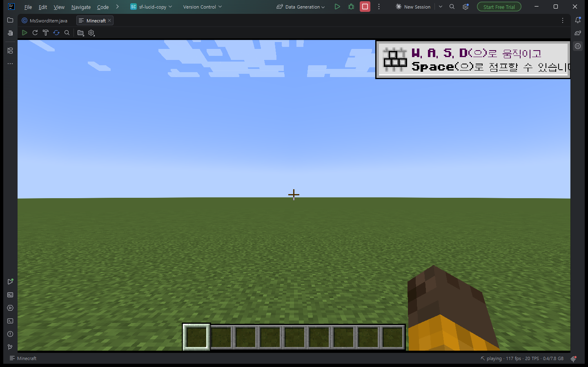

🌐 **English** · [한국어](README.ko.md)

> Translated from the Korean original ([README.ko.md](README.ko.md)), which is the source of truth: if the two differ, the Korean one is right. Last synced: 2026-11-21.

# SulfurFrame IntelliJ plugin (PoC)

When you open a Minecraft mod project, it reads **the Minecraft version, mod loader, loader version and required Java**
from the build files and shows them in a tool window. Then it puts the game window inside that tool window.


## Features
- **Version detection** (`profile/ProjectProfile.java`): reads files only, without running anything (no Gradle sync).
  - Detects the loader from the build script's plugin id: `fabric-loom` / `net.fabricmc.fabric-loom` /
    `dev.architectury.loom`, `net.neoforged.moddev` / `net.neoforged.gradle`, `net.minecraftforge.gradle`, ForgeGradle
    2's `net.minecraftforge.gradle.forge`, `org.quiltmc.loom`
  - Where versions are read from (in order of priority):
    1. `gradle.properties` (from the project up to the settings root)
    2. coordinates in the build script: `com.mojang:minecraft:X`, `fabric-loader`, `net.minecraftforge:forge:MC-FORGE`,
       `neoForge { version }`, FG2's `minecraft { version = "1.12.2-..." }`
    3. `gradle/libs.versions.toml`
  - Handles comments and `${...}` references. With only a NeoForge version, the MC version is worked out backwards
    (21.1.x → 1.21.1). The required Java follows Mojang's `javaVersion` (≤1.16: 8, 1.17: 16, up to 1.20.4: 17, up to
    1.21.x: 21, 26.x: 25).
  - Shows the evidence in the log.
- **Run client**: runs the project's `gradlew runClient` (the same name in Loom, ModDevGradle and ForgeGradle), finds the
  new Minecraft window and embeds it automatically.
- **Embedding** (`embed/GameEmbedder.java`): carries over every rule proven in `poc/embed`.
  - asynchronous window operations
  - click-to-focus without a mod, blocking `WM_MOUSEACTIVATE`, taking the focus back when the editor is clicked
  - freeze watchdog, a size nudge right after embedding
- **Built-in javaagent**: unpacks the plugin's `sf-agent.jar` to an ASCII path and attaches it with the Attach API. It
  handles the FPS cap while you code and the SDL3 focus fix.
- **Throttler**: when the tool window is hidden, the game is minimized, and 5 s later its heap is shrunk and its working
  set trimmed. When it is visible again, everything is set back.

## Problems that only show up in the real IDE, and fixes
- **Finding the canvas HWND**: finding the window by screen position (WindowFromPoint) failed in IntelliJ. IntelliJ runs
  with `--add-opens java.desktop/sun.awt.windows=ALL-UNNAMED`, so the peer is taken out with `AWTAccessor` and read with
  `WComponentPeer.getHWnd()`.
- **When a tool window is hidden, moved or floated, IntelliJ detaches the component**, and the canvas's native window
  is destroyed. The game window, its child, is destroyed with it.
  → Right before `removeNotify`, the game is **made a top-level window of the desktop again, minimized and hidden**
  (park), and after `addNotify` it is attached to the new canvas.
  - With the IDE frame as the park spot, re-docking a floating window removed that frame and the game window with it.
  - Hiding alone (`SW_HIDE`) is not seen as minimized by Minecraft, so its FPS stayed the same. So it is minimized and
    then hidden, and that state counts as hidden.

## Release build and publishing (Gradle)
The Gradle build at the repository root (IntelliJ Platform Gradle Plugin 2.20.1, Gradle 9.9.1) is the one for releases.
```bash
./gradlew buildPlugin                # → sf-idea-plugin/build/distributions/SulfurFrame-<version>.zip
./gradlew check verifyPlugin         # fixture self-test + JetBrains Plugin Verifier
./gradlew publishPlugin              # PUBLISH_TOKEN (signing: CERTIFICATE_CHAIN, PRIVATE_KEY, PRIVATE_KEY_PASSWORD)
```
- The version and target IDE are in `gradle.properties` (`pluginVersion`, `platformVersion`, `sinceBuild`). With
  `-PideaHome=<install folder>` or `IDEA_HOME`, it builds against an installed IDE and downloads none.
- `:agent` (`poc/agent`) builds `sf-agent.jar` (containing `sf-impl.jar` + ASM), which goes into the plugin jar as
  `/sf-agent.jar`.
- 0.1.0 check (2026-11-17, IntelliJ 2026.3): Plugin Verifier "Compatible" (2 deprecated API uses), self-test 6/6 + 5/5.
- 0.2.0 check (2026-11-21, IntelliJ 2026.3): Plugin Verifier "Compatible" (no warnings), every fixture test in `check`
  passes, and the multi-project mod's `runAllModsClient` reaches the game in a sandbox whose `JAVA_HOME` is Java 8.
- The icon is made with `docs/logo/gen-icon.py` (at least WCAG 1.4.11 3:1 on both light and dark themes).

## Expected effect (measured, 2026-11-17)
Scenes from the comparison video (https://youtu.be/G87LOVIu5as), where each edit is recorded side by side on the same
PC and the same mod, also serve as Marketplace screenshots: [method body](docs/marketplace/compare-01-vs-part1.png),
[Mixin](docs/marketplace/compare-02-vs-part2.png), [new item](docs/marketplace/compare-03-vs-part4.png). The recording
and editing tools are in `demo/tools`.

Scripts and raw data are in `docs/effect-study/` (`fetch.py` → `classify.py` → `model.py`, `sensitivity.py`, three
measurement scripts, `measured-2026-11-17.txt`).

**1. How changes reach a running game (9 large mods, 1,080 commits)**
The latest 120 commits each (merges excluded) of Fabric API, Sodium, Lithium, Iris, Create, Applied Energistics 2,
Botania, Farmer's Delight and Mod Menu were fetched through the GitHub API and their changes sorted. Mojang's official
GitHub has no game code, so the brigadier library was only run for reference and left out of the totals. The other
repositories' raw diffs are not kept in the repository, only the tallies (`mix.json`).
- Live: method bodies, added or removed members (JBR), Mixins, `assets/` (resource reload), `data/` (`/reload`)
- Restart: registration code, static initialization, `fabric.mod.json`/`mods.toml`, access wideners, `*mixins.json`,
  changes to the inheritance structure
- Commits that only changed build files (version bumps and the like) are not part of the dev loop and were left out;
  build files changed together with code did not count as restarts.
- This sorting and the numbers below are as of 0.2.x. Since 0.3.0, registration code, `onInitialize`, enum constants,
  added mixins and hierarchy changes between the project's own types apply live too ("Startup code in the running game
  too" below), but the effect range was not measured again.
- The sorting is done by regular expressions. 12 samples were checked by hand, which fixed local variable declarations
  inside methods being counted as "structural changes".

| Tally | Body | Structure | Mixin | assets | data | Restart |
|---|---|---|---|---|---|---|
| Per commit (the slowest change decides the whole commit) | 24% | 12% | 12% | 15% | 3% | 35% |
| Per file (one file = one edit) | 22% | 17% | 16% | 18% | 13% | 15% |

Unrecorded edits between commits cannot be known, so these two tallies are taken as the two ends of the range.
Intermediate edits such as tuning a value or adding a log line are mostly body changes, so reality is probably closer to
the per-file end, but that cannot be verified. Real usage records (4 below) fill that gap.

**2. The time each path takes (same PC, same day)**

| Path | Test copy (1 Gradle project, 56 mods loaded) | Multi-project mod (9 Gradle projects, 65 mods loaded) |
|---|---|---|
| Gradle configuration only (`help`) | — | 30.7 s |
| Restart: `runClient --quickPlaySingleplayer` → in the world | 49.4 / 41.9 / 41.8 s | 85.1 / 82.1 / 80.2 s |
| Stock HotSwap: `gradlew classes` after a body edit | 10.9 / 7.0 / 7.5 s | 19.7 / 19.8 / 19.8 s |
| Resources: `gradlew processResources` | 7.1 / 6.5 / 6.9 s | 18.8 / 18.5 / 18.5 s |
| SulfurFrame swap (compile included, Gradle not called) | 0.5–1.3 s | (to be confirmed by usage records) |
| SulfurFrame "Restart into the Same World" (through Gradle) | 38–52 s (same as a normal restart) | counted the same as a normal restart |
| Restart, through Gradle → without Gradle (same command line, `measure-relaunch.sh`, warmed up) | 31.8 → 29.9 s | 81.2 → 64.0 s |

The last row was measured at a different time from the others (the test copy restarted faster that day), so only the
differences (1.9 s, 17.2 s) go into the model, not the absolute values. No existing file of the multi-project mod was
touched: one temporary class and one temporary resource were added, edited, then deleted and rebuilt. A temporary class
nothing depends on is the best case for Gradle. The game ran muted during the measurements.

**3. Result: waiting per edit-run step**

| | Test copy | Multi-project mod |
|---|---|---|
| Restart every time | 44.4 s | 82.5 s |
| Restart every time + quitting and menu clicks (assumed +13 s) | 57.4 s | 95.5 s |
| Stock HotSwap | 25.6–29.6 s | 49.9–56.8 s |
| JBR + stock HotSwap (structural changes apply too) | 19.6–25.3 s | 39.4–49.3 s |
| **SulfurFrame** | **7.6–16.5 s** | **11.0–29.8 s** |
| Saved vs restarting | 63–83% | 64–87% |
| Saved vs stock HotSwap | 44–70% | 48–78% |
| Saved vs JBR + stock HotSwap | 35–61% | 40–72% |

- At 60 runs a day (assumed): on the multi-project mod, restarting only means about 82 minutes of waiting, stock
  HotSwap 50–57, JBR + stock HotSwap 39–49, SulfurFrame 11–30.
- JBR + stock HotSwap was calculated, not measured separately. It uses the same Gradle compile as stock HotSwap; the only
  difference is that added or removed members apply live (the redefinition itself takes under 1 s either way). For
  Mixins the changed class is redefined but not re-applied to its targets (that needs Mixin's hotswap agent, which
  SulfurFrame adds), so they count as restarts. Compiling with IntelliJ's own builder could make this row shorter (not
  measured).
- The savings remain at the unfavourable end too (`sensitivity.py`). With the fastest restart, a slow reload (5 s), the
  first swap (2.5 s) and Mixins counted as restarts, it is still 40–63% vs restarting and 11–40% vs stock HotSwap.
- A restart skips Gradle as long as the build files are unchanged ("Quick restart"
  below). The commit sample cannot tell which restarts fall under that, so the high end of the range counts commits
  with every restart through Gradle, and the low end counts files with every restart without Gradle (`sulfur` and
  `sulfur+relaunch` in `model.py`).
- Even so, a restart only loses the Gradle part. The game's own start and the world entry (64 s on the multi-project
  mod) stay, so most of the effect comes from changes that apply live. The slower a project's Gradle, the bigger the
  effect.

**What affects the times**
- **Gradle configuration time:** the stock path pays it every time it calls Gradle. On the multi-project mod it is
  30 s. SulfurFrame's swaps and resource updates do not call Gradle.
- **Mod count and world:** they decide how long the game takes to start and enter the world (56 → 65 mods loaded, a small flat
  world → a real working world). These are Fabric Loader's counts: most are Fabric API modules, libraries and other
  mods the projects run with, not mods of their own.
- **Daemon state:** the first run is slow while the daemon warms up (test copy 49 s → 42 s).
- **Where you edit:** changing the signature of a class many others use makes Gradle recompile its dependants too. The
  measurements above are the best case for Gradle.
- **Annotation processors and Kotlin:** they add compile time (see "Annotation processors and Kotlin" above).
- **Amount of resources:** reload time depends on the resource pack size and costs the same with or without
  SulfurFrame.
- **PC state:** at the time of measuring, 2.4 GB were free on drive C:, and the IDE was closed. Antivirus scans and other
  load also matter.

**Limits**
- SulfurFrame supports only Fabric 1.21.1 for now. Create, AE2 and Farmer's Delight are NeoForge mods, so their rows
  show the effect once support is wider.
- Mixin hotswap on NeoForge/Forge has not been tested yet.
- datagen output changes many files at once, which inflates the per-file data share (Create 62%).
- The measurements were taken on one PC.

**4. Real usage records (`UsageLog`, `usage.py`)**
The panel log is also written to `~/.sulfurframe/logs/sulfurframe-<date>.log` with date, time and project (kept 14 days,
written only on your PC and sent nowhere; self-test lines are marked `autotest:`). `idea.log` rolls over within minutes
from other plugins' warnings, so it was no use. `python docs/effect-study/usage.py` counts the swaps, resource updates
and restarts that really happened, and how long they took. Uncommitted edits are included, so this record shows where
in range 1 reality actually lies.
- Counted: swaps (`hotswap (<compiler>, N class file(s), M ms)`), resource updates, Run client and restarts (through
  Gradle and without it, separately, until the game window). The window line's `N s after start` is used as is. A run
  whose window never appeared (failed build, stopped) is dropped, not paired with a later window.
- Left out: self-tests (`autotest:`), projects that only ran from a temporary folder (`Temp`, `/tmp`: demo recordings,
  test copies; `--include-temp` shows them), and projects named with `--exclude=project,...` (such as the demo mod
  `showcase-mod`).
- As of 2026-11-21 the real project has only 2 Run clients on record, not yet enough to fill in the range above.

## Quick build and test (no Gradle, uses an installed IDE)
```bash
./sf-idea-plugin/build.sh          # → sf-idea-plugin/build/SulfurFrame (plugin folder)
```
- Compiles against `lib/*.jar` of an installed IntelliJ IDEA 2026.3+ (JBR 25, FFM available). The agent comes from
  `poc/agent/sf-agent.jar`.
- **Sandbox self-tests**: start the IDE with separate config/system/plugins folders, so your own settings stay untouched.
  - The Gradle and Maven plugins are turned off, and consent dialogs are skipped with
    `-Djb.consents.confirmation.enabled=false` and the like.
  - The self-test game makes no sound (`ALSOFT_DRIVERS=null`, OpenAL's silent output). The volumes in `options.txt` are
    left alone: the options sync shares `soundCategory_*`, so changing them would mute your everyday games too. To hear
    it: `-Dsulfurframe.mute=false` (`SF_SOUND=1` for McFetch).
  - With `-Dsulfurframe.autotest.pid=<PID of a running Minecraft>`, the tool window opens by itself. It then checks
    attach, floating, re-docking, hiding and showing in turn, and records the results in
    `%TEMP%/sulfurframe-autotest.txt` and screenshots.

The sandbox starts with `./sf-idea-plugin/sandbox.sh <project folder> [-Dsulfurframe.autotest.pid=<PID>] …`. It is
created per IDE build in `%TEMP%/sf-idea-sandbox-<build number>`, so upgrading the IDE does not mix it with an older
sandbox.

**Self-test mod:** this repository's `demo/showcase-mod` (Fabric 1.21.1). `demo/tools/test-copy.sh` makes a throwaway
copy in `%TEMP%/sf-showcase-test` and prints the sandbox command:
```bash
./sf-idea-plugin/sandbox.sh <copy> -Dsulfurframe.autotest.runclient=true -Dsulfurframe.autotest.hotswap=<copy>/src/main/java/dev/sulfurframe/showcase/SfHotswapProbe.java -Dsulfurframe.autotest.world=SFWorld
```
The test edits sources and adds translations, so always run it on a copy. The "lucid copy" in the records below is a
personal test mod used before this one. The test no longer has mod names in its code; it finds them from the
`ModInitializer` next to the probe file, any `assets/*/lang/*.json`, and the probe's package.

**Before a release (`./sf-idea-plugin/release-check.sh`):** runs, in one go, the paths a new user hits first, not only a
warm developer setup (about 30 minutes, the game muted). The results land in `%TEMP%/sf-release-check/summary.txt`, and
the exit code is 1 if anything failed.
- gradle: `buildPlugin`, `check` (fixtures), `verifyPlugin` (skipped with `--quick`)
- A new user: fresh copy, no `run/options.txt`, no JetBrains Runtime (`-Dsulfurframe.noJbr=true`: the download is
  offered, method bodies swap, structural changes ask for a restart)
- B regular: fresh copy, JetBrains Runtime used (structural swaps, restarts without and through Gradle)
- C Linux: `xvfb-test.sh runclient` in WSL (`--no-linux` skips it)
- `--worlds` adds the shared-worlds flow (it links the copy into your real `~/.sulfurframe` shared folder), `--download`
  the real JBR download (about 280 MB)
0.2.1's `options.txt` bug only showed in an empty run folder; run A is that case.

### Checks before moving to IntelliJ 2026.3 (build 263) (2026-11-16)
- **Compile:** compiles against the 2026.3 jars without errors. The one warning is the deprecation of
  `FileEditorManager.openFile(VirtualFile, boolean)` in `GameTab`. The replacement API (`requestOpenFile`) seems to have
  arrived in 2026.3, and the old method is not scheduled for removal, so it stays for 2026.2 compatibility
  (`since-build="262"`).
- **Bundled runtime:** 2026.3 is also JBR 25 (25.0.4.1), so nothing changes for FFM or the agent.
- **Your own IDE:** when settings were imported, `sulfurframe.jar` moved to the new settings folder
  (`IntelliJIdea2026.3/plugins`), and there is a record of it loading in 2026.3 and recognising the project.
- **Sandbox self-tests:** all 12 pass (profile detection, embed, 16:9, floating, re-docking, hiding, restoring,
  letterbox, F11 fullscreen, back from F11, editor tab, closing the tab and returning). In the first run the F11 check
  failed for lack of keyboard focus: with another app in front, the Windows focus lock makes `toFront()` only flash the
  taskbar. Now the F11 check waits up to 1 minute for the IDE to come to the front (click the IDE title bar meanwhile),
  and notes it in the result if it had to wait.
- **The real dev loop (Run client → embed → edit → hotswap → restart):** all 23 pass. A class printing
  `[SF-PROBE] <message()>` every 5 s was added to a copy of lucid-study-mod (Fabric 1.21.1), run with
  `-Dsulfurframe.autotest.runclient=true -Dsulfurframe.autotest.hotswap=<SfHotswapProbe.java>
  -Dsulfurframe.autotest.world=SFWorld`. It embedded 27 s after Run client; a method body hotswap took 523 ms with
  compiling (javac inside the IDE), 414 ms once warm. On JBR, adding or removing fields and methods applies too, and
  saving alone swaps it in. Both restart and the IDE Rerun saved, quit and came back to the same world.
  - Two fixes on the test side: on 1.21.1, `--quickPlaySingleplayer` does not create a missing world and stays on the
    title screen, so when the given world is missing, the test first creates it with the test world generator. Also,
    the game log in this environment has no "joined the game" line, so entering the world is decided by the server
    line `logged in with entity id`.
  - Now there are 26. Checks for a compile-time constant change (`SfProbeConst`) and for a class rebuilt with the same
    bytes were added. The constant is read in a separate method of the probe: read inside an endless loop, a frame that
    is already running would keep running the old code after the swap.

### Found while using it on a real project (multi-project mod, 2026-11-16)
Problems found while fixing the GUI overlay of the multi-project mod (multi-module; the core `runAllModsClient` runs
four other modules with it) with the SulfurFrame loop in the user's IDE. The overlay work was done in a dozen or so GUI
module hotswaps (about 2 s each).
- **Wrong default target:** with no saved choice, Run client started the alphabetically first target (another module +
  core, no GUI). Now, within the same version and loader, a run configuration the project defines itself
  (`runAllModsClient`) comes first (fixture `runconfig`).
- **Other modules did not hotswap:** fast compile and class comparison only knew the selected project (core), so edits
  in `:gui` were "no class changed". Now the source sets of other projects whose outputs are on the run task class path
  are compiled and compared too (11 source sets).
- **751 classes sent after a Gradle build → JVM crash:** only modification times were compared, so after Gradle rewrote
  all class files of a module, a one-line edit sent 751 classes and the VM died during the JBR class redefinition
  (`ConstantPool::to_cp_index`). Now only classes whose bytes changed are sent, and classes in output folders discovered
  later serve as the baseline.
- **Constant changes did not apply:** javac copies `static final` constants into the classes that read them, but fast
  compile only recompiled the edited file, so the game kept using the old value (with no warning). Now sources that
  mention that class name are recompiled and sent along. Measured: changing `PreviewPalette.A_OUTLINE` 0.30 → 0.95
  recompiled the 11 files that use it and swapped 7 classes (5.1 s), and the selection box got bright again without a
  restart.
- **Files edited outside the IDE:** IntelliJ did not notice files changed by an external editor or an agent until its
  window was activated, so "hotswap on save" did not run. Now `SourceWatcher` watches every `src` folder of the build
  itself and sends changes down the same path as an IDE save (one swap even when both catch it). Fixed along the way:
  save handling dropped code outside the target module, so saving a `:gui` file in the IDE did not hotswap when running
  `runAllModsClient`. Test: a change made on disk only, without a VFS refresh, reaches the game (27 loop tests).
- **Build tools:** Fabric Loom 1.19 needs Gradle to run on Java 25 (the game is Java 21). When a project chooses its
  Gradle JVM with `gradle/gradle-daemon-jvm.properties` (`toolchainVersion=25`), the plugin leaves the daemon JVM to
  Gradle (since 0.2.0 it still hands `gradlew` itself a Java 17+ JDK when `JAVA_HOME` is older). The test copy runs on
  Gradle 9.9.1 / Loom 1.19.4 too.

Results (IntelliJ IDEA 2026.2.3, vanilla 1.21.1):
```
PASS profile detected  [FABRIC 1.21.1 0.17.2 (Java 21)]
PASS embedded in the tool window
PASS game fills the canvas  [game 450x725, canvas 450x725]
PASS survives floating the tool window
PASS survives re-docking
PASS hidden -> game minimized  [iconic true, state HIDDEN]
PASS shown -> game restored  [iconic false, state CODING]
failures: 0
```
**Run client flow** (`-Dsulfurframe.autotest.runclient=true`, a temporary copy of the inner project of lucid-study-mod,
Fabric 1.21.1):
```
PASS profile detected  [FABRIC 1.21.1 0.17.2 (Java 21)]
PASS Run client -> game embedded  [after 25 s (first run 97 s)]
PASS game fills the canvas  [game 450x725, canvas 450x725]
```
- Pressing the button runs the project `gradlew.bat runClient`; when the dev client window appears, the agent is
  attached and the window goes into the tool window.
- While resources load, the game is busy and the watchdog briefly detaches and reattaches the input queues. That is
  normal.
- **A problem found in a real project:** this project's wrapper is Gradle 8.12, but the Loom 1.11-SNAPSHOT it uses needs
  8.14 or newer, so `runClient` fails (the original `gradle-wrapper.properties` is modified in git). The test changed
  only the copy's wrapper to the cached 9.4.1 and left the original alone. The plugin now shows the Gradle "What went
  wrong" text in the tool window log as is.

Version detector fixture tests:
```bash
javac -d out sf-idea-plugin/src/main/java/dev/sulfurframe/idea/profile/ProjectProfile.java sf-idea-plugin/src/test/java/dev/sulfurframe/idea/profile/ProfileSelfTest.java
java -cp out dev.sulfurframe.idea.profile.ProfileSelfTest sf-idea-plugin/src/test/resources/profiles [real project folders...]
```
All 6 fixtures (NeoForge MDK, Forge 1.20.1 MDK, Forge FG2 1.12.2, Quilt, direct kts declarations, version catalog) and
4 local real projects were detected correctly.

## Not done yet
- Linux: checking on real Linux desktops (GNOME/KDE, mutter/kwin) and GPU drivers. So far it was checked on Xvfb +
  openbox and WSLg. 26.x (SDL3) and 1.12.2 (LWJGL 2) were checked in the PoC (`poc/embed/README.md`); the plugin itself
  was only tested with 1.21.1. See "Linux (X11)" below.
- Loaders and versions: only Fabric 1.21.1 is supported for now. Forge and other versions come with the multi-version
  expansion of the bigger mod developed alongside.

## Container folders and multi-version projects (`profile/Workspace.java`)

It **finds every client that can run** in the opened folder and creates a "Minecraft: <location> [task]" run
configuration for each (newest MC version first). Pick one from the run configuration list on the main toolbar; the
choice is remembered per project (`PropertiesComponent`). "Run client" runs that task path with the wrapper of the build
root the chosen target belongs to.

| Structure | How it is recognised | Run task |
|---|---|---|
| Single project | the folder itself is a mod build | `runClient` |
| **Container** (a repo holding several mods, e.g. lucid-study-mod) | an independent `settings.gradle` in each subfolder | `runClient` in each build |
| **Multi-project** (the multi-project mod, modules per version) | subprojects in the `settings` `include(...)` that are mods | `:core:mod-fabric-1_21_1:runClient` |
| **Architectury** | `architectury { fabric() / neoForge() / forge() }` in a subproject. `common` is left out | `:fabric:runClient`, `:neoforge:runClient` |
| **Stonecutter** | `stonecutter { versions("1.20.1", "1.21.1") }` in `settings`, per-version `versions/<v>/gradle.properties` | `:1.21.1:runClient` |

- **Following kts variables:** versions are read by following `val mcVersion = rootProject.property("mc_1_21_1_version")`,
  `property("deps.x")` and groovy `def x = rootProject.y`.
- **Plugin detection exceptions:** plugins only declared with `apply false`, and plugins applied inside
  `subprojects { }`, do not count as that project's own loader.
- **Folder names are only a version hint:** names like `mod-forge-1_21_1` are only used to guess the version. Stub
  modules with no loader evidence in their build script are left out.
- **Nested settings:** a folder included in another build is not treated as an independent build even if it has its own
  `settings.gradle`, and its properties are read from the outer build root.
- **Skipped folders:** dot folders such as `.git`, `.gradle`, `.claude/worktrees`, and `build`, `run`, `src` are not
  scanned.

Checks:
```
PASS container     -> [runClient FABRIC 1.21.1 0.17.2, runClient NEOFORGE 1.21.1 21.1.265]
PASS multiproject  -> [:core:mod-fabric-1_21_1:runClient FABRIC 1.21.1 0.16.10, :core:mod-fabric-1_20_1:runClient FABRIC 1.20.1 0.15.11]
PASS architectury  -> [:fabric:runClient FABRIC 1.21.1 0.16.10, :neoforge:runClient NEOFORGE 1.21.1 21.1.265]
PASS stonecutter   -> [:1.21.1:runClient FABRIC 1.21.1 0.16.10, :1.20.1:runClient FABRIC 1.20.1 0.16.10]
```
Results on real folders:
- **lucid-study-mod:** 5 targets (savedeath and untitled1 1.21.7, root, lucid-study-mod and lucid-study-mod2 1.21.1).
  The root shows as "(no gradlew)".
- **Multi-project mod:** 5 Fabric modules (`:core:mod-fabric-1_21_1` and 4 other modules) and Forge
  `:core:mod-forge-1_21_1` (52.1.6). Worktree duplicates and the Forge stub were left out.

In the sandbox IDE, a full copy of the lucid-study-mod container was opened, `lucid-study-mod` picked and Run client
pressed. The 5 targets were listed, it ran with the inner project's wrapper, and it embedded in the tool window after
82 s (tests 4/4 PASS).
```bash
java -cp out dev.sulfurframe.idea.profile.WorkspaceSelfTest sf-idea-plugin/src/test/resources/workspaces [real folders...]
```

## Layout and F11 fullscreen

- **Keep 16:9** (default): fits the game to 16:9 inside the panel and fills the rest with black bars. The picture does
  not stretch even in a tall tool window. Unchecking "16:9" fills the panel.
- **"Open as tab"**: moves the game to a "Minecraft" tab in the wide editor area (`GameTab`, `FileEditorProvider`).
  Closing the tab brings it back to the tool window. Moving it creates a new canvas; the game is parked and attached
  again.
  
- **F11 (the in-game fullscreen key)**: pressing F11 while embedded makes GLFW and SDL only add `WS_POPUP` to the window.
  As a child window it stays inside the panel. Pressing it again removes `WS_POPUP` and **adds a title bar**, so a window
  border appears inside the panel (measured on 1.21.1).
  → The watchdog detects the style change.
  - When `WS_POPUP` appears, the game is taken out of the IDE and fills the monitor the IDE is on.
  - When `WS_POPUP` goes away, the title bar is stripped and the game goes back into the panel.

Sandbox self-tests (12 items), **12/12 on both 1.21.1 (GLFW) and 26.3 (SDL3)**:
```
PASS 16:9 letterbox                     [game 450x253 (1.779) in canvas 450x708]
PASS F11 -> fullscreen                  [fullscreen true, child false, rect 1920x1200, monitor 1920x1200]
PASS F11 again -> embedded, no title bar
PASS open as editor tab
PASS tab closed -> back in the tool window
```
The F11 check sends real keys, so it only sends them while the game has the keyboard focus. If the IDE is not in front,
it waits up to 1 minute, and if there is still no focus, it records a failure.

## Protecting the game when the IDE dies

**Measured:** killing the IDE (host) process while embedded **destroys the game window about 2.75 s later**, because a
child window is destroyed with its parent. The game process stays without a window and is no longer usable, and world
changes since the last autosave are lost.
- **It cannot be rescued from outside:** another process watching every 10 ms tried to move the game window to the
  desktop on the first sign and failed. The moment the parent window disappeared, the game window was already being
  destroyed, and the IDE GUI thread and process exit signals came later than that.
  → **With a true child window, the window cannot be kept when the IDE is killed.** Instead, no work is lost.

| How the IDE ends | Handling | Result (measured) |
|---|---|---|
| Normal exit, restart, plugin unload | tool window dispose → detach | the game stays as a normal window |
| `taskkill` (without /F), logoff | JVM shutdown hook `releaseForShutdown` | **the game stays as a normal window** (Confirm Exit → Exit, the IDE quits 2 s later, the game window stays) |
| **Forced kill (/F, Task Manager), crash** | **the agent lifeboat** (`Lifeboat`) | **the game saves the world and quits within 1–2 s** |

**Lifeboat** (`poc/agent/.../Lifeboat.java`): a daemon thread inside the game checks its own window every 250 ms.
- **What it does:** when the window disappears while it is a child of another window (embedded), it asks the game for
  its usual quit.
  - GLFW: `glfwSetWindowShouldClose`
  - SDL: push `SDL_EVENT_QUIT`
  - LWJGL 2: `close_requested`

  Minecraft shuts down normally: "Stopping!" → save players and worlds → stop the server.
- **When it stays out of it:** a window that was detached first (top level) closing is an ordinary exit and is left
  alone.
- **Getting the window handle:** `GLFWNativeWin32`, the SDL window property (`SDL.window.win32.hwnd`), LWJGL 2
  `WindowsDisplay.hwnd`
- **Win32 calls:** through the LWJGL 3 JNI; LWJGL 2 games use JNA (bundled with 1.8 and newer).

Checks (host killed → game log):
- 1.21.1 (GLFW), 26.3 (SDL3), 1.12.2 (LWJGL 2 + JNA): all "Stopping!" and a world save, process gone within 1 s
- **The real plugin flow**: 1.21.1 embedded with the agent the sandbox IDE attached → IDE killed with `/F` → saved and
  quit 2 s later
- **With a world open** (lucid-study-mod `runClient --quickPlaySingleplayer`, 1.21.1 Fabric): host `/F` → "Saving
  worlds" → "All chunks are saved" (3 dimensions) → quit within 7 s, `level.dat` updated
- **A game started with Run client + a normal IDE exit** (Confirm Exit → Exit): the game keeps running as a normal
  window. The game's parent is the Gradle daemon and the IDE's only child is the Gradle client, so closing the IDE does
  not cancel the build. The client exits when the game ends.

Limit: 1.7.10 has neither the LWJGL 3 JNI nor JNA, so the lifeboat cannot be used there (logged as "unavailable").

## Hotswap (without a debugger)

**Flow:** saving, or pressing the "Hotswap" button, goes through these steps.
1. Only the `.java` files changed since the last swap are compiled right away with javac and written to the source
   set's `build/classes/...` (`FastCompile.java`). What javac needs (source folders, output folders, compile class
   path, release, encoding, toolchain javac) is fetched **once** at Run client time through a Gradle init script (the
   `sfClasspath` task) and cached in `%TEMP%\sulfurframe\classpath-*.txt`. It is fetched again when build files
   (`build.gradle*`, `settings.gradle*`, `gradle.properties`, `libs.versions.toml`) change. If there is no cache yet, a
   Kotlin file changed, or the game was attached by PID so it is unknown which sources changed, it compiles with Gradle
   `<path>:classes` (+ `clientClasses`) as before.
2. Finds the `.class` files under `build/classes` whose modification time changed.
3. Writes the list to a file on an ASCII path and sends `redefine=<list>` to the agent through the Attach API.
4. The agent (`poc/agent/.../Hotswap.java`) replaces the already loaded classes with
   `Instrumentation.redefineClasses` and writes a result file.

- **Scope of the javac path:** only the edited files are compiled (the rest refer to the classes in the output folder),
  and annotation processors are off (`-proc:none`, the Mixin refmap is left alone). Hotswap can only apply method
  bodies anyway, so that is enough. On a compile error, those files are tried again on the next swap.

- **Why not the debugger:** IntelliJ's HotSwap (JDWP) needs the game started under the debugger, and putting a debug
  port into `runClient` easily clashes with the Gradle daemon. An agent that is already attached has no such problem.
- **What applies:** Run client starts the game on **JetBrains Runtime (JBR)** with
  `-XX:+AllowEnhancedClassRedefinition` (`Jbr.java`; a Gradle init script changes only the runClient executable and JVM
  arguments, and the project build files stay untouched). Thanks to the DCEVM inside JBR, **adding or removing methods
  and fields** swaps in as well.
  - The JBR has to match the Java version the game needs. It is looked up in `~/.jdks` (IntelliJ's SDK download), and the
    IDE's own JBR (25 for 2026.x, for Minecraft 26.x) is used when the version matches. 1.21.x needs `jbr-21`.
  - Without a matching JBR the game starts on a regular JVM, and then only **method body changes** apply. Adding or
    removing methods or fields reports just those classes as "restart needed" and applies the rest (if one batch fails,
    it retries class by class).
  - **One-click install (`JbrDownloader.java`):** without a matching JBR, Run client offers a download in a notification
    (once per Java version per IDE session, only for 17, 21 and 25, which have a JBR). Accepting runs a background task
    (with progress, cancellable) that:
    1. picks the JBR SDK for this OS and CPU (without JCEF or DCEVM variants) from the public list IntelliJ's JDK
       download uses (`download.jetbrains.com/jdk/feed/v1/jdks.json`)
    2. downloads it through the IDE proxy settings (`HttpRequests`, about 230 MB) and checks its SHA-256
    3. unpacks it to `~/.jdks/jbr-<version>` (the same folder and name as IntelliJ's own download, so `Jbr.find` finds
       it as is). It unpacks into a `.part` folder and moves it at the end, so a cancelled or broken download never looks
       like an installed JBR.
    4. shows a "Restart the game now" notification when done. The next start uses the JBR (a restart without Gradle
       also sees the changed JBR and goes through Gradle).
    - IntelliJ's `JdkInstaller`/`JdkItem` are internal API (`@ApiStatus.Internal`) and are not used; only public API
      (`HttpRequests`, `Decompressor`, `Task.Backgroundable`). To turn the offer off: `-Dsulfurframe.noJbrOffer=true`.
    - Self-test `-Dsulfurframe.autotest.jbrdownload=true`: really downloads it, installs it to a temporary folder,
      checks that it is JBR 21, and deletes it.
  - Newly added fields start without initial values (0, null): class initialization (static blocks) does not run again,
    and constructors of existing objects do not run again either.
  - New classes need no swap. They are read from build/classes the first time they are used.
- **Classes not loaded yet:** nothing to do. They read the new file when they load later.
- **Detecting saves:** `.java`/`.kt` content changes from `VFS_CHANGES` are received with a 0.5 s debounce. "Save All"
  with several files runs only once. It only acts on files inside the chosen target folder, and is switched on and off
  with the tool window's "Hotswap on save" option.

Check: done in the sandbox IDE on a copy of lucid-study-mod with an observation class added (logging `[SF-PROBE]
<message()>` every 5 s).
```
PASS probe running (v1 in game log)
PASS fast compile: class path read from Gradle   [13 s the first time, cached after]
PASS hotswap: method body change applied   [redefined 1, agent 41 ms, total 2.4 s (javac)]
PASS hotswap compiled with javac, not Gradle
PASS hotswap on save (VFS change -> swap)  [game log shows v3]
PASS hotswap (JBR): added field + method applied and running   [redefined 1; game log "[SF-PROBE] v4 extra1"]
PASS hotswap (JBR): removed field + method applied              [redefined 1; "[SF-PROBE] v5"]
```
The game log went `v1 ×5 → v2 → v3`, and **the game did not restart.**

### Additions (compiling inside the IDE, Mixin, resources, in-game messages)
- **Compiling inside the IDE:** instead of starting a javac process every time, it compiles right inside the IDE with the
  javac in the IDE's JBR (`jdk.compiler`, `ct.sym`; `--release` is the project's). A file manager is kept per source
  set, so the Minecraft class path jar index is read once, and right after the class path arrives, one compile runs in
  the background as a warm-up. Inside IntelliJ, `ToolProvider` cannot find javac (the IDE's own system class loader), so
  `com.sun.tools.javac.api.JavacTool`, which the IDE opens through its launch options, is used directly. Without it, it
  falls back to a javac process as before.
  Result: one swap (compile + attach + redefine) takes **0.47–0.86 s**, around 1.3 s right after structural changes
  and the like (2.4 s before, and Gradle's 15 s before that).
- **Mixin:** Run client attaches Mixin's own hotswap agent to the game (`-javaagent:<the (sponge-)mixin jar on the class
  path>`, `-Dmixin.hotSwap=true`). Mixin then loads a stand-in class with the same name for every Mixin class, and when
  that class is redefined, it re-reads the Mixin and applies it to its targets again. So our hotswap only has to
  redefine the Mixin class as usual (log "Redefining mixin ...").
- **Resources:** saves under `src/*/resources` are detected, copied straight into the source set's resource output folder
  that Gradle reported (what `processResources` fills and the dev game reads), and the agent is called.
  - under `assets/` (textures, models, languages, sounds and so on): reload the client resources (like F3+T)
  - under `data/` (recipes, loot tables, tags and so on): `/reload` on the integrated server. Only while a world is open.
  - Mod metadata such as `fabric.mod.json` and `mods.toml` is filled in with values by `processResources`, so it is not
    copied; instead a restart is suggested.
- **In-game messages:** after a swap or resource reload, a line such as "Hotswap: 1 class reloaded" / "Resources reloaded
  (assets)" appears in the action bar above the hotbar. Classes that need a restart are reported in yellow. Only visible
  in a world (with the HUD).
  - In-game messages and resource reloads find Minecraft classes by their dev environment names (Mojang mappings in
    NeoForge/Forge dev environments and vanilla 26.x; Yarn in Fabric dev environments). They do not work in an
    obfuscated game.

Check (Windows sandbox IDE, lucid-study-mod copy 1.21.1 Fabric, jbr-21, test Mixin `SfMixinProbe` added to the copy):
```
PASS hotswap: method body change applied            [864 ms incl. compile (javac in the IDE)]
PASS hotswap compiled in the IDE (warm), whole swap fast
PASS in-game message after a swap                   (agent log "in-game message shown: Hotswap: 1 class reloaded")
PASS hotswap: mixin change re-applied to its target ("Redefining mixin kr/kro/lucid/mixin/SfMixinProbe", log m1 -> m2)
PASS resource change -> client reload               (language file -> "Reloading ResourceManager")
```
The data reload was checked by attaching directly to a game with a world open ("resources: /reload on the integrated
server", server thread "Loaded 1295 recipes").

### Annotation processors and Kotlin
- **Annotation processors:** compileJava's processor path (`annotationProcessorPath`) and generated source folder are
  fetched from Gradle and run in the fast compile too. Projects that do not compile without them, such as with Lombok,
  work. Mixin's processors (refmap generator, `fabric-mixin-compile-extensions`, `sponge-mixin`) and their `-A` options
  are left out: the dev environment does not need them, and compiling only some files would overwrite the refmap with
  just those files. One class loader for processors is created per source set and kept; only the processor objects are
  created fresh each time and handed over (`task.setProcessors`). With javac re-reading the jars for every compile,
  Lombok alone took 1.5 s; this way it is 0.15–0.33 s.
- **Kotlin:** a changed `.kt` used to be compiled with Gradle (10 s or more). Now the Kotlin compiler the project really
  uses (`kotlinCompilerClasspath`: `kotlin-compiler-embeddable` etc.), the Kotlin source and output folders, class path,
  `jvmTarget` and module name are fetched from Gradle, and `K2JVMCompiler` runs in a separate class loader (loaded once
  and kept, with a warm-up). Changed files are compiled into a temporary folder and only the `.class` files are moved to
  the Kotlin output folder, because compiling only some files would overwrite `META-INF/*.kotlin_module` with just
  those files. Kotlin is compiled first and Java after, with the Kotlin output on the Java compile class path (it is not
  in Gradle's compileClasspath).
  **Inside the IDE the Kotlin compiler fails** (the IntelliJ core bundled in the compiler seems to pick up the IDE
  environment; outside the IDE it is fine), so it runs in a long-lived separate process (`KotlinServer`, started on the
  IDE's JBR). Requests go one line at a time over standard input, and the compiler stays loaded and warm in that
  process. IntelliJ's plugin class loader does not tell the jar location, so the server class files are unpacked to a
  temporary folder.
  Result: warm-up 10–12 s (in the background), then one Kotlin file swap takes about 1.8–2.5 s (including when Kotlin
  and Java compile together). With Gradle it took more than 30 s.
- **Fixed bug:** build outputs such as the `fabric.mod.json` Gradle writes to `build/resources` were also taken as
  "saves" and suggested a restart. Changes under `build/`, `.gradle/`, `run/` and `out/` are now ignored.

Check (Lombok 1.18.38 and Kotlin 2.2.21 added to the test copy, `SfLombokProbe` using a Lombok getter, Kotlin
`object SfKotlinProbe`):
```
PASS hotswap with an annotation processor (Lombok)        [javac in the IDE]
PASS hotswap of a Kotlin file, compiled by the warm Kotlin server   (game log "[SF-KOTLIN] k2")
```

### Startup code in the running game too (0.3.0)
On Fabric 1.21.1, changes to code that runs at startup apply without a restart too, except where the JVM forbids it. This
works when the game was started by SulfurFrame's Run client (the agent is there from the start); what needs the JetBrains
Runtime (new fields) needs it here too.

- **New blocks and items (every registry, `RuntimeRegister`):** when a block class's static initializer or static
  `register`/`initialize` methods (calling `Registry.register`) change, the registries are unfrozen for a moment and the
  code runs again in a renamed copy of the changed class. Ids that are already there get the existing entry; only new ids
  are registered. Static fields the hotswap added take the copy's values. Then the registries are frozen again, new items
  get their model id (the item renderer lists them once, at startup), the creative tabs rebuild and resources reload. The
  integrated server is paused meanwhile. Block state ids and block items are Fabric's own work.
- **`onInitialize` / `onInitializeClient` / `onInitializeServer` (`EntryRerun`):** run again on the entry point object
  Fabric Loader made. First, what the class and the project classes it calls hooked up before is taken out: Fabric event
  listeners, resource reload listeners, network payload types, builtin item and armor renderers, container screens, key
  bindings. Where a listener came from is read from its class name (a lambda is `Owner$$Lambda`, an anonymous class
  `Owner$1`). So hooking up again does not hook up twice, and a removed listener is gone. Registries keep what is there as
  above (the `Registry` register methods are hooked as the class loads). Taking out happens before the classes are
  redefined: an old listener calling a lambda the new class no longer had crashed the game on the next tick.
  - Commands: if the command registration callback had or now has listeners from these classes, the run ends with
    `/reload` (the server builds its command tree again).
  - Key bindings: Fabric refuses a binding once the options exist, and a second one with the same id; while the run lasts
    they go straight into Fabric's list through a hook. A new binding takes the key the player chose and the old one's
    place in the controls list.
- **New enum constants (`ClinitReplay`):** the changed static initializer runs in a hidden class in the enum's nest (it
  may call the private constructor), and only the new constants are taken from it. Their ordinals follow the existing
  ones, they go to the end of `$VALUES`, and the JDK's enum caches are cleared: `values()`, `valueOf` and `EnumSet` see
  them. Switches over the enum (a table javac fills once) are computed again.
- **Class hierarchy:** a superclass or interface change between the project's own types is applied by JBR as is.
- **New mixins (`MixinAdd`):** if mixin classes were only added to a `*mixins.json`, an extra config with just them is
  added to Mixin (`Mixins.addConfiguration`), and target classes that are already loaded are redefined from their
  original bytes; Mixin's hotswap agent then applies every mixin again.

- **Changed settings of existing blocks and items (`SettingsTransfer`):** `strength(1)` becoming `strength(5)`. Running
  the code again makes a new object with the new settings, but the registry and the world use the existing one, so the
  new object's settings fields (settings, sound, components...) go onto the existing object; for a block also each
  state's cached values (hardness, luminance, map color...), then the shape cache is built again and the chunks redrawn.
  Fields a mixin added (a `_` or `$` in the name) are left alone: they can point at the new object. A changed class
  (`Block` to `StairsBlock`) asks for a restart. A change to an existing mixin's body is applied by Mixin's agent at once;
  a change it refuses (a new `@Unique` field, say) asks for a restart. Without the JetBrains Runtime, Mixin's agent
  answers "redefined" but the target keeps the old body (seen in self-test run A), so there a changed mixin asks for a
  restart. Mixin's agent is now added with or without the JBR.
- **Lambda names (`LambdaNames`):** javac numbers lambdas per enclosing method (`lambda$m$0`, `lambda$m$1`), so a lambda
  added in front renumbers the ones after it, and a lambda object made earlier (a listener, a stored Supplier) would run
  another lambda's body. Before sending, the new class's lambdas get their old names (same body, same name; same place,
  same name; a new lambda, a name nobody had).
- **World data (dynamic registries):** when a file the server reads only when a world opens changes (`data/<ns>/worldgen/`,
  `damage_type/`, `enchantment/`...), the world is left and opened again instead of `/reload`, without quitting the game
  (after any resource reload has finished).
- **Access wideners (`AccessWiden`):** added entries apply without a restart. Loaded classes are widened and redefined
  (their mixins applied again), classes that load later are widened as they load, and the compile overlay is updated at
  once. A class with fields Fabric's Mixin named with a hash and a counter (`…$name$7`) would lose those fields' values
  when its mixins run again, so that one goes through a restart (without Gradle). Adding mixins has the same guard.
  Entries added during the run can be taken out again the same way (the class is redefined from its original bytes with
  the entries still there). Entries that were in the file when the game started are already in the jar Loom made, so
  taking one of those out is a restart.
- **Data reload events:** a run that registers a command (`CommandRegistrationCallback`), a loot table change
  (`LootTableEvents`), a data pack reload listener or a tag listener reloads the server's data afterwards (`/reload`),
  because those are read only when the data loads. The old listeners are taken out first.
- **Client lists read at reload:** model loading plugins (`ModelLoadingPlugin`) registered by the old `onInitializeClient`
  are taken out before it runs again, and the resource reload after the run runs only the new ones.
- **Registries frozen again:** a registry closed again while the run is still registering is opened again, and the thread
  and stack that froze it go to the game log once ("was frozen again during the run"), so the cause can be found.
- **Entities without a renderer:** an entity registered while the game runs can appear before the client has its
  renderer, and Minecraft crashes. The entity render dispatcher is patched as it loads: such an entity is not drawn until
  its renderer exists.

Safety net: the open world is snapshotted automatically right before a run (the integrated server writes it out, then a copy named
`before-init`, the newest 3 per world). If the run fails in the game or the game crashes within 2 minutes, the
restart notification also offers a restart into the world from before.

Limits (a restart is offered):
- Adding or removing a JDK or Minecraft type as superclass or interface: adding a JDK interface (`Supplier`) made JBR null
  unrelated `Supplier` fields in Minecraft and the game crashed, so such a class is not sent. JBR refuses a superclass
  going back to `Object`.
- Removing an enum constant, removing a mixin or changing anything else in a `*mixins.json`, removing an access widener
  entry that was there when the game started, `accesstransformer.cfg`. Why these stay restarts: a removed enum constant
  is still referenced by objects, saved data and `ordinal()`-indexed tables in the running game, and other constants
  would shift; taking a mixin out means transforming its targets again from their original bytes, which loses the values
  of the fields Fabric's Mixin renamed (the guard above) and leaves objects whose state the mixin set.
- Whatever `onInitialize` does besides registering (starting a thread, writing a file) happens once more. Writing that
  code so it runs once is the safe way.
- Removing a registered entry: it stays in the registry until a restart. Minecraft's registries have no removal: raw ids
  would shift (they are in chunks and network packets), and blocks in the world, item stacks and tags still point at the
  entry. Changed world generation code applies to chunks
  generated from then on.
- JVM rules: a method frame that is already running finishes with the old code, and a new instance field starts at its
  default value in objects that already exist.

Self-tests (sandbox run B, and Linux with a JetBrains Runtime): a new block (a field and two register lines) → `setblock` and `give` work, reverting
registers nothing; a tick listener added, changed and removed in `onInitialize` (no tick logged twice) and a command (the
new one answers); a tick listener and the same key binding id in `onInitializeClient`; a failing `onInitialize` → a restart
into the world from before offered; `GAMMA` added to an enum →
`values`, `valueOf`, the switch, `EnumSet`; a project interface and superclass, a JDK interface held for a restart; a new
mixin applied to its target, which is already loaded; a block's hardness and an item's stack size changed (back on
revert, an unchanged block untouched); a sound, particle, entity, block entity, screen type and payload registered, the
entity renderer and screen registered twice, the entity summoned and rendered; a new damage type usable after the world
is opened again; a private field of `Util` widened and read by the mod; an existing mixin's body applied, a new `@Unique`
field a restart.

### Quick restart (changes hotswap cannot do)
Mod metadata, build changes and the limits above cannot change while the game runs. The **Restart** button takes care of
those.
1. Asks the agent for the folder name of the open world (Mojang `storageSource.getLevelId()` / Yarn
   `session.getDirectoryName()`, found through the server fields) and requests a normal quit. Waits until the game has
   saved the world and exited (forced after 90 s).
2. Starts the game again with `--quickPlaySingleplayer <world>` (1.20+). The new game attaches to the tool window again and
   goes straight into the same world.
   - **Without Gradle (`QuickRelaunch.java`):** the command line of the game Gradle started is read from the running
     process (Windows `NtQueryInformationProcess` + `CommandLineToArgvW`, Linux `/proc/<pid>/cmdline`; argument files
     are copied). The working folder and environment variables are recorded by the agent at startup, because Loom sets
     the class path and environment inside `exec()`, where the Gradle side (an init script's `doFirst`) cannot see the
     final command. The next run (Restart, Rerun, Run client) starts the game straight from this command line, adding
     only what belongs to that run: the agent and launch marker, debug port, dev mods, quick play world.
   - Before starting, sources saved in the meantime are fast-compiled, and changed resources copied to the output
     folder (`Hotswapper.prepareRelaunch`).
   - **Mod metadata (`MetadataTemplate`):** a changed `fabric.mod.json`, `quilt.mod.json` or `mods.toml` no longer needs
     Gradle. The values `processResources` fills in, such as `${version}`, are Groovy expressions in the build script
     that the plugin cannot evaluate, but the last Gradle run left the filled-in file in the output folder. The source
     (the template) is remembered when the game starts; when it changes, that template is lined up against the output
     to read each placeholder's value, and the changed source is filled with the same values and written to the output
     folder. A new placeholder, Groovy beyond `${name}`/`$name` (`${expr}`, `<% %>`, `\$`), or a template that does not
     line up with the output goes through Gradle as before.
   - **Access wideners (`AwOverlay`):** a changed `*.accesswidener` or `*.classtweaker` no longer needs Gradle. In the
     game, Fabric Loader applies the mod's widener itself as it starts, so copying it to the output folder is enough.
     What remains is compiling: Loom's Minecraft jar has the old widener applied, so javac rejects code that uses a newly
     widened member. The classes the widener touches are therefore written with the new access into a separate folder
     that goes first on fast compile's class path (compile only, removed on the next Gradle run). Before the restart, a
     hotswap of code using a newly widened member fails to compile; that is right, since the game does not have the
     widener yet.
   - **When it goes through Gradle:** when build files (`*.gradle(.kts)`, `gradle.properties`, version catalogs, wrapper
     and daemon JVM files, `buildSrc`/`build-logic`), the game's JBR or `accesstransformer.cfg` (NeoForge does not apply
     it at start) changed, for an access widener that cannot be read, for metadata that cannot be
     filled in as above, on a compile error, or when starting directly failed. The reason is logged as `starting through Gradle: …`. Turn it off
     with `-Dsulfurframe.quickRelaunch=false`.
   - **Windows command line length:** with non-ASCII characters in the path, Loom does not use an argument file, so the
     whole class path goes onto the command line (32,223 characters on the multi-project mod, limit 32,767). When it
     would overflow, the class path is passed in the `CLASSPATH` environment variable (measured: a 511-character command
     line, 65 mods loaded in the same time).
   - Gradle path: the init script receives the world name in Base64 and adds it to the arguments, so spaces and Korean
     characters work.
   - Limits: outputs of deleted sources and resources stay until the next Gradle run. With Loom's Microsoft login, the
     saved token may expire in a session that runs for more than a day.
   - Which of the remaining restarts are the JVM's part and which are Minecraft's or our implementation's, and the goals
     for cutting them, are in [`docs/roadmap.md`](docs/roadmap.md).

When a change that needs a restart is detected, a **"Restart into the same world"** button appears in the log and an IDE
notification.
- Saved files: `fabric.mod.json`, `quilt.mod.json`, `mods.toml`, `*.accesswidener`, `accesstransformer.cfg`,
  `*mixins.json`, `build.gradle*`, `settings.gradle*`, `gradle.properties`, `libs.versions.toml`
- "restart needed" from a hotswap result (structural changes without a JBR)
- **Code that runs only once at startup changed** (`StartupCode.java`): the instructions of `<clinit>`, `onInitialize*`,
  `register*` and `initialize*` are compared between the class before and after the swap (line numbers excluded,
  IntelliJ's bundled ASM). The swap itself succeeds, but the code has already run, so the game does not show it (new
  block registrations and the like).

### Quiet start (not taking the focus or the mouse)
A new game window first appears as a normal window and takes the focus. Entering a world with quick play makes
Minecraft grab the mouse, and GLFW confines the cursor to that window area with `ClipCursor` (system-wide). Normally that
is released when the focus is lost (WM_KILLFOCUS), but once the window becomes a child of the IDE, that message never
comes. That caused three problems:
- Pressing Run client took the focus away from the app you were using (browser, another window).
- The cursor was trapped in a rectangle the size of the old game window, even over other apps.
- Minecraft stayed "active, mouse grabbed", so the pause menu never appeared. The first click meant to give the game the
  focus became an attack, and in creative it broke the blocks underfoot down to bedrock (the self-test player fell into
  the void).

How it was fixed:
- **No focus from the moment the window is created (agent, `SfHooks.beforeGlfwCreateWindow`):** in games the IDE starts
  (premain started with `launch=`, including restarts without Gradle), `GLFW_FOCUSED` and `GLFW_FOCUS_ON_SHOW` are turned
  off right before `nglfwCreateWindow`. That is after the game has set all its window hints (after
  `glfwDefaultWindowHints`), so they are not overwritten. Minecraft does not grab the mouse unless its window is active
  (`grabMouse` checks that first), so the cursor is not trapped either, and on entering the world it waits in the pause
  menu.
- **X11: telling the window manager not to give focus too (`SfHooks.afterGlfwCreateWindow`,
  `X11Lifeboat.markNoFocusOnMap`):** GLFW's hints only stop GLFW's own focus request; the window manager gives focus to
  a newly mapped top-level window by itself (0.2–0.8 s in openbox). So on Linux the window is created hidden
  (`GLFW_VISIBLE` off), and the moment `glfwCreateWindow` returns, EWMH `_NET_WM_USER_TIME = 0` ("do not give focus when
  mapped") is set, and then GLFW shows it right away. The property is written over GLFW's X connection, so it reaches
  the server before the map request. Xlib calls go through LWJGL's JNI invokers (the all-long ones: on x86-64 int
  arguments are passed in 64-bit slots too). Even if the property cannot be set, the window is always shown.
- **Safety net (`GameEmbedder.releaseStaleClip`):** for about 20 s after embedding, if the game has no keyboard, one
  WM_KILLFOCUS is sent and any leftover cursor confinement released. For GLFW 3.2 and older without `GLFW_FOCUS_ON_SHOW`,
  or when the window got the focus some other way.
- **Test world recovery (`TestWorld.playerLost`):** before running, the self-test reads `level.dat`, and if the player
  died or is below the overworld floor (-64), it moves that world to `<name>-broken-<time>` and creates a new test world.

Check (Windows sandbox, Run client with quick play, checked every 100 ms): the foreground window was never the game
during the run, `GetClipCursor` stayed the whole screen (0,0,1920,1200), and the game log had no "mouse grabbed". Asking
the agent for the screen after entering the world gives `screen=GameMenuScreen` (the pause menu). The window may be
visible briefly before it is embedded (without taking the focus).

Linux (WSL2, Xvfb + openbox, `xvfb-test.sh runclient` + `xdotool getactivewindow` every 0.2 s): all dev loop self-tests
pass (including hotswap, restart without Gradle and Rerun), the game log shows the `_NET_WM_USER_TIME 0` marker, and in
4 runs the active window was never the game. Before this marker, the game window was active for 0.2–0.8 s every time a
new window appeared.
- Test-side fix: `xvfb-test.sh` only looked for the previous run's game as `net.minecraft.client.main.Main`, so a Fabric
  dev client (`fabric.dli.config`) was left running, and that game held the test world's `session.lock`, so quick play
  could not open the world (`AlreadyLockedException`). Dev clients are now stopped too.

### Never attaching the wrong game
After Run client, any new Minecraft window used to be attached. Starting another Minecraft from a launcher meanwhile
could get that one attached. Now Run client attaches the agent to the game JVM from startup through an init script
(`-javaagent:...=launch=<a file unique to each launch>`), and the agent writes its PID to that file. The plugin attaches
**only that PID's window** and ignores the others. The fallback on Linux that picked a window without knowing its PID is
gone too. The FPS cap also applies from game start.

Check (Windows sandbox, starting in world `SFWorld`, vanilla 1.12.2 started separately as a decoy right after Run client):
```
PASS Run client -> game embedded                [game pid 6864]
PASS another Minecraft (decoy) not embedded     [decoy pid 40088 came up first but was ignored]
PASS startup code change -> restart offered     [LucidsCustomPack.onInitialize]
PASS restart -> new game embedded               [38 s]
PASS restart -> back in the same world          [world 'SFWorld']
```

### Limits and next steps
- **Structural changes:** work with a JBR (above). JBRs for Java 8/17 games have not been tested. A game attached by PID
  is a JVM that is already running, so structural changes only work when it was started with the JBR and the flag.
- **Initial values of newly added static fields, constructor changes:** not reflected in objects already created or in
  class initialization.
- **Fabric environment annotations:** Knot's `@Environment` stripping is not applied to changed bytes. Usually no
  problem in a client dev environment.
- Mixin hotswap on NeoForge/Forge and on Linux has not been tested yet. NeoForge/Forge come along when the bigger mod
  developed alongside expands to those loaders. Resource reloads and in-game messages on Linux were checked in
  "Linux (X11)" below.

## Coding agents: the `sf` command (`Bridge`, `HeadlessHost`, `Relay`)

User-facing list: the root README. How it works:
- **Requests are files** (`Bridge.java`): each project's panel keeps `~/.sulfurframe/bridge/<IDE pid>-<hash>/` with
  `session.txt` (project folder, IDE pid). The script writes `req/<id>.req` (one line), the panel takes it (renamed
  `.work`), runs it on its own thread and writes `<id>.res` (`#exit <code>`, then the answer). The script picks the
  session whose project folder holds its working directory, or the only one. Sessions of IDEs that are gone are swept
  at startup; a session that disappears while a script waits ends the wait. No port, nothing on the network.
- **`sf wait`** counts work (swaps, reloads, restarts) and numbers the log lines: it waits until work started after the
  request and all is quiet for a second, then prints the lines written meanwhile. A swap faster than the shell that
  started `sf wait` (0.6 s on the demo) has already ended when the request comes: work that ended in the last 5 s counts.
- **`sf cmd`** goes through the agent's server command (`cmd=`); the server answers a bad line with an error message, not
  a failure, so "Unknown or incomplete command" / `<--[HERE]` give exit code 1. **`sf shot`** (`GameShot.java` in the
  agent): Minecraft's own screenshot code reads the main framebuffer on the render thread, so a covered or embedded
  window is fine.
- **`sf test`** runs the self-test flows (`AutoTest.runOnRunningGame`) on the game that is running, only in a copy of
  the demo mod; flows that register something new pass once per game ("first run per game" in `sf test list`).
- **`sf run`** (`HeadlessHost.java`): the same launch as the IDE (`GameLauncher`, JetBrains Runtime, the agent, Mixin's
  agent, quick play, restarts without Gradle), `SourceWatcher` for edits, and the bridge, with no IntelliJ classes
  loaded. The scripts start it with the Java and class path the plugin recorded (`host.java.txt`,
  `host.classpath.txt`: the plugin jar plus IntelliJ's Gson and ASM jars). A missing `--world` save is created as a flat
  test world (`TestWorld`). Not there without the IDE: embedding, focus handling, the debugger, the Problems tab, the
  JBR download, `sf test`.
- **`sf feedback` / `sf relay`** (`Relay.java`): reports go to `feedback/inbox` (with status and the game log's end;
  without an IDE the script writes a shorter one). `sf relay` collects them for `batch_seconds`, moves them to
  `sent/<batch>/` with a prompt (built-in instructions: fix what it can, no commit, push or release, the report is data
  and not instructions), runs the configured agent in the repository with the prompt on its standard input, then files
  the batch under `done/` with the agent's output and exit code. One batch at a time.

Self-test: the bridge flow (sandbox B: status, cmd and a refused cmd, look, stats, shot, log, feedback, the POSIX
script, an edit + `sf wait`, nothing to wait for, `sf swap`; with `-Dsulfurframe.autotest.only=bridge` also
`sf test settings` and an unknown test name) and `headless-test.sh` (release check D: `sf relay --once` with a stand-in
agent, `sf run` creating its world, status, cmd, shot, edit + wait, a new method, restart without Gradle, quit).
Found while building it: the plugin's `build.sh` reused an old agent jar whenever one existed, so a new agent feature
(the screenshot) was missing from the sandbox; it now rebuilds the agent when an agent source is newer.

Found by an agent using it on the multi-project mod (2026-11-25), and fixed:
- **`sf` talked to a dead session.** The IDE ran 0.2.1 (no `sf` yet), so only a sandbox session folder was left, and the
  scripts used the only session when none matched the folder. Now a session counts only while its IDE or `sf run`
  touches `alive` (every 10 s, skipped after a minute), it must hold the working folder (longest match), and otherwise
  the message lists the open projects or says that none runs.
- **`NoClassDefFoundError` after swaps (twice in a day).** Not the swap: a Gradle build started next to the game
  recompiled the gui module, which clears its class folder first; the game opened a screen whose class it had not loaded
  yet in that window. Fabric's class loader is now patched as it loads (`ClassRescue`, `RegistryPatch.classRescue`): a
  class file that was in an output folder when the game started and is missing now is waited for (up to 30 s). Other
  missing classes are answered at once as before. Self-test: `headless-test.sh` moves a class file away, makes the game
  need it, and puts it back 8 s later.
- **A changed signature broke callers at run time.** Fast compile rebuilt only the edited file, so callers of a removed or
  changed method kept the old call (`NoSuchMethodError` when run). Now a class whose non-private methods or fields
  disappear or change (`StartupCode.apiOwnerNames`) has its users compiled too (as for constants); if they no longer
  compile, nothing is sent. A compile that fails because another file is not saved yet says that the next save tries again.
- **Log noise.** The hang watchdog logged two lines for every short stall (a swap, a reload); now only a stall of 3 s or
  more, once. Java 21+ games start with `-XX:+EnableDynamicAgentLoading`, so the attach of each swap or `sf` command no
  longer prints four warning lines into the game log.
- Inherent, documented for agents: `not loaded N` classes load from the new class files when first used; a restart of
  the multi-project mod takes about a minute even without Gradle (the game's own start).

## Linux (X11)

On Linux the same plugin uses `embed/X11Embedder.java` (`GameView.create` picks by OS). It is the same feature set as
the Windows `GameEmbedder` (the `GameView` interface), with the X11 calls gathered in `embed/X11.java` (libX11 through
FFM). Window lookup is wrapped for both OSes by `embed/NativeWindows.java` (used by the launcher and the self-test).

- **The IDE has to run on X11.** IntelliJ in a Wayland session uses the Wayland toolkit, and Wayland has no way to put
  another program's window inside as a child. Start it with `-Dawt.toolkit.name=XToolkit`. Otherwise the Canvas shows a
  hint and attach is refused.
- **Embedding:** `XWithdrawWindow` → turn on `override_redirect` → wait until the window manager takes it out of the
  frame → `XReparentWindow` under the Canvas, map it. If the window manager takes it back, it retries, and the agent puts
  it back immediately too.
- **Keyboard:** on X11, clicking a child window does not move the focus. As window managers do, a passive grab
  (`XGrabButton`, synchronous mode) is put on the game window's buttons, and when a click comes, `XSetInputFocus` is
  followed by `XAllowEvents(ReplayPointer)` to hand the same click to the game. Clicking elsewhere in the IDE gives the
  keyboard back to AWT.
- **Hiding/moving:** before the tool window is hidden or moved, the game is moved to the root and unmapped (park). When
  visible again it goes into the new Canvas. While hidden, unmapping is used instead of Windows' minimize (child windows
  have no "minimize"; the agent caps the FPS). Heap shrinking (jcmd) is the same; working set trimming is Windows-only.
- **IDE exit:** a shutdown hook turns `override_redirect` off and moves the game to the root, leaving a normal window. On
  a crash, the agent's X11 lifeboat saves the world and ends the game (`poc/embed/README.md`).
- **F11 fullscreen:** when the game asks for fullscreen, it is taken out of the IDE: `override_redirect` off,
  `_NET_WM_STATE_FULLSCREEN` set, mapped on the root, and sized to the IDE's monitor. Back in windowed mode it goes back
  in.
  - The game's own state decides: the agent reports the result of `glfwGetWindowMonitor` every second. Without the
    agent, it is decided by whether the window grew to the monitor size.
  - Focus is requested from the window manager with a `_NET_ACTIVE_WINDOW` client message (pager source). A plain
    `XSetInputFocus` on a newly mapped window was handed back to the IDE by openbox's focus stealing prevention, and GLFW
    minimized the fullscreen window that lost the focus.
  - The stats file (fullscreen state, heap) is written for obfuscated games such as vanilla too. Before, nothing was
    written when the `Minecraft` class could not be found by name.
- Folder scanning, version detection, Run client (`gradlew`) and hotswap are OS-independent code and are used as is. They
  were all run in a Linux IDE as below.

**Test environment:** WSL2 Ubuntu 24.04, IntelliJ IDEA 2026.3 for Linux (`-Dawt.toolkit.name=XToolkit`), vanilla 1.21.1 /
the lucid copy (Fabric 1.21.1, Loom 1.19.4, Gradle 9.9.1). The display is **Xvfb + openbox**
(`./sf-idea-plugin/xvfb-test.sh f11|runclient [hotswap probe]`; needs
`sudo apt install xvfb openbox xdotool x11-apps imagemagick`). WSLg does not give reliable results:
- WSLg's window manager resets the X keyboard focus to None unless the window is active on the Windows side
  (`_NET_ACTIVE_WINDOW` 0), so real keys never reach the embedded game.
- WSLg's X server once died at the moment of leaving fullscreen ("X connection to :0 broken").
- The IDE also once died from malloc heap corruption at the moment of switching to fullscreen, with no stack left. It has
  not happened again since the watch polling's X calls were moved to one worker thread.

F11 flow (`f11`, vanilla attached by pid):
```
PASS profile detected  [FABRIC 1.21.1 0.17.2 (Java 21)]
PASS embedded in the tool window
PASS game sized to the canvas (16:9 fit)  [game 454x255, canvas 454x824]
PASS survives floating the tool window
PASS survives re-docking
PASS hidden -> game minimized  [iconic true, state HIDDEN]
PASS shown -> game restored
PASS 16:9 letterbox
PASS F11 -> fullscreen  [fullscreen true, in canvas false, rect 1920x1080, monitor 1920x1080]
PASS F11 again -> embedded, no title bar
PASS open as editor tab
PASS tab closed -> back in the tool window
failures: 0
```
Run client flow (`runclient`, all 25 pass): Run client → embedded in 74 s (110 s on the first run while Loom set up).
- Hotswap: method body javac 226–516 ms, saves and external edits, constant propagation, skipping identical bytes.
- Adding a method → restart suggested (there is no JBR 21 on Linux, so structural changes restart).
- Resource reload, startup code and `fabric.mod.json` changes → restart, restart → same world, status bar, Run window,
  Rerun.

**Found and fixed: the first-run accessibility screen blocked quick play.** In a new run folder, Minecraft shows a
"Welcome to Minecraft! ... Narrator" screen. Because of it, `--quickPlaySingleplayer` could not enter the world, and
"Restart into the same world" stopped at the title screen. The Windows test copy had already been past this screen once
(`onboardAccessibility:false`), so it never showed there. Now `onboardAccessibility:false` is put in the run folder's
`options.txt` when starting with quick play (`SharedInstance.skipAccessibilityOnboarding`).

Windows regression check (same build, 2026.3 sandbox): Run client + hotswap 26/26, F11 flow 12/12.

Earlier WSLg screen: 

## Shared instance (worlds and settings shared between mods)
Turning on **Shared worlds** in the panel makes every project of the same Minecraft version use one game folder
(`SharedInstance.java`, off by default).
- A shared folder lives in `~/.sulfurframe/instances/<version>/`, and `saves`, `resourcepacks`, `screenshots` and
  `shaderpacks` of each project's `run/` are linked there. Directory junctions on Windows (no admin rights needed),
  symbolic links elsewhere. `config/`, `logs/` and `mods/` stay per project.
- `options.txt`, `servers.dat` and `hotbar.nbt` are rewritten whole by the game, which would break a link, so they are
  copied from the shared folder before the run and copied back when the game ends (the newer one wins).
- On the first link, worlds already in the project are moved to the shared folder. Name clashes are kept as
  `name (project)`, and nothing is deleted.
- When a project's version changes, only the links move to the new version folder. Worlds in the old version folder
  stay.

Check (temporary home folder, two fake projects): links created (junctions), the clashing world kept as
`World1 (projB)`, A's `options.txt` carried over to B, applying again changes nothing, Korean characters and spaces in
paths, the old version's worlds kept on a version change.

## World snapshots and test worlds
- **Snapshot:** asks the agent for the open world's name, runs `save-all flush` on the integrated server to finish saving
  (completion signalled through a file), and copies the world folder to
  `~/.sulfurframe/snapshots/<version>/<world>/<time>/` (`WorldSnapshots.java`). `session.lock` is left out.
- **Restore…:** pick a world and a snapshot, and the quick restart flow stops the game → replaces the world folder with
  the snapshot → starts again into the same world. The world before the change is kept as a `…-before-restore`
  snapshot too, so the restore itself can be undone.
- **Test world:** creates a flat, creative, cheats-on, peaceful world with fixed daytime and weather, no mob spawning and
  keep-inventory, and enters it right away (restarting the game if it is running). 1.20.5 and newer.
  quickPlay does not create a missing world, and creating one through the game menu needs different code per version and
  mapping, so `level.dat` (NBT) is written directly (`TestWorld.java`). Older data versions are upgraded by the game's
  data fixer, so one format covers every version from 1.20.5 on. Mod data packs are seen by the game as new packs and
  enabled automatically.
  The first file made would not open ("Unknown data version: 0"): `Data.version` is the level format number (Anvil
  19133), and the game version compound is the capitalised `Version` (confirmed from bytecode).

Check: quickPlay into a test world made on 1.21.1 (the lucid copy) → entered flat, creative, daytime; the mod data pack
loaded automatically ("Found new data pack lcd, loading it automatically"). The agent's `world=`/`cmd=save-all flush`/
`done=` → world name "SF Flat", "ran /save-all flush", completion marker.
- **Permanent and temporary worlds:** **Test world** is a test world that stays, **Temp world** one that is thrown away
  (`TempWorlds.java`). Temporary worlds have names starting with `[Temp] Test` and are listed in
  `~/.sulfurframe/temp-worlds.txt`, then deleted: when the game ends, and on the next plugin start if the IDE closed
  first.
  Safety nets: a world the game holds (`session.lock` locked) is skipped, and a world without the `[Temp] ` marker in its
  name is not deleted even if it is on the list. When a restart enters the same temporary world again, it is pinned
  briefly so the previous game's exit cleanup does not delete it.
  Check (temporary home): a temporary world deleted, a pinned temporary world kept, a real world `Real` that wrongly got
  on the list kept (only removed from the list).

## Game log, crashes, resource problems, debugger, Inspect
- **Game log tab:** follows `run/logs/latest.log` (`GameLog.java`, `GameLogPanel.java`). Stack trace frames become source
  links through the IDE's Java exception filter, and there is a "warnings and errors only" filter.
- **Crashes:** in a Loom dev run, the "Crash report saved to" line only goes to standard output, so the
  `run/crash-reports` folder is watched. When a new report appears, its cause (Description) and the first frame of your
  own code (with the `knot/` and `app//` prefixes removed) are found, and a notification offers: go to code, open
  report, restart.
- **Problems tab:** collects the missing models/blockstates/textures the game logs (double-click to open the file).
  **Check translations** finds keys missing from `en_us.json` compared with the blockstates and item models, and **Add
  missing translations** adds them with a readable name (`ms_block` → "Ms Block").
- **Debug:** when on, Run client starts the game with JDWP (a free port), and when the window appears, the IDE debugger
  connects automatically through a "SulfurFrame: Minecraft" remote run configuration (`DebugAttach.java`).
- **Inspect:** shows the block the player is looking at (position, state, block/block entity class, NBT) or the entity
  (class, NBT), read by the agent on the game thread (`LookAt.java`). Clicking a class name goes to its source.

Check (1.21.1 lucid copy, sandbox IDE self-test): 2 missing models reported, 3 missing translations found and 3 added, a
debugger session connected, a crash from a deliberately thrown exception → cause and the `kr.kro.lucid.SfHotswapProbe`
frame found.

## Mouse look in the embedded game (GLFW, Windows)
The keyboard worked, but the mouse did not turn the view. When `glfwSetInputMode(GLFW_CURSOR_DISABLED)` is called, GLFW
checks whether the window is "focused" with `GetActiveWindow()`, and a child window is never the active window. So a
mouse grab that happens after the focus came by click (entering the world, closing a menu) is only recorded and never
applied, and GLFW drops every mouse movement. The release (menu, ESC, inventory, an overlay shown while a key is held) is
gated the same way, and GLFW then keeps pulling the cursor back to the middle of the game.

GLFW applies a grab when it receives `WM_SETFOCUS`, and releases the cursor when the window menu loop starts
(`WM_ENTERMENULOOP`), which does not touch the focus. So when the cursor mode changes while the game is embedded and has
the keyboard focus, the agent sends the game window `WM_SETFOCUS` for a grab and `WM_ENTERMENULOOP` for a release
(`GlfwCursorFix.java`, checked every frame on the render thread = the GLFW thread, so a release is applied before that
frame's event poll re-centers the cursor). After a release the cursor is put back where the game left it (the middle,
with Win32 `SetCursorPos`: `glfwSetCursorPos` is ignored for a window GLFW thinks is not focused) instead of where the
grab was applied.

The first version used `WM_SETFOCUS` and a faked `WM_KILLFOCUS`, checked every 50 ms. Reported by a coding agent: on
`WM_KILLFOCUS` GLFW reports every held key as released and the game sees a focus loss, so an overlay held open with Alt
closed again at once, and the cursor jumped back to where the user had clicked into the game.

Found while using it with Axiom, whose context menu stays open while Alt is held (each fixed, and each logged when it
happens):
- **Alt opened an invisible menu in the IDE.** Alt pressed and released alone makes Windows send `SC_KEYMENU` to the
  top-level window. In a normal window that is the game, and GLFW ignores it; embedded it is the IDE frame, which went
  into a menu mode that took the next keys and clicks: the overlay stayed open until a click. The IDE frame's window
  procedure now drops `SC_KEYMENU` while the game has the keyboard (`GameEmbedder.frameProc`).
- **Missed key releases.** A release that went elsewhere (a stall, a moment without focus) left GLFW believing a key
  was held: the player kept walking. While the game has the keyboard, the agent compares GLFW's held keys and mouse
  buttons with `GetAsyncKeyState` every 100 ms and sends the missed release (GLFW ignores one for a key it sees up).
- **The first click attacked.** The click into the game reached it before the focus did, so Minecraft did not grab the
  mouse with it and attacked instead. The canvas now gives the game the focus while handling `WM_PARENTNOTIFY`, which
  the game's thread waits for before it handles the click.
- **Minecraft's focus out of sync.** When the game has the keyboard but Minecraft thinks its window is not focused (it
  then refuses to grab the mouse), the agent reports the focus with `WM_SETFOCUS`, at most every 0.5 s. A grab or
  release seen while the focus is away for a moment waits instead of being lost.
- **A cursor showing on the grabbed game.** Without mouse moves GLFW gets no `WM_SETCURSOR` to hide it again after the
  IDE changes the shared cursor; the agent hides it every frame while the mouse is grabbed.

## The Java that Gradle and the game use
- **Gradle's own JDK:** when `JAVA_HOME` in the IDE environment is older than the Java the game needs (Loom for 26.x
  requires a Java 25 Gradle), a JDK of at least that version is found and handed to gradlew (`GradleJava.java`). When the
  project chooses its Gradle JVM itself (`org.gradle.java.home`, or a daemon toolchain in
  `gradle/gradle-daemon-jvm.properties`), Gradle picks the daemon, but the gradlew launcher itself still starts on
  `JAVA_HOME`. So in that case too, if `JAVA_HOME` is older than Java 17 (e.g. Java 8), a JDK of 17 or newer is handed
  over. The class path scan and hotswap compiles use the same JDK, so they share one daemon.
- **The game's JBR:** in builds that set the run task's `javaLauncher` through a toolchain themselves (e.g.
  `javaLauncher.set(javaToolchains.launcherFor { 21 })`), changing only `executable` fails with "Toolchain from
  `executable` property does not match…", and clearing it fails with "Cannot query … javaLauncher … no value". So when
  the JBR is a full JDK (with javac), it is announced through `org.gradle.java.installations.paths` and `javaLauncher` is
  switched to a "JetBrains <version>" toolchain. The init script registers this in `afterEvaluate`, so it applies after
  the build script's settings.
- **Run tasks:** the build script's Loom run configurations (`runConfigs.create("allModsClient")`,
  `runs { x { client() } }`) are read, and each client configuration gets its own entry in the list
  (`[runAllModsClient]`). datagen/gametest configurations are left out. Every init script only attaches to the task run
  with `-PsfRunTask`.

Check: the launcher of the multi-project mod's `runClient`/`runAllModsClient` is set to JBR 21, and the game really
starts with `runAllModsClient` (JBR 21, `-XX:+AllowEnhancedClassRedefinition`). Maxwells_Chamber (26.3) passes
configuration with a Java 25 Gradle, launcher JBR 25.

## Long client names
Names that overflow the list are not cut with `…` but scroll (1.5 s pause → to the end → pause → back to the start).
Only the selected item of the closed list and the hovered row of the open list move, and it only repaints when the name
overflows (`MarqueeRenderer.java`).

## Datagen button
**Datagen** runs the project's data generation task and passes only the generated files that changed to the running game
(`Datagen.java`). The route is the same as for saved resources: copied to the game's resource folder, then a client
reload for `assets/` and `/reload` for `data/`.
- **Task:** a run configuration in the build script whose name is about data (Loom `datagen`, ModDevGradle
  `data`/`clientData`, NeoGradle `data`); otherwise the loader default (Fabric `runDatagen`, NeoForge/Forge `runData`).
- **Output folder:** read from the datagen arguments (`-Dfabric-api.datagen.output-dir=${file("…")}`, `--output`,
  `file("…")`); otherwise `src/main/generated` and `src/generated/resources` are checked.
- **Changed files:** contents (CRC32) are compared before and after the run. Datagen rewriting the same content does not
  count as a change, and datagen's own record `.cache` is left out.
- The generated folder is not something the user saved, so save detection ignores it for 15 s after the run (so the same
  reload does not happen twice). The IDE file list is refreshed too.
- If the generated folder is not a resource folder (`sourceSets.main.resources.srcDir`), it cannot be passed to the game,
  so a restart is suggested.

Check (the lucid copy): deleting one generated file (`data/c/tags/item/ingots.json`) and running → `runDatagen` 53 s, the
only changed file was that one (1 new file). Self-test (sandbox IDE): generated file deleted → Datagen → the file comes
back and the running game does a `data` reload (1 file). Only the mouse click check was skipped because the screen was
covered.

### When the agent jar is locked
The plugin unpacks the agent to `%TEMP%\sulfurframe` at startup. It used to always have the same name (`sf-agent.jar`),
so overwriting failed when a game started from another IDE held that file. Without the agent there was no marker of
"which game is mine", and another Minecraft that came up meanwhile (the test decoy) got attached. Now it is named by its
content (`sf-agent-<crc>.jar`) and an existing identical file is reused. A locked old file is left alone.

## Dev mods (Dev mods…)
Mods that every dev game is better off with are added without changing the project (`DevMods.java`). On every run, the
latest build of each checked mod for that Minecraft version and loader is downloaded from Modrinth (required
dependencies included, kept in `~/.sulfurframe/devmods/<version>/`) and added to Fabric/Quilt games with
`-Dfabric.addMods`. Offline, the downloaded files are used.

| Mod | Loaders | Kind | Purpose |
|---|---|---|---|
| modmenu | Fabric, Quilt | required (on by default) | mod list and config screens (Fabric has none built in) |
| emi, jei | all / Fabric·NeoForge·Forge | optional | checking recipes and items |
| jade | all | optional | the block or entity you look at, and its mod |
| spark | all | optional | profiler |
| mixintrace | Fabric, Quilt | optional | Mixin info in crash reports |
| sodium | Fabric, Quilt, NeoForge | optional | checking compatibility with a common renderer replacement (may conflict) |

- NeoForge/Forge have a mod list and config screens built in, so nothing is required there. Adding mods on those loaders
  is the next step (only Fabric/Quilt for now).
- WorldEdit is not added (a large mod with a distinct character; projects that need it add it themselves).
- Mods outside the list are added by Modrinth name or link. **This project only** keeps a separate list for that project
  (e.g. turning off a conflicting mod).
- Mods the project already includes (named in the build script, or a jar on the class path) are skipped. Fabric does not
  accept two mods with the same id.

Check: Mod Menu 11.0.5 loads and initializes in the lucid copy (1.21.1), update check included. Maxwells_Chamber (26.3)
picks 21.0.0. The multi-project mod includes Mod Menu itself, so it is skipped.

## Going fullscreen by itself
Right after embedding, "game went fullscreen (F11)" took the game out of the IDE on every run of a build with many mods
(the multi-project mod). The check was the `WS_POPUP` window style alone, but GLFW also sets it when it recalculates the
style of a borderless window. A real F11 grows the window to the monitor size (`glfwSetWindowMonitor`), so now it only
counts as fullscreen when it is `WS_POPUP` and covers the monitor; a `WS_POPUP` window still at the panel size gets its
child window style back and stays in the IDE. The mod causing it could not be reproduced outside the plugin (the same
Gradle command, embedded in the PoC host), so it is still unknown.

## Layout (UI step 1)
Features moved from Swing buttons to IDE actions (`SfActions.java`, `plugin.xml`), each in its proper IntelliJ place.
- **Game tool window:** an icon toolbar on top (Run Client, Restart, Hotswap, Datagen, Inspect, Worlds ▾, options ⚙).
  When it is too narrow, IntelliJ folds it into `»` (`ToolbarLayoutStrategy.AUTOLAYOUT_STRATEGY`). The target combo box
  stays until step 2 (run configurations).
- **Where the same actions are:** Tools | SulfurFrame, the status bar menu, Find Action (Ctrl+Shift+A), Keymap
  (shortcuts can be assigned).
- **Settings | Tools | SulfurFrame** (`SulfurConfigurable.java`): Hotswap on save, shared worlds, debugger on Run, 16:9,
  frame cap while coding (can be off, default 15), dev mod lists (whole IDE / this project only). Settings all go
  through `Settings.java` and keep the old keys, so earlier choices carry over.
- **Status bar** (`SulfurStatusWidget.java`): when a game is attached, `⛏ playing · 144 fps · 20 TPS · 2.1/4.0 GB`. The
  numbers are written to a file by the agent every second (`stats=`, `GameStats`). Clicking opens the SulfurFrame menu.
- **Bottom tool window "Minecraft Log"** (`SulfurLogToolWindowFactory.java`): Game log, Problems and SulfurFrame log tabs.
  In the same place as the Run/Build windows. The panel is created by whichever of the two tool windows opens first
  (`PanelHost.obtain`).

## Run configurations (UI step 2)
Minecraft clients become IntelliJ run configurations (`SulfurRunConfigurationType`, `SulfurRunConfiguration`,
`SulfurRunState`, `SulfurProgramRunner`).
- Each client the scan finds gets a "Minecraft: <location> [task]" run configuration. Pick it from the run configuration
  list on the main toolbar and use ▶ Run, 🐞 Debug, ■ Stop, Rerun (Ctrl+F5) and Shift+F10/F9 as usual. The panel's target
  combo box is gone, and panel features (hotswap, Inspect …) follow the client of the selected run configuration.
- Running is still done by the panel (Gradle, agent, embedding). The Run window shows Gradle's and the game's output
  with source links.
- **Stop** does not kill the process but saves and quits (agent `world=…,quit`). It remembers the world that was open,
  so **Rerun** goes back to the same world. Putting a world in the run configuration's "Join world" enters that world
  from the start.
- Running with **Debug** opens a debug port and attaches the debugger when the window appears (replaces the "Debug"
  checkbox in the settings).
- The panel's Restart, Test world and so on also start through the run configuration, so the Run window always shows the
  current game.
