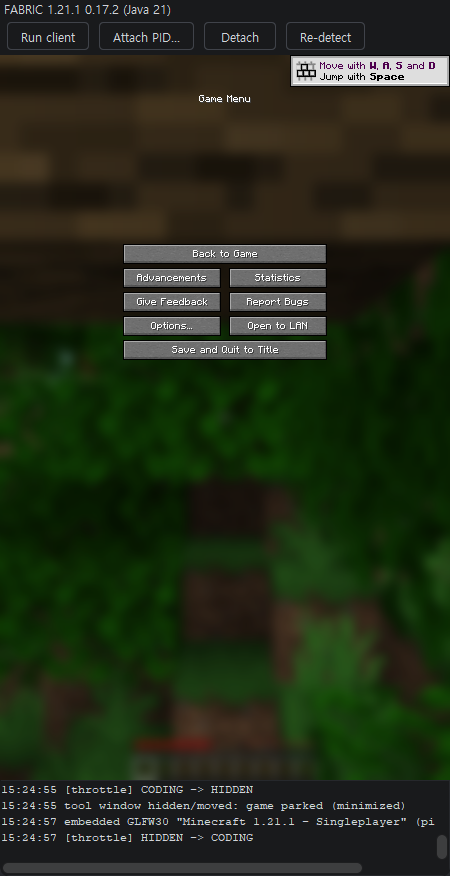
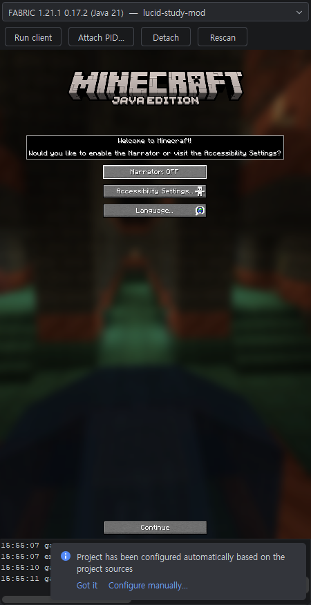
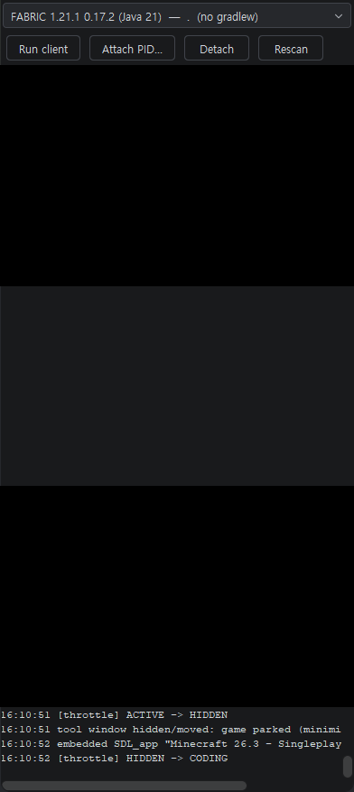

# SulfurFrame IntelliJ 플러그인 (PoC)

마인크래프트 모드 프로젝트를 열면, 빌드 파일에서 **마인크래프트 버전, 모드 로더, 로더 버전, 필요한 Java**를 읽어 툴윈도우에 보여 줍니다.
그리고 게임 창을 툴윈도우 안에 넣습니다.



## 기능
- **버전 자동 결정** (`profile/ProjectProfile.java`): 아무것도 실행하지 않고(Gradle 동기화 없이) 파일만 읽습니다.
  - 빌드 스크립트의 플러그인 id로 로더를 판별: `fabric-loom` / `net.fabricmc.fabric-loom` / `dev.architectury.loom`,
    `net.neoforged.moddev` / `net.neoforged.gradle`, `net.minecraftforge.gradle`, ForgeGradle 2의 `net.minecraftforge.gradle.forge`, `org.quiltmc.loom`
  - 버전을 읽는 곳(우선순위 순):
    1. `gradle.properties` (프로젝트에서 settings 루트까지)
    2. 빌드 스크립트의 좌표: `com.mojang:minecraft:X`, `fabric-loader`, `net.minecraftforge:forge:MC-FORGE`, `neoForge { version }`, FG2의 `minecraft { version = "1.12.2-..." }`
    3. `gradle/libs.versions.toml`
  - 주석과 `${...}` 참조를 처리합니다. NeoForge 버전만 있으면 MC 버전을 거꾸로 계산합니다(21.1.x → 1.21.1).
    필요한 Java는 Mojang `javaVersion` 기준입니다(≤1.16: 8, 1.17: 16, ~1.20.4: 17, ~1.21.x: 21, 26.x: 25).
  - 근거(evidence)를 로그로 보여 줍니다.
- **Run client**: 프로젝트의 `gradlew runClient`를 실행하고(Loom, ModDevGradle, ForgeGradle 모두 같은 이름) 새로 뜬 마인크래프트 창을 찾아 자동으로 임베드합니다.
- **임베딩** (`embed/GameEmbedder.java`): `poc/embed`에서 검증한 규칙을 모두 옮겼습니다.
  - 비동기 창 조작
  - 모드 없는 click-to-focus, `WM_MOUSEACTIVATE` 차단, 에디터 클릭 시 포커스 회수
  - 멈춤 와치독, 임베드 직후 크기 nudge
- **javaagent 내장**: 플러그인 안의 `sf-agent.jar`를 ASCII 경로에 풀어서 Attach API로 붙입니다. 코딩 중 FPS 제한과 SDL3 포커스 보정을 맡습니다.
- **스로틀러**: 툴윈도우가 숨겨지면 게임을 최소화하고, 5초 뒤 힙을 줄이고 워킹셋을 트림합니다. 다시 보이면 원래대로 돌립니다.

## 실제 IDE에서만 생기는 문제와 해결
- **캔버스 HWND 찾기**: 화면 좌표로 창을 찾는 방식(WindowFromPoint)은 IntelliJ에서 실패했습니다.
  IntelliJ는 `--add-opens java.desktop/sun.awt.windows=ALL-UNNAMED`로 실행되므로 `AWTAccessor`로 peer를 꺼내 `WComponentPeer.getHWnd()`로 읽습니다.
- **툴윈도우를 숨기거나 옮기거나 플로팅하면 IntelliJ가 컴포넌트를 떼어 내고**, 캔버스의 네이티브 창이 파괴됩니다. 자식인 게임 창도 함께 파괴됩니다.
  → `removeNotify` 직전에 게임을 **데스크톱 기준 최상위 창으로 되돌리고 최소화한 뒤 감추고**(park), `addNotify` 뒤 새 캔버스에 다시 붙입니다.
  - park 위치를 IDE 프레임으로 했을 때, 플로팅 창을 다시 도킹하면 그 프레임이 사라지면서 게임 창이 함께 없어졌습니다.
  - 그냥 감추기만(`SW_HIDE`) 하면 마인크래프트가 최소화로 보지 않아서 FPS가 그대로였습니다. 그래서 최소화한 뒤 감추고, 이 상태를 숨김으로 처리합니다.

## 빌드와 테스트 (Gradle 없이, 설치된 IDE 사용)
```bash
./sf-idea-plugin/build.sh          # → sf-idea-plugin/build/SulfurFrame (플러그인 폴더)
```
- IntelliJ IDEA 2026.2+(JBR 25, FFM 사용 가능)의 `lib/*.jar`에 대고 컴파일합니다. 에이전트는 `poc/agent/sf-agent.jar`를 넣습니다.
- **샌드박스 자동 테스트**: 별도의 config/system/plugins 폴더로 IDE를 띄워서 사용자 설정을 건드리지 않습니다.
  - Gradle과 Maven 플러그인을 끄고, 동의 창은 `-Djb.consents.confirmation.enabled=false` 등으로 건너뜁니다.
  - `-Dsulfurframe.autotest.pid=<실행 중인 마인크래프트 PID>`를 주면 툴윈도우가 자동으로 열립니다. 그다음 붙이기, 플로팅, 재도킹, 숨김, 보이기를 차례로 검사해서 `%TEMP%/sulfurframe-autotest.txt`와 스크린샷으로 남깁니다.

결과 (IntelliJ IDEA 2026.2.3, 바닐라 1.21.1):
```
PASS profile detected  [FABRIC 1.21.1 0.17.2 (Java 21)]
PASS embedded in the tool window
PASS game fills the canvas  [game 450x725, canvas 450x725]
PASS survives floating the tool window
PASS survives re-docking
PASS hidden -> game minimized  [iconic true, state HIDDEN]
PASS shown -> game restored  [iconic false, state CODING]
failures: 0
```
**Run client 흐름** (`-Dsulfurframe.autotest.runclient=true`, lucid-study-mod 안쪽 프로젝트의 임시 사본, Fabric 1.21.1):
```
PASS profile detected  [FABRIC 1.21.1 0.17.2 (Java 21)]
PASS Run client -> game embedded  [after 25 s (첫 실행 97 s)]
PASS game fills the canvas  [game 450x725, canvas 450x725]
```
- 버튼을 누르면 프로젝트의 `gradlew.bat runClient`가 실행되고, 개발 클라이언트 창이 뜨면 에이전트를 붙인 뒤 툴윈도우에 넣습니다.
- 리소스를 로드하는 동안은 게임이 바빠서 와치독이 잠깐씩 입력 큐를 뗐다 붙입니다. 정상 동작입니다.
- **실제 프로젝트에서 찾은 문제:** 이 프로젝트의 wrapper는 Gradle 8.12인데, 쓰는 Loom 1.11-SNAPSHOT은 8.14 이상이 필요해서
  `runClient`가 실패합니다(원본의 `gradle-wrapper.properties`는 git에서 수정된 상태). 테스트는 사본의 wrapper만 캐시에 있는 9.4.1로 바꿔서 진행했고,
  원본은 건드리지 않았습니다. 플러그인은 이제 Gradle의 "What went wrong" 내용을 툴윈도우 로그에 그대로 보여 줍니다.

버전 감지기 fixture 테스트:
```bash
javac -d out sf-idea-plugin/src/main/java/dev/sulfurframe/idea/profile/ProjectProfile.java sf-idea-plugin/src/test/java/dev/sulfurframe/idea/profile/ProfileSelfTest.java
java -cp out dev.sulfurframe.idea.profile.ProfileSelfTest sf-idea-plugin/src/test/resources/profiles [실제 프로젝트 폴더...]
```
fixture 6개(NeoForge MDK, Forge 1.20.1 MDK, Forge FG2 1.12.2, Quilt, kts 직접 선언, 버전 카탈로그)와 로컬 실제 프로젝트 4개를 정확히 감지했습니다.

## 아직 안 된 것
- 모드마다 빌드와 월드가 따로인 불편(공유 인스턴스/월드), Gradle 플러그인 기반 정식 빌드, 마켓플레이스 배포 형태는 아직입니다.

## 컨테이너 폴더와 멀티 버전 프로젝트 (`profile/Workspace.java`)

열린 폴더에서 **실행할 수 있는 클라이언트를 모두 찾아** 툴윈도우 위쪽 콤보박스에 보여 줍니다(최신 MC 버전 순).
선택은 프로젝트마다 기억합니다(`PropertiesComponent`).
"Run client"는 고른 대상이 속한 빌드 루트의 wrapper로 해당 작업 경로를 실행합니다.



| 구조 | 판별 방법 | 실행 작업 |
|---|---|---|
| 단일 프로젝트 | 폴더 자체가 모드 빌드 | `runClient` |
| **컨테이너** (모드 여러 개를 담은 레포, 예: lucid-study-mod) | 하위 폴더마다 독립된 `settings.gradle` | 각 빌드에서 `runClient` |
| **멀티 프로젝트** (buildpali, 버전별 모듈) | `settings`의 `include(...)` 중 모드인 서브프로젝트 | `:core:mod-fabric-1_21_1:runClient` |
| **Architectury** | 서브프로젝트의 `architectury { fabric() / neoForge() / forge() }`. `common`은 제외 | `:fabric:runClient`, `:neoforge:runClient` |
| **Stonecutter** | `settings`의 `stonecutter { versions("1.20.1", "1.21.1") }`, 버전별 `versions/<v>/gradle.properties` | `:1.21.1:runClient` |

- **kts 변수 추적:** `val mcVersion = rootProject.property("mc_1_21_1_version")`, `property("deps.x")`, groovy `def x = rootProject.y`를 따라가서 버전을 읽습니다.
- **플러그인 판별 예외:** `apply false`로 선언만 한 플러그인과 `subprojects { }` 안에서 적용하는 플러그인은 그 프로젝트 자신의 로더로 보지 않습니다.
- **폴더 이름은 버전 힌트로만:** `mod-forge-1_21_1` 같은 이름은 버전을 짐작하는 데만 씁니다. 빌드 스크립트에 로더 근거가 없는 스텁 모듈은 대상에서 뺍니다.
- **중첩 settings 처리:** 다른 빌드에 include된 폴더는 자기 `settings.gradle`이 있어도 독립 빌드로 보지 않고, 프로퍼티도 상위 빌드 루트에서 읽습니다.
- **제외 폴더:** `.git`, `.gradle`, `.claude/worktrees` 같은 점(.) 폴더와 `build`, `run`, `src`는 훑지 않습니다.

검증:
```
PASS container     -> [runClient FABRIC 1.21.1 0.17.2, runClient NEOFORGE 1.21.1 21.1.265]
PASS multiproject  -> [:core:mod-fabric-1_21_1:runClient FABRIC 1.21.1 0.16.10, :core:mod-fabric-1_20_1:runClient FABRIC 1.20.1 0.15.11]
PASS architectury  -> [:fabric:runClient FABRIC 1.21.1 0.16.10, :neoforge:runClient NEOFORGE 1.21.1 21.1.265]
PASS stonecutter   -> [:1.21.1:runClient FABRIC 1.21.1 0.16.10, :1.20.1:runClient FABRIC 1.20.1 0.16.10]
```
실제 폴더 결과는 다음과 같습니다.
- **lucid-study-mod:** 대상 5개(savedeath·untitled1 1.21.7, 루트·lucid-study-mod·lucid-study-mod2 1.21.1). 루트는 "(no gradlew)"로 표시됩니다.
- **buildpali:** Fabric 모듈 5개(`:core|gui|terrain|3dio|ai:mod-fabric-1_21_1`)와 Forge `:core:mod-forge-1_21_1`(52.1.6). worktree 중복과 Forge 스텁은 빠졌습니다.

샌드박스 IDE에서 lucid-study-mod 컨테이너 전체 사본을 열고 `lucid-study-mod`를 골라 Run client를 눌렀습니다.
대상 5개가 나열됐고, 안쪽 프로젝트의 wrapper로 실행돼 82초 뒤 툴윈도우에 임베드됐습니다(테스트 4/4 PASS).
```bash
java -cp out dev.sulfurframe.idea.profile.WorkspaceSelfTest sf-idea-plugin/src/test/resources/workspaces [실제 폴더...]
```

## 화면 배치와 F11 전체화면

- **16:9 비율 유지**(기본값): 게임을 패널 안에서 16:9로 맞추고, 남는 곳은 검은 띠로 채웁니다. 세로로 긴 툴윈도우에서도 화면이 늘어나지 않습니다.
  "16:9" 체크를 끄면 패널을 꽉 채웁니다.
- **"Open as tab"**: 게임을 가로로 넓은 에디터 영역의 "Minecraft" 탭으로 옮깁니다(`GameTab`, `FileEditorProvider`).
  탭을 닫으면 툴윈도우로 돌아옵니다. 옮길 때 캔버스가 새로 만들어지는데, 게임은 park 후 다시 붙습니다.
  
- **F11 (게임 안의 전체화면 키)**: 임베드 상태에서 F11을 누르면 GLFW와 SDL은 창에 `WS_POPUP`만 추가합니다. 자식 창이라 패널 안에 그대로 남습니다.
  다시 누르면 `WS_POPUP`이 빠지고 **제목 표시줄이 생겨서** 패널 안에 창 테두리가 붙습니다(1.21.1에서 실측).
  → 와치독이 스타일 변화를 감지합니다.
  - `WS_POPUP`이 생기면 게임을 IDE에서 빼서 IDE가 있는 모니터를 꽉 채웁니다.
  - `WS_POPUP`이 빠지면 제목 표시줄을 걷어내고 패널에 다시 넣습니다.

샌드박스 자동 테스트(12개 항목), **1.21.1(GLFW)과 26.3(SDL3) 모두 12/12 통과**:
```
PASS 16:9 letterbox                     [game 450x253 (1.779) in canvas 450x708]
PASS F11 -> fullscreen                  [fullscreen true, child false, rect 1920x1200, monitor 1920x1200]
PASS F11 again -> embedded, no title bar
PASS open as editor tab
PASS tab closed -> back in the tool window
```
F11 검사는 실제 키를 보냅니다. 그래서 키보드 포커스가 게임에 있을 때만 보내고, 그렇지 않으면 실패로 기록합니다.
